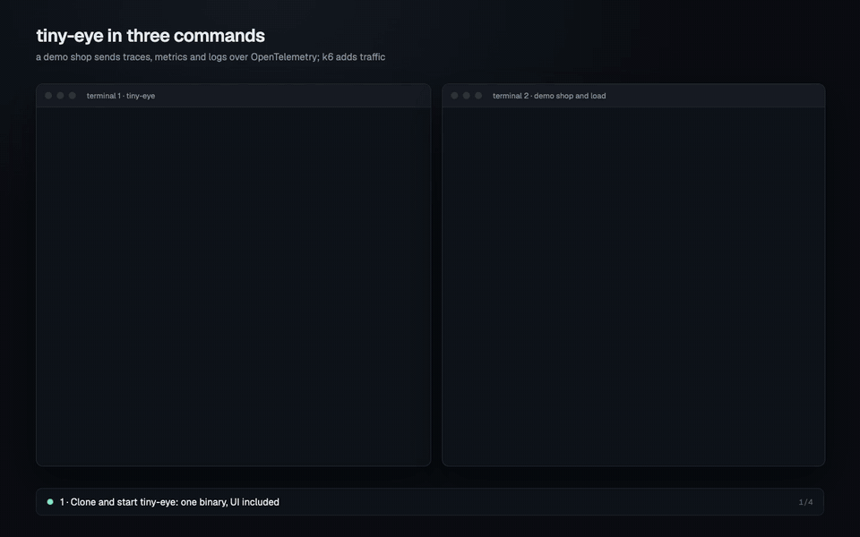
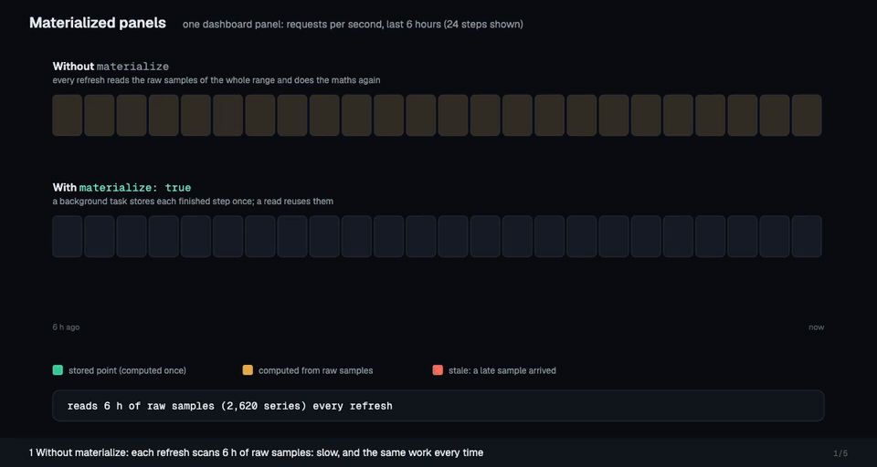
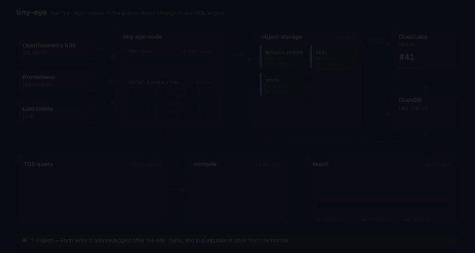

# tiny-eye

**Metrics, logs and traces in one Rust binary, stored as Parquet you own.**
Send OpenTelemetry, Prometheus remote-write or Loki data; tiny-eye writes it as sorted Parquet to
disk or S3 and answers queries that return the same points as Prometheus.

[](https://github.com/tinnguyenhuuletrong/tiny-eye/actions/workflows/ci.yml)
[](https://tinnguyenhuuletrong.github.io/tiny-eye/)
[](LICENSE)
[](docs/deep-dive/evidence/tqs-coverage.md)

<a href="https://tinnguyenhuuletrong.github.io/tiny-eye/docs/getting-started/quickstart">
  
</a>

> **Pre-release.** Single-node mode works end to end and is tested against Prometheus. APIs may
> still change; cluster mode is not built yet. See [Status](#status).

- **One binary.** Ingest, storage, query engine, web UI and an MCP server for AI agents, in one
  process with one YAML config.
- **Open storage.** Sorted, ZSTD-compressed Parquet on local disk or any S3 store with conditional
  writes, cataloged by DuckLake. Any DuckDB, Spark or pandas can read it.
- **Prometheus-exact queries.** TQS is a JSON query language compiled to DuckDB SQL and checked
  point by point against Prometheus 3.16: 105/105 conformance cases.
- **All three signals.** Rates, quantiles and formulas over metrics; trace search and waterfalls;
  log search and log patterns.
- **Dashboards as code.** YAML files in git, editable in the UI (drag, resize, add a panel), saved
  back to the same file. Mark a panel `materialize: true` and tiny-eye keeps its points up to date
  incrementally (spec section 9.1): the same answer, 10–12× faster on long-range
  aggregations once the range is stored (2–4× for quantiles and gauges, none for a single series).



## Quick start

Needs Rust stable, a C/C++ compiler, Node.js 20+ and Docker (for the k6 load generator).

```bash
git clone https://github.com/tinnguyenhuuletrong/tiny-eye && cd tiny-eye
make demo        # terminal 1: build and start tiny-eye on http://127.0.0.1:7070
make demo-app    # terminal 2: a Node.js shop instrumented with OpenTelemetry
make demo-load   # terminal 3: k6 traffic for 3 minutes
```

Open **http://127.0.0.1:7070**. The first build compiles DuckDB and takes a few minutes; later
starts take a second. The [demo shop guide](docs/examples/demo-shop.md) walks through what to
look at.

**Send your own telemetry.** Any OpenTelemetry SDK or Collector:

```bash
export OTEL_EXPORTER_OTLP_ENDPOINT=http://127.0.0.1:7070
export OTEL_EXPORTER_OTLP_PROTOCOL=http/protobuf
```

Prometheus and Grafana Alloy remote-write to `http://127.0.0.1:7070/api/v1/write`; Loki clients
push JSON to `/loki/api/v1/push`. More in [Sending data](docs/examples/sending-data.md).

**Query over HTTP.** A query is a JSON document:

```bash
curl -s localhost:7070/api/v1/query -d '{
  "tqs": "3", "id": "rps", "kind": "timeseries", "time": {"from": "-15m", "step": "30s"},
  "queries": [{"name": "r", "metric": "http_server_request_duration_count",
               "fn": {"op": "rate", "window": "1m"}, "agg": {"op": "sum", "by": ["http_route"]}}]}'
```

`POST /api/v1/validate` returns every problem with its JSON path. The
[query cookbook](docs/examples/query-cookbook.md) has recipes for every kind of query.

**Connect an AI agent.** The binary is also an MCP server:

```bash
claude mcp add tiny-eye -- "$PWD/target/release/tiny-eye" mcp --url http://127.0.0.1:7070
```

Then ask "which route has the worst p99 right now, and why?". Setup for other clients:
[AI agents over MCP](docs/examples/ai-agents-mcp.md).

**Let an assistant run your machine.** In [`examples/machine`](examples/machine), an assistant
([tiny-assistant](https://github.com/tinnguyenhuuletrong/tiny-assistant) or Claude Code) starts a
metrics agent for this computer, builds its dashboard in tiny-eye, then finds and stops a runaway
process ([guide](docs/examples/assistant-machine.md)):


**Run it in a container.**

```bash
make docker
docker run -p 7070:7070 -v tiny-eye-data:/data tiny-eye:dev
```

## How it works



A write is acknowledged once it is in the write-ahead log and the in-memory hot tail, so it is
queryable at once. Every flush interval, each table's rows become sorted Parquet files in object
storage, and a create-only commit envelope adds them to the DuckLake catalog in one snapshot.
Queries run on embedded DuckDB over the lake plus the hot tail. Compaction and retention run
hourly in the same process. Details: [Architecture](docs/deep-dive/architecture.md).

## Documentation

The full docs are at **[tinnguyenhuuletrong.github.io/tiny-eye](https://tinnguyenhuuletrong.github.io/tiny-eye/)**
(sources in [`docs/`](docs)).

| | |
| --- | --- |
| Get started | [Quickstart](docs/getting-started/quickstart.md) · [Installation](docs/getting-started/installation.mdx) · [Concepts](docs/getting-started/concepts.md) |
| Guides | [Demo shop](docs/examples/demo-shop.md) · [Sending data](docs/examples/sending-data.md) · [Query cookbook](docs/examples/query-cookbook.md) · [Dashboards as code](docs/examples/dashboards-as-code.md) · [AI agents (MCP)](docs/examples/ai-agents-mcp.md) |
| Concepts | [Architecture](docs/deep-dive/architecture.md) · [Write path](docs/deep-dive/write-path.md) · [Storage format](docs/deep-dive/storage-format.md) · [Query engine](docs/deep-dive/query-engine.md) · [Materialized panels](docs/deep-dive/materialized-panels.md) · [TQS reference](docs/deep-dive/tqs-reference.md) · [Configuration](docs/deep-dive/configuration.md) · [Operations](docs/deep-dive/operations.md) · [Security](docs/deep-dive/security.md) |
| Reference | [HTTP API](docs/reference/http-api.md) · [MCP tools](docs/reference/mcp-tools.md) · [Editor grammars](docs/reference/editor-grammars.md) |

## Status

**Works today (single node):** Prometheus remote-write 1.0, OTLP/HTTP metrics, traces and logs
(protobuf and JSON), Loki JSON push; WAL durability with replay; flush, checkpoint, compaction and
retention; TQS 3 with Prometheus staleness semantics; YAML dashboards with save from the UI and
materialized panels; the web UI; MCP; bearer-token scopes; self-metrics.

**Not built yet:** cluster mode, OTLP gRPC, Loki protobuf push, alerting, a Grafana data source,
native histograms, span events and links. Full list:
[Limitations and roadmap](docs/deep-dive/limitations-and-roadmap.md).

## Evidence

Every claim comes from a test that can fail; reports are generated into
[`docs/deep-dive/evidence/`](docs/deep-dive/evidence).

| Claim | How | Result |
| --- | --- | --- |
| TQS returns what Prometheus returns | `make conformance`: 34 metric cases, real panel shapes, spans, logs, traces, validation and injection cases, a mutation check | [105/105 cases, 16/16 mutants caught](docs/deep-dive/evidence/tqs-coverage.md) |
| The whole binary returns what Prometheus returns | `make e2e`: the same remote-written samples in Prometheus 3.16 and tiny-eye, spread over Parquet, a pending envelope and RAM | [20/20 panels equal](docs/deep-dive/evidence/e2e.md) |
| Acknowledged data survives a crash | `crates/engine/tests/node.rs`: crash without flush, WAL replay, retried flushes, no double counting | pass |
| Ingest and query speed (8-core laptop, 2,620 series × 6 h) | `make bench` | remote-write [1.65 M samples/s](docs/deep-dive/evidence/bench-local.md); 6 h `sum by (rate)` 0.58 s; histogram p99 73 ms; trace by id 11 ms |
| Materialized panels answer exactly what raw queries answer, faster | `crates/engine/tests/materialize.rs` (12 query shapes, late data, restarts) and `make bench` | 6 h `sum by (rate)`: [443 ms raw, 38 ms materialized, every point equal](docs/deep-dive/evidence/bench-local.md#materialized-panels) |
| Trace lookups on S3 stay cheap | `make bench-s3` (MinIO) | absent trace id: [22 GETs before compaction, 2 after](docs/deep-dive/evidence/bench-s3.md) |

## Development

```bash
make tools     # once: pinned DuckDB extensions + Prometheus (for the tests) into .tools/
make run       # build the UI and the binary, serve 127.0.0.1:7070 with config/dev.yaml
make fmt lint test
make check     # everything CI runs: lint, UI build, tests, end-to-end, conformance
make help      # every target
```

The API (`api/openapi.yaml`), the stored tables (`schema/tables.yaml`) and the defaults
(`config/default.yaml`) are each defined once in YAML; the router, Arrow schemas, DDL, UI types,
MCP tools and editor grammars are generated from them. See [CONTRIBUTING.md](CONTRIBUTING.md).

<details>
<summary>Repository layout</summary>

| Path | Contents |
| --- | --- |
| `api/` | `openapi.yaml`: the HTTP API, auth scopes and MCP tools are generated from it; TQS examples |
| `config/` | `default.yaml` (every default, embedded in the binary) and `dev.yaml` |
| `crates/tqs` | TQS model, validator, formula parser, SQL compiler, conformance suite |
| `crates/engine` | WAL, hot tail, flush, checkpoint, compaction, retention, queries, dashboards |
| `crates/server` | The binary: HTTP handlers, receivers, auth, MCP bridge, embedded UI, benchmark |
| `dashboards/` | Dashboards as YAML |
| `deploy/` | Docker Compose for a local MinIO (the image itself is built by `Dockerfile`) |
| `docs/` | Documentation, generated evidence reports, and `assets/media/` (sources of the GIFs) |
| `examples/` | The demo shop: Node.js app, k6 load, dashboard, queries |
| `research/` | The specification and the research it is based on |
| `schema/` | `tables.yaml` (stored tables) and `generated/` (JSON Schemas, MCP tools, grammar) |
| `ui/` | Web UI (Preact + Vite, embedded in the binary) and `prototype/` (the design prototype) |
| `website/` | Docusaurus site that publishes `docs/` |

</details>

## License

Apache-2.0. See [LICENSE](LICENSE).
