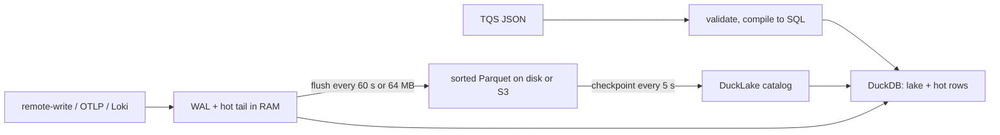

# tiny-eye

Metrics, logs and traces in one Rust binary: stored as Parquet on disk or S3, queried with a
JSON language that returns the same points as Prometheus.

## What it is

- **One binary, one process.** Ingests Prometheus remote-write 1.0, OTLP/HTTP (protobuf and JSON)
  and Loki push (JSON). Single-node mode today.
- **Open storage.** Sorted, ZSTD-compressed Parquet in local disk or S3, tracked by a DuckLake
  catalog and read by embedded DuckDB 2.0.1.
- **TQS 3 queries.** A closed JSON schema compiled to DuckDB SQL, tested point by point against
  Prometheus 3.16. Covers metrics, span and log aggregates, trace search, waterfalls, log search
  and log patterns.
- **Dashboards as YAML in git**, a web UI embedded in the binary (dashboards with drag-and-resize
  layout editing, Explore with a Builder | TQS switch, traces, logs), and an MCP bridge for AI agents.


## Quick start

```bash
make tools      # once: pinned DuckDB extensions + Prometheus (for tests) into .tools/
make run        # builds the UI and binary, serves 127.0.0.1:7070 with config/dev.yaml

curl -s localhost:7070/api/v1/query -d '{"tqs":"3","id":"rps","kind":"timeseries",
  "time":{"from":"-1h","step":"1m"},
  "queries":[{"name":"r","metric":"http_requests_total","fn":{"op":"rate","window":"5m"},"agg":{"op":"sum","by":["job"]}}]}'

claude mcp add tiny-eye -- "$PWD/target/release/tiny-eye" mcp --url http://127.0.0.1:7070
```

Needs Rust stable, a C/C++ compiler and Node.js 20+. Send data from any OpenTelemetry SDK
(`OTEL_EXPORTER_OTLP_ENDPOINT=http://127.0.0.1:7070`, `http/protobuf`), Prometheus remote-write
(`/api/v1/write`) or Loki push (`/loki/api/v1/push`). Open http://127.0.0.1:7070 for the UI.

For a full walkthrough with a real app, run the demo shop: `make demo`, `make demo-app`,
`make demo-load` ([guide](docs/examples/demo-shop.md)).

## How it works



A write is acknowledged once it is in the write-ahead log and the hot tail, so it is queryable
immediately. Hourly compaction and retention run in the same process.

## Documentation

The docs site (published from `docs/` by GitHub Pages, at `https://<owner>.github.io/tiny-eye/`)
renders the pages in [`docs/`](docs). Start with:

- [What is tiny-eye](docs/intro.md)
- [Quickstart](docs/getting-started/quickstart.md)
- [Demo shop](docs/examples/demo-shop.md)
- [Architecture](docs/deep-dive/architecture.md)

## Status

Built (single node):

- Ingest: Prometheus remote-write 1.0, OTLP/HTTP metrics, traces and logs (protobuf and JSON,
  gzip), Loki push (JSON); sample-age bounds; secret attribute redaction; arena limit with 429.
- Durability `wal` (group-committed fsync, replay on restart) and `memory`.
- Flush per (table, hour): sorted, ZSTD, page statistics, delta and byte-stream-split encodings,
  `trace_id` bloom filters; envelopes written with a create-only PUT.
- Idempotent checkpointer, hot tail with a per-node watermark, hourly compaction, series dedup,
  retention through DuckLake.
- TQS 3 with Prometheus staleness; HTTP API with every validation problem code; catalog
  discovery; YAML dashboards with save from the UI; MCP stdio bridge; bearer-token scopes;
  self-metrics.
- Web UI served by the binary: dashboards (live panels, edit layout, add panel, save to YAML),
  Explore (Builder | TQS, validated by the engine), trace search with waterfalls, log search and
  patterns.

Not built yet:

- Cluster mode (roles, lease and fencing, hot-tail RPC, `replicated` durability), OTLP gRPC,
  Loki protobuf push.
- Alert evaluation and Alertmanager, materialized panels, a Grafana data source.
- Snapshot export, multi-region buckets, native histograms, a trace index.
- Span events and links are not stored. OTLP delta temporality and exponential histograms are
  skipped. Response `freshness_s` is always 0 and `partial_regions` always empty.

Details: [Limitations and roadmap](docs/deep-dive/limitations-and-roadmap.md).

## Evidence

Every result below comes from a test that can fail. Reports are generated into
[`docs/deep-dive/evidence/`](docs/deep-dive/evidence).

| Claim | How | Result |
| --- | --- | --- |
| TQS returns what Prometheus returns | `make conformance`: 33 metric functions, real panel shapes, spans/logs/traces, validation and injection cases, a mutation check | [104/104 cases, 15/15 mutants caught](docs/deep-dive/evidence/tqs-coverage.md) |
| The whole binary returns what Prometheus returns | `make e2e`: the same remote-written samples in Prometheus 3.16 and tiny-eye, spread over Parquet, a pending envelope and RAM | [20/20 panels equal](docs/deep-dive/evidence/e2e.md) |
| Acknowledged data survives a crash | `crates/engine/tests/node.rs`: crash without flush, WAL replay, retried flushes, no double counting | pass |
| Ingest and query speed (8-core laptop, 2,620 series x 6 h) | `make bench` | remote-write [1.65 M samples/s](docs/deep-dive/evidence/bench-local.md); 6 h `sum by (rate)` 0.58 s; histogram p99 73 ms; trace by id 11 ms |
| Trace lookups on S3 stay cheap | `make bench-s3` (MinIO) | absent trace id: [22 GETs before compaction, 2 after](docs/deep-dive/evidence/bench-s3.md) |

## Repository layout

| Path | Contents |
| --- | --- |
| `api/` | `openapi.yaml`: the HTTP API, auth scopes and MCP tools are generated from it; TQS examples |
| `config/` | `default.yaml` (every default, embedded in the binary) and `dev.yaml` |
| `crates/tqs` | TQS model, validator, formula parser, SQL compiler, conformance suite |
| `crates/engine` | WAL, hot tail, flush, checkpoint, compaction, retention, queries, dashboards |
| `crates/server` | The binary: HTTP handlers, receivers, auth, MCP bridge, embedded UI, benchmark |
| `dashboards/` | Dashboards as YAML |
| `deploy/` | Docker Compose for a local MinIO |
| `docs/` | Documentation and generated evidence reports |
| `examples/` | The demo shop: Node.js app, k6 load, dashboard, queries |
| `research/` | The specification and the research it is based on |
| `schema/` | `tables.yaml` (stored tables) and `generated/` (JSON Schemas, MCP tools, grammar) |
| `ui/` | Web UI (Preact + Vite, embedded in the binary) and `prototype/` (the design prototype) |
| `website/` | Docusaurus site that publishes `docs/` |

## Contributing

See [CONTRIBUTING.md](CONTRIBUTING.md). `make help` lists every task; the daily loop is
`make fmt lint test`, and `make check` runs everything CI runs before a pull request.

## License

Apache-2.0. See [LICENSE](LICENSE).
