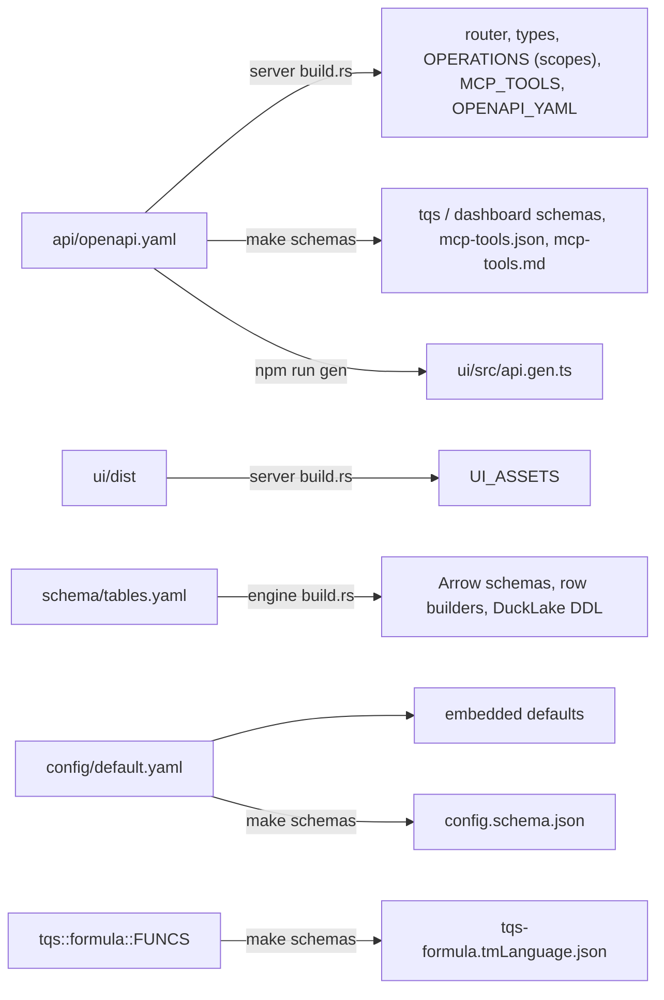

tiny-eye follows one rule: **define a thing once, generate it everywhere else**. Four files are sources of truth. Build scripts turn them into Rust code at compile time, `make schemas` turns them into editor and agent grammars, and tests fail when a committed generated file is stale.

## Sources of truth

| Source | Defines | Read by |
| :--- | :--- | :--- |
| `api/openapi.yaml` | Every HTTP operation, its auth scope (`x-scope`), its MCP tool (`x-mcp-tool`), every request and response schema, the TQS 3 JSON Schema | `crates/server/build.rs`, `ui/` (openapi-typescript), `crates/server/tests/openapi.rs` |
| `schema/tables.yaml` | Every stored table: columns, types, encodings, bloom filters, sort order, identity (`unique`), partition time column, schema `version` | `crates/engine/build.rs` |
| `config/default.yaml` | Every configuration default | embedded by `crates/engine/src/config.rs`; `tiny-eye schemas` |
| `dashboards/*.yaml` | Dashboards as TQS panels | loaded at start by `crates/engine/src/dashboards.rs` |

## What `crates/server/build.rs` generates

The build script parses `api/openapi.yaml` and writes `api.rs` into Cargo's `OUT_DIR`. `crates/server/src/lib.rs` includes it as the module `server::api`.

| Generated item | From | Effect |
| :--- | :--- | :--- |
| `router(state)` | every operation in `paths` | One axum route per path; each method calls `crate::handlers::<operationId>`. A missing handler is a compile error, and a route that is not in the spec cannot exist. |
| `OPERATIONS` | method, path, `operationId`, `x-scope` | The auth table used by the `auth` middleware. A missing or unknown `x-scope` (anything but `public`, `ingest`, `query`, `admin`) fails the build. |
| `types` module | every `components.schemas` entry except those marked `x-codegen: false` | One serde struct per schema, with `deny_unknown_fields` when `additionalProperties: false`, optional fields as `Option<T>`. |
| `MCP_TOOLS` | operations with `x-mcp-tool` | Tool name, description, method, path and input schema. The input schema is the operation's JSON request body with every `$ref` inlined into `$defs`, so it is self-contained; operations without a body get an empty object schema. |
| `OPENAPI_YAML` | the file itself | Served at `GET /openapi.yaml`. |
| `TQS_SCHEMA_JSON`, `DASHBOARD_SCHEMA_JSON` | `TqsDocument`, `Dashboard` | Standalone JSON Schemas, later written by `make schemas`. |

The type generator covers the subset the spec uses: objects with typed properties, `additionalProperties` maps, arrays, `$ref`, string enums and consts, and `prefixItems` tuples. An inline object with properties must be named in `components.schemas`, otherwise the build panics.

Schemas marked `x-codegen: false` (the `Tqs*` schemas and `LokiPush`) are referenced as raw `serde_json::Value`. They are validated elsewhere: TQS by the Rust model in `crates/tqs`, Loki push by `receivers::loki_push`.

### Embedded UI table

The same build script walks `ui/dist` (the built web UI) and writes `ui_assets.rs`: a static table of `(path, content type, bytes)` with every file embedded through `include_bytes!`. When `ui/dist` does not exist, the table is empty and `/` serves a short page that explains how to build the UI. See [Dashboards and the web UI](dashboards-and-ui.md).

## What `crates/engine/build.rs` generates

From `schema/tables.yaml` it writes `tables.rs`, included by `crates/engine/src/tables.rs`:

- the Arrow schema the Parquet writer emits (with `schema_version` metadata from the file's `version`);
- a typed row struct and column builder per table (`MetricsSeriesRow`, `SpansRow`, ...);
- the DuckLake DDL and the in-memory hot-tail DDL;
- sort columns, identity (deduplication) SQL and the hour partition expression.

`ducklake_add_data_files` refuses a schema mismatch only at commit time, so the writer schema and the DDL must never be written by hand. See [Storage format](storage-format.md).

## What `make schemas` generates

`make schemas` runs `tiny-eye schemas --root .`, implemented in `crates/server/src/schemas.rs`:

| File | Generated from |
| :--- | :--- |
| `schema/generated/tqs.schema.json` | `TqsDocument` in `api/openapi.yaml` |
| `schema/generated/dashboard.schema.json` | `Dashboard` in `api/openapi.yaml` |
| `schema/generated/config.schema.json` | the config structs in `crates/engine/src/config.rs` (via schemars), with every default from `config/default.yaml` injected and no key required |
| `schema/generated/mcp-tools.json` | the exact MCP `tools/list` result |
| `docs/reference/mcp-tools.md` | the same tools, as a Markdown table ([MCP tools](../reference/mcp-tools.md)) |
| `schema/generated/tqs-formula.tmLanguage.json` | the formula function list `tqs::formula::FUNCS` |

Each JSON Schema gets `$schema` (draft 2020-12), an `$id` under `https://tiny-eye.local/schema/`, a `title` and a `$comment` saying it is generated. How editors use them: [Editor grammars](../reference/editor-grammars.md).

## UI TypeScript types

The web UI in `ui/` generates `ui/src/api.gen.ts` from `api/openapi.yaml` with `openapi-typescript` (`npm run gen`). `npm run dev`, `npm run build` and `npm run typecheck` all run the generator first, and `ui/src/api.ts` takes every request and response type from it. The generated file is not committed (it is in `ui/.gitignore`). A change to a schema that breaks the UI therefore fails `tsc` in the UI build.

## Add an endpoint, end to end

1. **Describe it in `api/openapi.yaml`.** Add the path and method with a unique `operationId`, an `x-scope` (`public`, `ingest`, `query` or `admin`), and request and response schemas under `components.schemas`. Add `x-mcp-tool: {name, description}` if agents should be able to call it.
2. **Write the handler.** Add `pub async fn <operationId>(...)` to `crates/server/src/handlers.rs`, using the generated types from `crate::api::types`. Until it exists, the crate does not compile.
3. **Build.** `cargo build` regenerates the router, the scope table and the MCP tool list. Nothing else needs wiring: the auth middleware already enforces the new scope.
4. **Regenerate grammars.** Run `make schemas` if the change touches the TQS or dashboard schemas or adds an MCP tool, and commit the changed files in `schema/generated/` and `docs/reference/mcp-tools.md`.
5. **Update the UI types** (if the UI uses it): `npm run gen` in `ui/`, or any UI build.
6. **Test.** Add a request to an integration test in `crates/server/tests/`, and run `make test`. Document it in the [HTTP API reference](../reference/http-api.md).

## Tests that keep it honest

| Test | Checks |
| :--- | :--- |
| Compile time (`build.rs`) | Every `operationId` has a handler; every operation has a valid `x-scope`; MCP tools have a name and description. |
| `scopes_come_from_the_spec` (`crates/server/src/lib.rs`) | Required scopes per route, HEAD = GET, unknown routes fail closed, UI paths are public. |
| `every_mcp_tool_schema_is_json` (`crates/server/src/lib.rs`) | Each generated tool input schema is JSON with `type: object`. |
| `crates/server/tests/openapi.rs` | Every example in `api/examples/` and every dashboard panel passes **both** the TQS JSON Schema and the Rust model plus validator; eight shape errors (unknown fields, unknown enum values, wrong types, a missing `kind`) fail **both**. |
| `crates/server/tests/schemas.rs` | `doc_schema_is_up_to_date`: every file `make schemas` writes equals the committed copy ("run `make schemas` and commit" otherwise); `config/default.yaml` and `config/dev.yaml` match the config schema, and a typo is refused; every file in `dashboards/` matches the dashboard schema. |
| `crates/server/tests/dashboards.rs` | A dashboard round-trips through `GET` and `PUT` with the YAML file as the source of truth. |
| `crates/engine/src/config.rs` unit tests | Defaults parse, file and env layering, unknown keys refused, secrets redacted. |

All of them run in `make test`, which CI runs on every push. See [Testing and evidence](testing-and-evidence.md).
