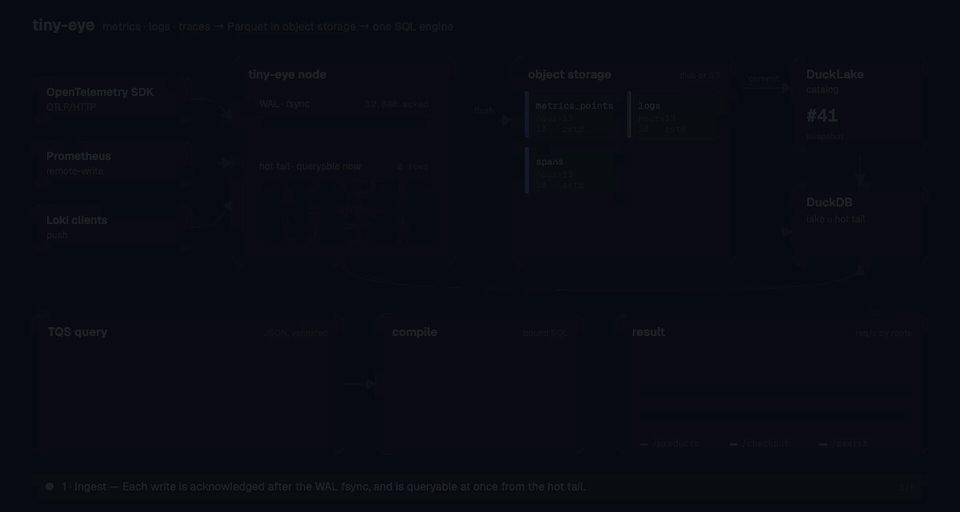
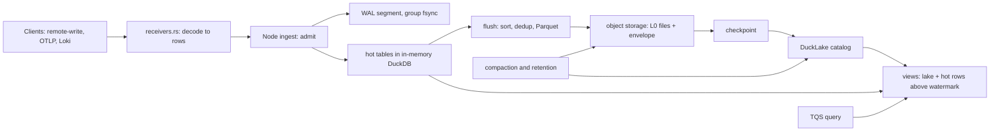
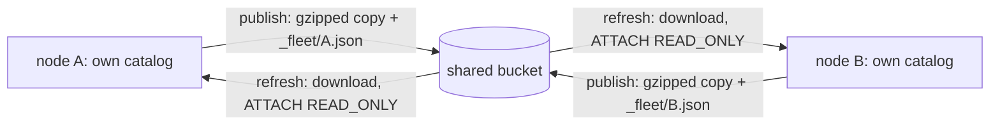

tiny-eye is a blob-first observability engine. Metrics, logs and traces are written as sorted, ZSTD-compressed Parquet files to object storage (local disk or S3). A DuckLake catalog makes those files visible, and DuckDB answers queries written in TQS 3, a closed JSON query schema. The design is specified in `research/spec/Observability Engine Spec.md` (the spec). The evidence behind it is in `research/RESEARCH.md`, and the code follows both. This page is the map. The pages after it explain each part in depth.

## One binary, one process

Each process of the `tiny-eye` binary (`crates/server/src/main.rs`) is one complete node, which the spec calls `--role all`. One process holds every role:

| Role (spec section 3) | In tiny-eye | Where |
| --- | --- | --- |
| Ingest | HTTP receivers decode remote-write, OTLP/HTTP and Loki push into rows. `Node::ingest` admits them, writes the WAL and appends them to the hot tables | `crates/server/src/receivers.rs`, `crates/engine/src/node.rs` |
| Coordinator | Background loop: flusher, checkpointer, compactor, retention, and the fleet's publish and refresh | `Node::run_background` in `node.rs`, `fleet.rs` |
| Query | TQS validation, compilation and execution on a pool of DuckDB connections | `crates/engine/src/query.rs`, `crates/tqs` |
| UI and MCP | The web UI is compiled into the binary. `tiny-eye mcp` is a stdio bridge to the HTTP API | `crates/server/src/web.rs`, `crates/server/src/mcp.rs` |

Other subcommands: `tiny-eye config` prints the effective configuration with secrets redacted, and `tiny-eye schemas` writes the generated editor and agent grammars. Any `--role` other than `all` is refused. Several nodes are run as a [fleet](#several-nodes-a-fleet), not as separate roles.

Shutdown is graceful. On SIGINT or SIGTERM the HTTP server stops accepting requests and the background loop stops. `Node::flush_and_checkpoint` then writes and applies everything still buffered. If both succeed, a clean stop leaves nothing in the WAL. If either fails, the process exits with the error. The next start recovers whatever was not applied, either from the WAL or from the pending envelope.

## Data flow

1. **Write.** A request becomes Arrow batches (generated builders), then frames in the WAL (fsynced in groups), then rows in `memory.main.hot_<table>` tagged with the open flush sequence `_seq`. Only then is the request acknowledged. See [Write path](write-path.md).
2. **Flush.** Every `ingest.flush_interval` or `ingest.flush_bytes`, the open sequence is sealed. Its rows are exported per (table, hour), deduplicated and sorted by DuckDB, and written as Parquet by our own writer. They are PUT as L0 files, then committed with one create-only envelope object. See [Write path](write-path.md) and [Storage format](storage-format.md).
3. **Checkpoint.** Every `coordinator.checkpoint_interval`, all pending envelopes are applied to DuckLake in one transaction. The `applied_envelopes` table makes this idempotent. See [Catalog and maintenance](catalog-and-maintenance.md).
4. **Maintain.** Each closed hour is compacted from L0 (plus any earlier L1) into one L1 file, swapped in atomically. Retention drops expired files, and DuckLake deletes the objects.
5. **Read.** Queries read views that union the lake with the hot rows whose `_seq` is above this node's committed watermark. Every acknowledged row is visible immediately and is counted exactly once. In a fleet the views also union the tables of the other nodes' published catalogs. See [Query engine](query-engine.md).

## Several nodes: a fleet

Nodes that share one `storage.url` form a fleet. Every node is the same `--role all` node with its own catalog, its own WAL and hot tail, and its own object prefix `<node.region>/<node.id>/`. Nothing is shared but the bucket:

- **Publish** (`Node::publish`, every `fleet.publish_interval`): after a checkpoint, under `catalog_lock`, copy the catalog metadata into a fresh DuckDB file, gzip it into the node's prefix, then write the manifest `_fleet/<id>.json`.
- **Refresh** (`Node::refresh_fleet`, every `fleet.refresh_interval`, in its own task so downloads never delay a flush or checkpoint): list `_fleet/`, skip this node and manifests older than `coordinator.snapshot_grace`, download changed copies into `fleet.dir`, attach them read-only, and replace the views in one transaction. A replaced copy stays attached for `query.timeout`, so a query that started before the swap can finish.
- **Safe deletion**: each node's retention keeps superseded snapshots for `coordinator.snapshot_grace`, which must cover `publish + refresh + query.timeout`, so no copy another node reads names a deleted file.

A node alone finds only its own manifest and keeps the single-node views. There is no coordinator and no peers list. How to run one, what each node sees and the limits: [Run a fleet](../examples/run-a-fleet.md).

## The three crates

The repository has three crates. `CLAUDE.md` states the rule: no layer, trait, crate or config knob without a second user.

| Crate | Owns | Does not know about |
| --- | --- | --- |
| `crates/tqs` | The TQS 3 model (`lib.rs`), the validator, the formula grammar and AST (`formula.rs`), and the compiler to one DuckDB SQL statement plus its runner (`compile.rs`). It also holds the mutation switches used by the conformance suite (`--features mutants`) | Storage, the hot tail, HTTP. It only expects views named `metrics_series`, `metrics_points`, `spans` and `logs` |
| `crates/engine` | Everything between a decoded row and a query result: config (`config.rs`), generated tables (`build.rs`, `tables.rs`), WAL (`wal.rs`), object storage and key layout (`store.rs`), Parquet writer (`parquet.rs`), DuckDB setup and extensions (`duck.rs`), identities (`ids.rs`), the node with its write path, coordinator and pool (`node.rs`), the fleet's publish and refresh (`fleet.rs`), query execution (`query.rs`), self-metrics (`metrics.rs`) and dashboards (`dashboards.rs`) | Wire protocols, HTTP status codes |
| `crates/server` | The binary: the router, auth and response types generated from `api/openapi.yaml` (`build.rs`), handlers (`handlers.rs`), protocol decoders (`receivers.rs`), the MCP bridge (`mcp.rs`), grammar export (`schemas.rs`), the embedded UI (`web.rs`), and the `tiny-eye-bench` binary (`src/bin/bench.rs`) | How rows are stored |

## Inside the node

`engine::Node` (`node.rs`) is the single object that owns state. Its concurrency model is small enough to keep in your head.

| Resource | What it is | Who uses it |
| --- | --- | --- |
| `root` connection | Owns the in-memory DuckDB database (hot tables, views) and the `lake` attachment | Cloned with `try_clone()` for every other connection, so all of them see the same hot tables and catalog |
| `writer` (Mutex) | One connection for appends and deletes on the hot tables | `ingest`, WAL replay, `release_hot` |
| `pool` + `pool_gate` | `query.workers` connections and a semaphore of the same size | Every query (`with_conn`) |
| `lake_conn()` | A fresh clone per coordinator job | flush export, checkpoint, compaction, retention |
| `seq` (async RwLock) | The open flush sequence number | Ingest holds it shared for a whole request. Sealing takes it exclusively |
| `open`, `sealed`, `unflushed`, `replay_sources` (Mutexes) | Bookkeeping: the open batch's size and seen series, per-sequence hot bytes and commit time, sequences not yet in object storage, WAL files of earlier processes awaiting a flush | Ingest, flush, checkpoint |
| `flush_lock`, `catalog_lock` (async Mutexes) | Serialize flushes, and serialize catalog writes (checkpoint, compaction, retention) and the fleet publish | The background loop, tests, benchmark |
| `fleet` (async Mutex) | The other nodes' attached catalog copies, and replaced copies waiting to be detached | `refresh_fleet` (refreshes run one at a time) |
| WAL thread | One OS thread that drains queued frames and fsyncs once per group | `Wal::append` |

DuckDB calls are synchronous. Every one runs in `tokio::task::spawn_blocking`, so the async runtime never blocks on a scan.

`run_background` ticks every 250 ms. On each tick it flushes if `flush_due()` is true. It checkpoints when `checkpoint_interval` has elapsed, then publishes the catalog copy when `fleet.publish_interval` has elapsed and starts a fleet refresh when `fleet.refresh_interval` has elapsed. It compacts when `compaction_interval` has elapsed, and runs retention when `retention_interval` has elapsed. Retention, publish and refresh also run on the first tick after start. Each job logs its error and is retried on a later tick. A failing job never stops the loop.

## Sources of truth and code generation

One definition per concern, generated everywhere else (`CLAUDE.md`, principle 2):

| Definition | Generates | Generator |
| --- | --- | --- |
| `schema/tables.yaml` | Arrow schemas, typed row structs and builders, DuckLake and hot-table DDL, hour-partition SQL, dedup SQL, encoding and bloom column lists | `crates/engine/build.rs` |
| `api/openapi.yaml` | The axum router (operationId to `handlers::<id>`), the scope table, response types, the MCP tool list, the TQS and dashboard JSON Schemas | `crates/server/build.rs`, `crates/server/src/schemas.rs` |
| `config/default.yaml` | Every default. It is embedded in the binary and overlaid by a user file and `TINY_EYE__*` variables, and it supplies the config JSON Schema with its defaults | `crates/engine/src/config.rs` |
| `dashboards/*.yaml` | Dashboards and panels, loaded at start | `crates/engine/src/dashboards.rs` |

When you change a definition and rebuild, the compiler points at whatever must follow. For example, a new operation without a handler is a compile error. The storage side of this is covered in [Storage format](storage-format.md). The API side is covered in [API and code generation](api-and-codegen.md).

## How this differs from the spec's cluster architecture

The spec (section 3) describes N stateless ingest nodes, N query nodes, one leased coordinator per region, a hot-tail RPC between nodes, and a PostgreSQL catalog. tiny-eye builds milestone M1 as a single node, and instead of the spec's cluster (M3) a fleet of such nodes that share one bucket. It makes these choices on purpose:

| Spec | tiny-eye | Why |
| --- | --- | --- |
| Separate roles by flag (M3) | Only `--role all`. Several nodes form a [fleet](#several-nodes-a-fleet): each is a full node, and each reads the others' published catalog copies | No lease, fence, RPC or role split to build and operate. The cost: another node's rows are visible only after flush, checkpoint, publish and refresh (about 2 minutes with the defaults) |
| D9: one catalog per region referencing every bucket, absolute file paths | One catalog per node, absolute file paths, one shared bucket. A query unions the node's own catalog with read-only copies of the others | No shared catalog to write or replicate. A copy is about 50 KB gzipped ([fleet proof of concept](evidence/fleet-poc.md)) |
| D1: the ingest path uses `arrow`/`parquet`/`object_store` only, with no DuckDB | Ingest appends to in-memory DuckDB tables. DuckDB sorts, deduplicates and exports each sealed sequence. Our writer still writes the Parquet | In one process DuckDB is already loaded. One copy of the rows serves as the arena, the queryable hot tail and the flush source. Spec section 7.3 measured the alternative, an Arrow scan through `arrow()`, at about 116 ms for 60k rows with no projection pushdown. It named a per-node in-memory DuckDB table as the option to measure |
| Hot tail served over RPC, watermark re-pin up to 2 tries | Hot tail is a local table. The watermark is a subquery inside each view, so it is read in the scan's transaction (D8). Other nodes' hot tails are not read | A node's own rows are visible once acknowledged. `freshness_s` is the age of the oldest other-node copy read (0 when alone) |
| Lease object plus `coordinator_fence` (D7) | `catalog_lock`, an in-process mutex | Exactly one coordinator per catalog exists by construction: each node writes only its own catalog. D7's conditional writes are still used for envelopes |
| Envelope key `commits/<region>/<ulid>-<node_id>.json` | `<region>/<node>/commits/<epoch>-<seq>.json`, under the node's own prefix | A deterministic key turns a retried flush into a no-op instead of a second commit. See [Write path](write-path.md) |
| Durability `memory`, `wal`, `replicated`, `s3-wal` | `memory` and `wal` | `wal` is the single-node default (spec Q7). The other two need peers or segment uploads |
| Arena spills at 75 %, refuses at 95 % | One limit, `ingest.arena_limit`, then 429 | No spill tier. The limit bounds every hot byte, sealed sequences included |
| Batching all pending envelopes per checkpoint is U (unverified) | Built: one transaction per tick | Fewer catalog snapshots. The trade-off is in [Catalog and maintenance](catalog-and-maintenance.md) |
| Metrics compaction through DuckDB `COPY` | DuckDB query, then our writer, for every table | One writer for every file, so sort, encodings and bloom filters are the same everywhere (D4) |
| Materialized panels as mergeable partials fed from envelopes (D5, D6) | Phase 1 built differently | A panel's finished points are stored in a node-local DuckDB file and extended as data settles; see [Materialized panels](materialized-panels.md) |
| Laptop mode: a read-only client of a catalog snapshot in S3 (D10) | A laptop runs a normal node in the fleet (with `fleet.publish_interval: 0s` it publishes nothing) and reads the published copies | The same mechanism as the fleet, so there is nothing separate to build. It is a full node, not a read-only client: running it with a read-only storage key is not tested. See [Run a fleet](../examples/run-a-fleet.md) |
| `traces_index`, `metrics_hist`, `events`/`links` columns, alert evaluator | Not built | Later milestones. See [Limitations and roadmap](limitations-and-roadmap.md) |
| Ten crates (spec section 15.1) | Three crates | Fewer layers. A crate boundary needs a second user |

What is kept unchanged: DuckLake as the catalog (D3), our own compactor and writer (D4), conditional create-only envelopes (D7), the per-node watermark (D8), absolute file paths (D9, now one catalog per node), TQS 3 as the only language (D11), and extensions shipped and pinned (D12).

## Where to read next

- [Storage format](storage-format.md): tables, Parquet settings, object keys, identities, DuckDB build.
- [Write path](write-path.md): ingest, WAL, flush, replay, durability and crash windows.
- [Catalog and maintenance](catalog-and-maintenance.md): checkpoint, hot release, compaction, retention.
- [Query engine](query-engine.md): views, pool, the TQS compiler and its Prometheus semantics.
- [Performance](performance.md): measured numbers, what dominates them, and their caveats.
- [Testing and evidence](testing-and-evidence.md): how every claim on these pages is tested.
