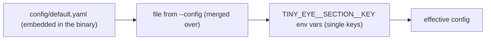

tiny-eye reads one YAML configuration. `config/default.yaml` is the only place defaults live; `crates/engine/src/config.rs` defines the structure and documents each key.

## Layering



1. **Embedded defaults.** `config/default.yaml` is compiled into the binary.
2. **File.** `tiny-eye --config <file.yaml>` merges a file over the defaults. Maps merge key by key; any other value (scalar or list) replaces the default. The file needs only the keys you change.
3. **Environment.** Each `TINY_EYE__<SECTION>__<KEY>=<value>` variable sets one key. Path segments are separated by `__` and lowercased: `TINY_EYE__INGEST__FLUSH_INTERVAL=5s` sets `ingest.flush_interval`. The value is parsed as YAML, so numbers, booleans and lists keep their type (`TINY_EYE__AUTH__TOKENS='[{token_env: T, scopes: [query]}]'`).

### Unknown keys are refused

Every section refuses unknown keys, so a typo never silently becomes a default:

- a file key that does not exist fails the start with `invalid configuration`;
- an env var naming an unknown key fails with, for example, `env TINY_EYE__INGEST__NOPE: unknown key ingest.nope`;
- a bad size or duration fails with `bad size "64XB" (use B, KB, MB, GB)` or `bad duration ... (use ms, s, m, h, d, w)`.

After parsing, these checks run:

- `node.id` and `node.region` name an object-storage prefix, so they may hold only letters, digits, `.`, `_` and `-` (and may not be `.`, `..` or `_fleet`). An empty or null value falls back to the default (`node-0`, `local`), so it never makes an empty path segment.
- `coordinator.snapshot_grace` must be at least `fleet.publish_interval + 2 × fleet.refresh_interval + query.timeout` (see [`fleet`](#fleet)).
- A `postgres:` `catalog.url` is refused unless `fleet.publish_interval` and `fleet.refresh_interval` are both `0s`: a fleet node keeps its catalog in a DuckDB file.
- `0s` is accepted only for `fleet.publish_interval` and `fleet.refresh_interval`.
- `query.workers` and `duckdb.threads` must be greater than 0, and so must `ingest.flush_bytes` and `ingest.row_group_rows`.

One more check only warns. When the node reads other nodes' data (`fleet.refresh_interval` is not `0s`) and `materialize.settle` is shorter than `ingest.flush_interval + coordinator.checkpoint_interval + fleet.publish_interval + fleet.refresh_interval`, the start logs a warning: materialized panels may store steps before every node's rows for them have arrived.

### Sizes and durations

| Kind | Grammar | Examples |
| :--- | :--- | :--- |
| Size | whole number followed by `B`, `KB`, `MB` or `GB` (powers of 1024) | `512KB`, `64MB`, `1GB` |
| Duration | whole number followed by `ms`, `s`, `m`, `h`, `d` or `w` | `250ms`, `60s`, `10m`, `15d` |

Durations use the same grammar as TQS durations. Zero (`0s`) is accepted only for `fleet.publish_interval` and `fleet.refresh_interval`, which read it as "never". Fractions and combined units (`1h30m`) are not accepted. `duckdb.memory_limit` is passed to DuckDB as text (for example `4GB`).

## Keys

### `node`

| Key | Type | Default | Meaning |
| :--- | :--- | :--- | :--- |
| `node.id` | string | `node-0` | Node id, unique among the nodes sharing `storage.url`. Part of every data file name, and second part of the node's object prefix `<region>/<id>/`. Letters, digits, `.`, `_`, `-`; empty falls back to the default. |
| `node.region` | string | `local` | Region label stamped on every ingested row and part of each series' identity. First part of the node's object prefix. Same characters as `node.id`; empty falls back to the default. |
| `node.tenant` | string | `default` | Tenant stamped on every row and used in data file keys (single tenant in v1). |

### `server`

| Key | Type | Default | Meaning |
| :--- | :--- | :--- | :--- |
| `server.listen` | `host:port` | `127.0.0.1:7070` | Listener for the API, OTLP/HTTP, remote-write, Loki push, `/metrics` and the web UI. |

### `storage`

| Key | Type | Default | Meaning |
| :--- | :--- | :--- | :--- |
| `storage.url` | string | `./data/objects` | Root of the object store: a relative or absolute path, `file:///abs/dir`, or `s3://bucket/prefix`. The node writes under `<node.region>/<node.id>/` of it; nodes of a [fleet](../examples/run-a-fleet.md) share one root. |
| `storage.s3.endpoint` | string | `""` | Empty for AWS; for example `http://127.0.0.1:19000` for MinIO (path-style requests). |
| `storage.s3.region` | string | `us-east-1` | S3 region. |
| `storage.s3.access_key_id` | string, secret | `""` | Prefer the env var `TINY_EYE__STORAGE__S3__ACCESS_KEY_ID`. |
| `storage.s3.secret_access_key` | string, secret | `""` | Prefer the env var `TINY_EYE__STORAGE__S3__SECRET_ACCESS_KEY`. |
| `storage.s3.allow_http` | bool | `false` | Allow plain HTTP to the endpoint. |

The S3 keys apply only when `storage.url` starts with `s3://`. DuckDB reads S3 over TLS unless the endpoint starts with `http://`.

### `catalog`

| Key | Type | Default | Meaning |
| :--- | :--- | :--- | :--- |
| `catalog.url` | string | `./data/catalog.ducklake` | This node's DuckLake catalog: a DuckDB file path or `postgres:<libpq conninfo>`. The parent directory of a file path is created. Every node has its own catalog, also in a fleet. A `postgres:` catalog cannot be used in a fleet: it is refused unless both `fleet.*_interval` are `0s`. |

### `duckdb`

| Key | Type | Default | Meaning |
| :--- | :--- | :--- | :--- |
| `duckdb.extension_dir` | string | `""` | Directory laid out as `<dir>/<duckdb version>/<platform>/*.duckdb_extension`. When set, auto-install and auto-load are turned off and `icu`, `ducklake` and `httpfs` are loaded from it. Empty = DuckDB's default location (`~/.duckdb/extensions`) with auto-install. |
| `duckdb.threads` | integer > 0 | `4` | DuckDB worker threads. |
| `duckdb.memory_limit` | string | `4GB` | DuckDB memory limit. |

### `ingest`

| Key | Type | Default | Meaning |
| :--- | :--- | :--- | :--- |
| `ingest.durability` | `wal` or `memory` | `wal` | `wal`: acknowledge after a group-committed fsync to the local WAL, replayed on restart. `memory`: acknowledge after admission to RAM; a crash loses the unflushed batch. |
| `ingest.wal_dir` | path | `./data/wal` | Directory of the write-ahead log (`durability: wal`). |
| `ingest.flush_bytes` | size > 0 | `64MB` | Flush the open batch when it reaches this size... |
| `ingest.flush_interval` | duration | `60s` | ...or this age. |
| `ingest.max_sample_age` | duration | `1h` | Samples, spans and log lines older than this are dropped (counted as `out_of_bounds`). |
| `ingest.max_sample_future` | duration | `10m` | Rows further ahead than this are dropped (counted as `out_of_bounds`). |
| `ingest.arena_limit` | size | `1GB` | Above this many buffered bytes, ingest answers `429`. |
| `ingest.row_group_rows` | integer > 0 | `122880` | Parquet row-group size. |

### `coordinator`

| Key | Type | Default | Meaning |
| :--- | :--- | :--- | :--- |
| `coordinator.checkpoint_interval` | duration | `5s` | How often pending envelopes are applied to the catalog. |
| `coordinator.hot_grace` | duration | `30s` | Keep committed rows in RAM this long after the catalog has them. |
| `coordinator.compaction_interval` | duration | `1m` | How often closed hours are checked for compaction. |
| `coordinator.compaction_delay` | duration | `10m` | Compact an hour this long after it closes. |
| `coordinator.retention` | duration | `15d` | Data older than this is deleted. |
| `coordinator.retention_interval` | duration | `1h` | How often retention runs. |
| `coordinator.snapshot_grace` | duration | `10m` | A catalog snapshot is expired, and the files only it names are deleted, once a newer snapshot has existed this long. Must be at least `fleet.publish_interval + 2 × fleet.refresh_interval + query.timeout`. Published in the manifest; other nodes skip a manifest older than the smaller of this and their own grace. Use the same value on every node of a fleet. |

### `fleet`

Nodes that share `storage.url` find each other there and answer queries over all their data. A node alone answers exactly as before (it still publishes a small copy every 30 s; set both `fleet.*_interval` to `0s` to turn that off). See [Run a fleet](../examples/run-a-fleet.md).

| Key | Type | Default | Meaning |
| :--- | :--- | :--- | :--- |
| `fleet.publish_interval` | duration | `30s` | Publish a copy of this node's catalog (`<region>/<id>/_fleet/catalog.ducklake.gz` and the manifest `_fleet/<id>.json`) this often. `0s` = never: other nodes do not see this node. |
| `fleet.refresh_interval` | duration | `30s` | Look for the other nodes' copies this often, download the changed ones and query them with this node's data. `0s` = never. |
| `fleet.dir` | path | `./data/fleet` | Local directory for downloaded copies. A node keeps them in `<fleet.dir>/<node.id>/` (its own id) as `fleet_<n>.ducklake`, and empties that directory at start. |
| `fleet.max_copy_bytes` | size | `256MB` | Another node's catalog copy larger than this once decompressed is rejected (see [Copies are untrusted](../examples/run-a-fleet.md#copies-are-untrusted)). |

**Use the same `fleet.publish_interval`, `fleet.refresh_interval`, `fleet.max_copy_bytes`, `query.timeout` and `coordinator.snapshot_grace` on every node.** A node's grace protects the copies the other nodes read, so it must fit their timing too. Each manifest carries the publisher's grace, and a reader uses the smaller of its own and the publisher's. A node may still set `fleet.publish_interval: 0s` to publish nothing. Keep the nodes' clocks synced with NTP: a reader compares the publish time in a manifest with its own clock.

`coordinator.snapshot_grace` must cover `publish_interval + 2 × refresh_interval + query.timeout` (120 s with the defaults), otherwise the start fails with `coordinator.snapshot_grace (...) must be at least ...`. With both intervals at `0s`, only `query.timeout` counts.

### `query`

| Key | Type | Default | Meaning |
| :--- | :--- | :--- | :--- |
| `query.timeout` | duration | `30s` | A query taking longer from arrival (waiting for a free connection included) is interrupted and answered with `500`. |
| `query.workers` | integer > 0 | `4` | DuckDB connections serving queries in parallel; further queries wait for a free connection. |

### `auth`

| Key | Type | Default | Meaning |
| :--- | :--- | :--- | :--- |
| `auth.tokens` | list | `[]` | Bearer tokens and their scopes. Empty = auth disabled (local development). |
| `auth.tokens[].token_env` | string | none | Name of the env var holding the token; tokens never live in the file. The start fails if the variable is not set. |
| `auth.tokens[].scopes` | list of `ingest`, `query`, `admin` | none | Scopes granted; `admin` grants all. |

```yaml
auth:
  tokens:
    - { token_env: TINY_EYE_INGEST_TOKEN, scopes: [ingest] }
    - { token_env: TINY_EYE_QUERY_TOKEN, scopes: [query] }
```

See [Security](security.md) for which scope each operation needs.

### `dashboards`

| Key | Type | Default | Meaning |
| :--- | :--- | :--- | :--- |
| `dashboards.dir` | path | `./dashboards` | Directory of dashboard YAML files, loaded at start and written by dashboard saves. |
| `materialize.path` | path | `./data/materialized.duckdb` | Node-local DuckDB file for the points of [materialized panels](materialized-panels.md); empty keeps them in memory. Derived data: safe to delete. |
| `materialize.resolution` | duration | `15s` | Step of the stored points. A read whose step is a multiple of it uses them. |
| `materialize.settle` | duration | `5m` | A step is stored once it is this old. A sample arriving later than this for a stored step makes the next tick recompute the stored steps from its timestamp on. |
| `materialize.max_panels` | int | `64` | Panels materialized at most; the rest are skipped with a warning (the same panels win on every start). |
| `materialize.max_points_per_panel` | int | `1000000` | Stored points kept per panel. Past it the oldest steps are dropped and computed on read. A panel too wide to keep 240 steps (1 h) is not stored. |
| `materialize.max_slice_points` | int | `200000` | Points one background slice may produce. The slice length shrinks for wide panels, so a tick's working memory stays bounded. |

Relative paths are relative to the process's working directory.

## Shipped configuration files

| File | Purpose |
| :--- | :--- |
| `config/default.yaml` | Every default; embedded. |
| `config/dev.yaml` | Local development (`make run`): extensions from `.tools/duckdb_ext`, `flush_interval: 10s`, `checkpoint_interval: 2s`, `hot_grace: 5s`. |
| `examples/demo/tiny-eye.yaml` | The demo (`make demo`): data under `./data/demo`, the demo dashboards. |

## Effective configuration at start

At start the node logs the effective configuration (after all layers) with secrets redacted. `tiny-eye config [--config <file>]` prints the same thing and exits. Redaction replaces non-empty `storage.s3.access_key_id` and `storage.s3.secret_access_key` with `<redacted>`, and masks a `password=` value or a `user:password@` part in `catalog.url`. The output is YAML in the config file's own grammar (sizes like `64MB`, durations like `1m`), so it can be saved and loaded back as a config file:

```yaml
node:
  id: node-0
  region: local
  tenant: default
server:
  listen: 127.0.0.1:7070
storage:
  url: ./data/objects
```

Token values are never in the configuration, only the names of their env vars.

## Editor autocompletion

`schema/generated/config.schema.json` describes the file with every key's type, description and default (taken from `config/default.yaml`), and no key is required, since a user file is an overlay. Add this first line to a config file to get completion, hover docs and typo detection in editors that use yaml-language-server:

```yaml
# yaml-language-server: $schema=../schema/generated/config.schema.json
```

The repository's `.vscode/settings.json` maps `config/*.yaml` to the schema. The file is regenerated by `make schemas` and checked by a test. See [Editor grammars](../reference/editor-grammars.md).
