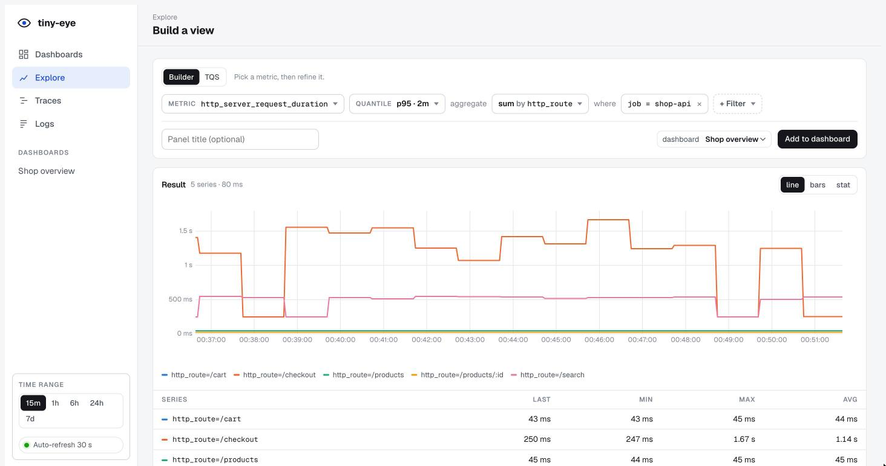
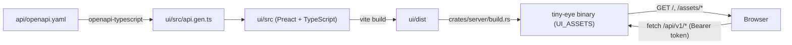

Dashboards are YAML files in git (spec question Q12). The engine loads them at start, serves them over the API, and writes them back when the UI saves a change. The file stays the source of truth: commit it.

## Dashboard model

```yaml
# yaml-language-server: $schema=../schema/generated/dashboard.schema.json
id: tiny-eye-self
title: tiny-eye self-monitoring
vars:
  job: tiny-eye
panels:
  - ui: { display: timeseries, unit: rows/s, w: 9, h: 4 }
    query:
      tqs: "3"
      id: ingest-rate
      title: Ingested rows per second by table
      kind: timeseries
      time: { from: "-1h", step: "1m" }
      queries:
        - name: r
          metric: tiny_eye_ingested_rows_total
          match: [{ label: job, op: "=", value: "$job" }]
          fn: { op: rate, window: 5m }
          agg: { op: sum, by: [table] }
```

| Field | Type | Notes |
| :--- | :--- | :--- |
| `id` | string matching `^[a-z0-9][a-z0-9_-]{0,63}$` | Also the file name on save, so it can never leave the dashboards directory. Unique across files. |
| `title` | non-empty string | |
| `vars` | map of name to string | Defaults for every panel's query. |
| `panels` | list | Drawn in list order. |

A **panel** is data plus presentation:

| Field | Required | Meaning |
| :--- | :--- | :--- |
| `query` | yes | A complete TQS 3 document (see the [TQS reference](tqs-reference.md)), kept as JSON so the API returns exactly what the file says. |
| `ui.display` | no | `timeseries`, `stat`, `table`, `bar`, `traces` or `logs`. Default: `timeseries` for timeseries queries, `table` otherwise. |
| `ui.unit` | no | Unit shown next to values, for example `req/s`, `s`, `%`, `bytes`. |
| `ui.w` | no | Width in columns of a **12-column grid**, 1 to 12. Default 3 for `stat`, 6 otherwise. |
| `ui.h` | no | Height in fixed-height rows, 1 to 8. Default 2 for `stat`, 4 otherwise. |

Unknown keys anywhere in a dashboard are refused. Panels flow in list order over the grid; there are no x/y coordinates, so reordering the list moves panels.

### Variables are defaults, never stored into queries

When a panel is validated or run, the dashboard's `vars` are added to the panel query's own `vars` for every name the query does not define. The panel's own value wins. This merge happens in memory only (`Panel::effective_query` in `crates/engine/src/dashboards.rs`); `GET` returns the stored query without the merged variables, and a save writes the query as sent. The UI applies the same rule and also replaces `time` with the range picked on the page (except for `kind: trace`).

## Load, validate, save

### Load at start

`dashboards.dir` (default `./dashboards`) is read once at start. Every `*.yaml` and `*.yml` file is parsed and validated, in file-name order. A missing directory means no dashboards. A file that does not parse, does not validate, or reuses an id stops the start with the file name and the problems.

Validation checks the id, the title, every `ui` field, and every panel's effective query with the full TQS validator. Problems carry paths such as `panels[2].ui.w` or `panels[0].query.queries[0].fn.window`.

### API

| Operation | Scope | Result |
| :--- | :--- | :--- |
| `GET /api/v1/dashboards` | `query` | `[{id, title, panels}]`, where `panels` is the count |
| `GET /api/v1/dashboards/{id}` | `query` | The dashboard with its panels' TQS documents and `ui`; `404` for an unknown id |
| `PUT /api/v1/dashboards/{id}` | `admin` | Saves the whole new state; returns it |

### Save

The UI sends the **whole new state** of the dashboard: panels in order, each with its `query` and `ui`. The engine then:

1. parses the body (an unknown key or wrong type gives a `schema` problem);
2. checks that the body `id` equals the URL id (`id` problem otherwise);
3. validates it exactly like a file loaded at start;
4. picks the file: the YAML file in the directory that already holds this id, or `<id>.yaml` for a new dashboard;
5. writes it **atomically**: to `<file>.yaml.tmp`, then renames over the target;
6. replaces the dashboard in memory and serves it from then on.

Any problem returns `400` with every problem and its path, and nothing is written. A write failure is reported as an `io` problem. The written file starts with a `yaml-language-server` schema header and a comment saying it was saved by tiny-eye.

Saving needs the `admin` scope because it writes a file on the server. See [Security](security.md).

:::note
A save rewrites the file from the parsed model, so comments in a hand-written file are replaced by the generated header. Keep long explanations in panel `title` fields or in git history.
:::

## Web UI

Pages: **Dashboards** (live panels; Edit layout to drag, resize and remove; Add panel; Done
saves with `PUT`), **Explore** (a pill builder and a TQS editor validated live by the engine,
synced both ways; add the view to a dashboard), **Traces** (search and waterfall) and **Logs**
(lines, patterns, volume by level). Every panel on every page is drawn by one component that runs
a TQS document, so dashboards and pages render the same way.



### Architecture



- **Stack.** Preact 11 with TypeScript, built by Vite, charts with uPlot, fonts Geist and Geist Mono. Sources in `ui/src/`: `api.ts` (typed client), `tqs.ts` (effective query, display inference, Explore builder), `board.tsx` (a dashboard page with layout editing and an Add panel drawer), `panels.tsx` (runs any panel's query and draws it per its `ui`), `charts.tsx` (time-series charts with a crosshair shared across the page), `format.ts`, `ui.tsx`.
- **Typed API.** `npm run gen` regenerates `ui/src/api.gen.ts` from `api/openapi.yaml`; every build runs it, so the UI cannot drift from the contract. See [API and code generation](api-and-codegen.md).
- **Build.** `make ui` (`npm ci` and `npm run build` in `ui/`) type-checks and writes `ui/dist`. The next `cargo build` embeds every file of `ui/dist` into the binary. A binary built without `ui/dist` serves a short page at `/` that explains how to build the UI, and the API keeps working.
- **Serving.** Any path outside `/api/`, `/v1/` and `/loki/` belongs to the UI. A known file is served with its content type; files under `/assets/` (hashed names) get `Cache-Control: public, max-age=31536000, immutable`, others `no-cache`. Every other UI path returns `index.html` (SPA fallback), so client-side routes survive a reload. An unknown path under `/api/`, `/v1/` or `/loki/` returns `404` with a pointer to `/openapi.yaml`.
- **Development.** `npm run dev` serves the UI on port 5173 and proxies `/api` and `/openapi.yaml` to a running node (`TINY_EYE_URL`, default `http://127.0.0.1:7070`).

### Auth in the UI

The UI's static files are public: they hold no data. Every data call goes to the API and needs a bearer token when auth is enabled. The client sends `Authorization: Bearer <token>` with the token kept in the browser's `localStorage` (key `tiny-eye-token`); on a `401` it raises an event so the app can ask for a token. Viewing needs a `query` token; saving a dashboard needs an `admin` token.

### Prototype

`ui/prototype/index.html` is a clickable design prototype on sample data, not wired to the engine. Open it in a browser. It shows:

- dashboards with a shared crosshair, an Add panel drawer, and an Edit layout mode (drag to move, drag the corner to resize on the 12-column grid, keyboard arrows on both handles);
- Explore, with a pill query bar and a **Builder | TQS** switch that edits the same query both ways;
- trace search with a waterfall;
- log lines and log patterns.

The real UI follows it: panel positions are `w` and `h` in the dashboard YAML, written back on save; panels map one to one to TQS documents; the plan is for the Explore TQS editor to become Monaco with `schema/generated/tqs.schema.json` for completion (see [Editor grammars](../reference/editor-grammars.md)); and every view reads the existing HTTP API.

For a dashboard written as code, see [Dashboards as code](../examples/dashboards-as-code.md).
