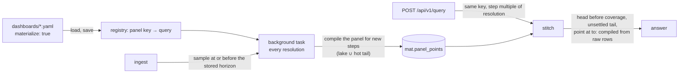

In short: a materialized panel keeps the points it has already computed, so a refresh does not
compute them again.

A dashboard panel normally reads all of its raw samples again on every refresh. Mark it
`materialize: true` and tiny-eye keeps the points it has already computed. As data arrives, it
adds new points. A refresh then reads the stored points. It computes only the few newest points
in time (steps) that are not stored yet. The answer is still the one the raw query gives. On the
benchmark's 6-hour panels over many series, reads are 10–12× faster (443 ms raw, 37 ms
materialized). The code is in `crates/engine/src/materialize.rs`.

## The idea in 60 seconds

In short: compute each point once, keep it, and reuse it on every refresh.


A panel shows "requests per second, last 6 hours". Think of the 6 hours as 24 boxes. To fill a
box, tiny-eye reads the raw samples for that time and computes a value.

```
WITHOUT materialize: every refresh does all the work

  [raw][raw][raw][raw][raw] ... [raw][raw][raw]
  read + compute all 24 boxes                       -> 443 ms


WITH materialize: do the work once, keep it

  every 15 s a background task finishes one more box and stores it

  t=0     [    ][    ][    ] ...                   (empty)
  t=15 s  [ ## ][    ][    ] ...
  t=30 s  [ ## ][ ## ][    ] ...
  ...
  later   [ ## ][ ## ][ ## ] ... [ ## ][ ?? ][ ?? ]
           stored points           newest boxes: too new
                                   to store yet

  A refresh = read the stored boxes
            + compute only the "??" boxes            -> 37 ms
```

The drawing is simplified. The real store keeps one point per output series every 15 s, not
24 boxes.

The newest boxes are not stored on purpose. A sample for them can still arrive late. So
tiny-eye waits until a step is 5 minutes old (the default) before it stores it. This wait is
called *settle*.

Two cases people ask about:

```
Late data   a sender was offline and sends old samples for step 13

  stored:  [##][##]...[##][XX][##][##]             XX = now wrong
  next tick: delete step 13 and later, compute them again
  stored:  [##][##]...[##][##][##][##]             correct again

New panel   stored for 1 h, you view 6 h

  [ compute 5 h from raw ............ ][ 1 h stored ]   little gain yet
  Each hour of uptime moves one more hour to the store.
```

- **Late data.** When an old sample arrives, tiny-eye throws away the stored points from that
  time on. Then it computes them again.
- **New panel.** tiny-eye does not compute the past in advance. A new panel gains more as its
  stored part grows.

The answer is the same as the raw query at the same timestamps. The stored points are only a
copy of work already done. tiny-eye can always compute them again from the lake and the hot tail
(see the words below).

### Words used on this page

In short: these words mean the same thing everywhere on this page.

| Word | Meaning | Example |
| :--- | :--- | :--- |
| **Sample** | One raw measurement sent by a sender | the request counter is 1,042 at 10:00:15 |
| **Series** | All samples of one metric with the same labels | `http_requests_total{route="/cart"}` |
| **Step** | The time between two points on a chart | 6 h at a 2-minute step is 180 points |
| **Window** | How far back a function looks from each point | `rate` over 5 min at 10:00 uses the samples from 09:55 to 10:00 |
| **Raw** | Computed from the samples on every read, the normal way | a panel without `materialize` |
| **Stored point** | A finished value that tiny-eye keeps, so it does not compute it again | the value at 10:00 for one series |
| **Resolution** | The step of the stored points (`materialize.resolution`) | 15 s by default |
| **Settle** | How old a step must be before it is stored (`materialize.settle`) | 5 min by default: at 10:00, steps up to 09:55 are stored |
| **Unsettled tail** | The newest steps, newer than `now - settle`. Not stored yet, so a read computes them raw | at 10:00, the steps after 09:55 |
| **Tick** | One run of the background task that stores new points | every 15 s |
| **Lake, hot tail** | Where samples live. The lake is the Parquet files in object storage. The hot tail is the newest rows, still in memory. Every query reads both | not the same thing as the unsettled tail |

## Use it

In short: add `materialize: true` to a panel. You can do it in a dashboard file, in the web UI,
or over the API.

**In a dashboard file**, next to `ui` and `query`:

```yaml
panels:
  - ui: { display: timeseries, unit: req/s, w: 6, h: 4 }
    materialize: true
    query:
      tqs: "3"
      id: rps
      kind: timeseries
      time: { from: "-6h" }
      queries:
        - { name: r, metric: http_requests_total, fn: { op: rate, window: 5m }, agg: { op: sum, by: [route] } }
```

**In the web UI**, tick **Store points** in the *Add panel* drawer (line and bar panels). The
panel is saved with `materialize: true` and shows a **stored** badge.

**Over the API**, send the dashboard with `materialize: true` on the panel to
`PUT /api/v1/dashboards/{id}`. Some panels [cannot be materialized](#what-can-be-materialized).
Validation refuses those, and says why.

**Check that it works.** A query answered from the store says so in its response:

```json
"materialized": { "panel": "shop/rps", "resolution_ms": 15000, "stored_points": 1780, "computed_steps": 3 }
```

Here `resolution_ms` is the 15 s resolution, `stored_points` counts the points read from the
store, and `computed_steps` counts the steps computed raw. On `/metrics`,
`tiny_eye_materialized_reads_total` counts reads and `tiny_eye_materialized_points_total`
counts stored points.

Any client that sends the same query uses the stored points: the UI, `curl`, or an agent over
MCP. What is stored is exactly the panel's TQS document. Edit the panel, and its old points are
dropped.

## When to use it

In short: materialize a panel that reads a lot of raw data and is read often.

The gain is the raw work a read no longer does. So it is largest where a panel reads a lot of
raw data and is read often. The table shows three good fits. The numbers come from the
benchmark (6 h of data, 2,620 series).

| Use case | Why it fits | Measured |
| :--- | :--- | :--- |
| **Long-range dashboards on auto-refresh** (6 h, 24 h, 7 d; wall screens) | Raw cost grows with the range. Stored points are not read again from raw | 1 h 5.1×, 3 h 6.8×, 6 h 12.0×. Materialized stays at 37–45 ms; raw grows from 229 to 441 ms |
| **Aggregations over many series** (`sum by`, `topk`, ratios) | Each raw read touches the samples of every series | `sum by`, `topk`, an error ratio: 10.6–11.9×; gauge `max` 3.9×; `histogram_quantile` 2.3× |
| **Recurring questions from agents and scripts** | An agent (MCP) or `curl` that sends the panel's query gets the stored points. Put the recurring question in a materialized panel | The panel's query with another `id` and `title`: 58 ms with the store, 441 ms raw ([ad-hoc queries](evidence/bench-local.md#ad-hoc-queries-6-h-relative-time-no-step-what-an-agent-or-curl-sends)) |

### When it does not help

In short: the gain comes from reusing finished work. So the gain is small when there is little
work to reuse, when the query does not match the stored work, or when nothing is stored yet.

**1. One-off, exploratory queries**

- *What happens:* the query runs raw. In the benchmark, the panel's query with `window: 4m`
  instead of `5m` took 441 ms.
- *Why:* only a query that matches a materialized panel uses the store. Another window is
  another query. Explore and new agent questions are one-off by nature.
- *What to do:* materialize the questions that come back.

**2. Single-series or cheap panels**

- *What happens:* almost no gain. A single series: 21 ms raw, 20 ms materialized (1.1×).
- *Why:* there is little raw work to save.
- *What to do:* nothing. The raw query is already cheap.

**3. Short ranges**

- *What happens:* the UI's 15-minute range runs raw.
- *Why:* it asks for a 5 s step. That is not a multiple of the 15 s resolution.
- *What to do:* nothing. A 15-minute raw read is cheap anyway.

**4. Panels materialized only recently**

- *What happens:* a 6-hour read of a panel stored for 1 h takes 431 ms (raw: 441 ms).
- *Why:* points start when the panel is first seen
  ([no backfill](#when-data-starts-no-backfill)). The 5 hours before them are computed raw.
  That costs nearly a full raw read.
- *What to do:* wait. Expect the gain once the panel has been stored for about the range you
  view.

```
a 6 h read, panel stored for 1 h:
   [ 5 h computed raw ........... ][ 1 h ]   431 ms (raw 441 ms)

a 6 h read, panel stored for 6 h:
   [ 6 h stored ..................... ]       37 ms (raw 450 ms, 12.1×)
```

## How it works

In short: a background task stores each panel's new points every 15 s. A read takes the stored
points and computes only the rest from raw samples.

The diagram uses a few short words. *Stitch* joins stored and computed points into one answer.
The *horizon* is the newest stored step. *Coverage* is the time range that has stored points.
"lake ∪ hot tail" means the lake together with the hot tail.



1. **Registration.** At start, and each time a dashboard is saved, tiny-eye registers every
   panel that has `materialize: true`. Each panel gets a key. The key is the panel's query,
   with the dashboard's `vars` filled in, written as canonical JSON (always the same text for
   the same query). The key leaves out `id`, `title` and `time`. So the UI's copy of a panel and
   the file's copy get the same key.
2. **Extension.** Every `materialize.resolution` (15 s), a background task computes each panel
   for the steps between its last stored step and `now - settle`. For example, at 10:00 with
   the default `settle` of 5 min, it stores steps up to 09:55. It stores the final points: after
   formulas, `having` and per-step `top` have run. It reads the same views as any query, so it
   also sees hot-tail rows. This task is separate from flushes and checkpoints.
   - Each panel runs on its own connection, one panel after the other.
   - One slice (the steps computed in one go) is at most 2,880 steps (12 h). Wide panels get
     fewer (see [Memory](#memory-nothing-grows-without-a-bound)).
   - A panel that fails is skipped and retried with a shorter slice. So it does not block the
     others. A slow panel delays the panels after it in the same tick.
   - A node that was down catches up slice by slice.
3. **Late data.** A sample can arrive for a time at or before the horizon. Examples: a sender
   sends its backlog after an outage, or retries. Ingest notes the sample's time once the
   sample is visible to queries. After a crash, WAL replay (re-reading the write-ahead log)
   notes it too. So a note lost with the process is not lost for good. The next tick deletes
   the stored points from that time on, for every panel, and computes them again. For example:
   points are stored up to 09:55, and a sample for 09:40 arrives. The next tick deletes every
   panel's points from 09:40 on and computes them again. Late data is not tracked per metric.
   So a sender that is always about `settle` behind keeps the newest minutes of every panel
   recomputing.
4. **Reads.** A `timeseries` query uses the store when all three hold:
   - its key matches a registered panel;
   - its step is a multiple of the resolution;
   - its range overlaps the stored range.

   The answer has a point at each multiple of the step (for example 10:00, 10:02, 10:04 for a
   2-minute step: the step-aligned grid). It also has one last point at `to`. Each part comes
   from the cheapest place:

   ```
   from                                                 to
    | head |<---------- stored points ---------->| tail | *
   ```

   - **head**: the steps before the stored range. Computed from raw.
   - **stored points**: read from `mat.panel_points`. This is most of the range.
   - **tail**: the unsettled tail, newer than `now - settle`. Computed from raw.
   - **`*`**: the point at `to`. Computed from raw.

   With nothing stored in range, the query runs raw, unchanged.
5. **Forgetting.** The registered set changes when a panel is removed or its query is edited.
   Then the points of panels no longer registered are deleted. A changed query starts again
   from `now - settle`. After a start, nothing is deleted before the first registration.

Points live in a DuckDB database on the node itself (`materialize.path`). DuckDB is the database
engine that runs every tiny-eye query. This database is attached to the same DuckDB instance as
the lake and the hot tail. So stored and computed points are read in one transaction. It holds
derived data only. If the file is unusable at start, it is moved aside and a new one is begun.

### When data starts: no backfill

In short: stored points start when the panel is first seen. Older steps are computed raw on
every read.

Stored points start **when the panel is first seen**: at startup for a dashboard file, or when
the dashboard is saved. They start from `now - settle`. Nothing earlier is computed in advance.
There is no "start from 7 weeks ago" option.

Reads are correct for any range anyway. Steps before the stored range are computed from raw data
on every read, as they would be without `materialize`. Example: a panel was materialized an hour
ago, and you read it over 7 days. The read takes the last hour (minus the newest few minutes)
from the store. It computes the other 6 days 23 hours raw. Each hour of uptime moves another
hour of every read to the store.

## Why the answer is exact

In short: tiny-eye stores only points that every later read would compute the same way.

### The one rule

In short: a stored point may depend only on its own window, its own time, and the query.

A stored point at time *t* depends on three things only:

1. the samples inside its own window, `(t - offset - window, t - offset]`. That means after
   `t - offset - window`, up to and including `t - offset`. Without `offset`, the window simply
   ends at *t*;
2. *t* itself;
3. the panel's query document, which is fixed.

For example: `rate` over 5 minutes at 10:00 uses the samples after 09:55, up to and including
10:00. It does not care which dashboard asked. It does not care if the chart shows 1 hour or 7
days, or which step it uses.

This page calls such a point **pure**: its value depends only on those three things. It does not
depend on `from`, `to` or `step`, on other steps, or on how long the range is. So a value
computed once is the value any later read would compute. Only queries where **every output
point follows this rule** can be materialized. All others are refused, with a reason.

Because a value at *t* does not depend on the step, points stored at 15 s serve any step that
is a multiple of 15 s. For example, a 2-minute step is 8 × 15 s, so a 2-minute chart reads every
8th stored point. The UI's default steps for its ranges are such multiples:

```
range          1 h     6 h     24 h    7 d
UI step        15 s    2 min   5 min   1 h
step / 15 s    1       8       20      240

all are multiples of 15 s -> read from the store
```

(see the [TQS reference](tqs-reference.md)). The tests that check this point by point are in
[What the tests prove](#what-the-tests-prove).

### What can be materialized

In short: a query can be stored only if every part of it is pure.

**Pure** means it follows [the one rule](#the-one-rule). Pure items can be stored. The others
are refused with a reason. The table lists each part of a query, whether it is pure, and why.

| Item | Pure? | Why |
| :--- | :--- | :--- |
| `rate`, `increase`, `irate`, `delta`, `resets`, `changes`, `last_over_time`, `count_over_time` | yes | uses the first and last samples (the last two for `irate`), or counts, inside the step's own window |
| `avg_over_time`, `min_over_time`, `max_over_time`, `sum_over_time` | yes | the same window, aggregated |
| `last` (no window) | yes | the latest sample in a fixed 5-minute window, `(t − offset − 5 min, t − offset]`; a staleness marker (the signal that a series stopped) ends it |
| `histogram_quantile` | yes | computed per step from the bucket rates of that step |
| `absent` | yes | 1 at the steps that have no value |
| `agg`, `then`, `having` | yes | grouped or filtered per step |
| `derive` | yes | rewrites labels, which do not change with time |
| `offset` | yes | moves the window into the past; a late sample still only affects steps at or after its timestamp |
| formulas, inner and outer | yes | joined per step and per series key |
| `top` with `rank: per_step` (the default) | yes | ranks the series at each step on its own |
| `top` with `query` | yes | ranks by another query at the same step (`rank` is then ignored) |
| `top` with `rank: max`, `avg` or `last`, and no `query` | no | picks the series over the **whole range** |
| `fill: zero` | no | fills zero for series seen **anywhere in the range** |
| `$__range`, `$__interval` | no | change with the requested range or step |
| `kind: table` and the list kinds | no | `table` is one value at `to`; the list kinds return rows, not steps |
| spans and logs measures | no | each point covers a bucket as wide as the **step** (and they are not built yet) |

Two refused cases, with tiny numbers. In the first, the range changes the answer. "Top 1 by
max" shows only the series with the highest peak in the range you view.

```
top 1 by max over the range          (the range changes the answer)

           05:30   ...   10:00   10:30   11:00
  A         90             10      12      11
  B         40             50      52      51

  view 1 h  (10:00-11:00)   top series is B (max 52)
                            -> shows B at 11:00
  view 6 h  (05:00-11:00)   top series is A (max 90)
                            -> shows A at 11:00
  same step, different answer: it cannot be stored once.
```

In the second, the step changes the answer. A spans count per step counts the spans inside one
step.

```
spans count per step bucket          (the step changes the answer)

  spans in the last 2 min: 20, of which 3 in the last 15 s

  step 15 s   point at t = spans in (t - 15 s,  t]  =  3
  step 120 s  point at t = spans in (t - 120 s, t]  = 20
  same time t, different value: it cannot be stored once.
```

With 15 s buckets stored, the 120 s point would be the sum of 8 of them (120 / 15 = 8). Adding
up stored pieces like this is what mergeable partials would add (see
[Chained updates](#chained-updates-not-built)).

## What it costs

In short: the stored points are a trade. The background task does the work for each step once,
and every read gets cheaper. This part shows where the work goes and why.

### How the work adds up

In short: each tick reads one window of raw samples, computes one new step, and keeps only the
finished points.

No half-done result is carried from one tick to the next. Each tick starts from the raw
samples. It usually computes one new step and stores its finished points. Only the finished
points, and where they end, pile up.

```
samples, one every 15 s:
  .  .  .  .  .  .  .  .  .  .  .  .  .  .  .  .  .  .  .  .  .  .

tick k     computes t:
  (======== 5 min window: 20 samples ========]
tick k+1   computes t+15 s:
     (======== 5 min window: 20 samples ========]
     <--- overlap: 19 of 20 samples read again -->

stored:  [ t ] [ t+15 s ] [ t+30 s ] ...   <- finished points pile up
```

Three short formulas show the cost. In words: one window holds `w / i` samples per series. One
tick reads one window for every series. One hour has 240 ticks.

The letters, with the benchmark's values:

- `S`: the number of series the panel reads (2,000);
- `w`: the window (5 min);
- `i`: the scrape interval, the time between two samples of one series (15 s);
- resolution: the stored step (15 s).

```
one step, one tick      reads about  S x (w / i)  samples
                        2,000 x (5 min / 15 s)
                        = 2,000 x 20 = 40,000

one hour of ticks       240 steps  =  240 x S x (w / i)  samples
                        (3,600 s / 15 s = 240)

each sample is read     about  w / resolution  times
                        by the background task
                        (20 times for w = 5 min at the
                        15 s resolution)
```

This is on purpose. Reading a window again is cheap. In return, there is no state to repair.
After a late sample, the steps from its timestamp on are deleted and computed again from the raw
data. The older steps stay as they are.

### Where the time goes

In short: a stored refresh reads about 30 times fewer samples (estimate), and the benchmark
measured it 11.9 times faster.

The example is the benchmark's `sum by (job) (rate(http_requests_total[5m]))` panel. In words:
requests per second over a 5-minute window, added up per job. Here `S` = 2,000 series, `i` =
15 s and `w` = 5 min. The read covers 6 h at a 120 s step (180 steps). The panel has 10 jobs,
so it returns 1,800 points (180 × 10).

Numbers marked *estimate* are worked out from the formulas. The times and the point counts are
measured.

**A raw refresh** reads every sample of every series once. It also reads 5 more minutes before
the range, because the first point's window starts there.

```
raw refresh, samples read (estimate)

  per series   (range + w) / i
               = (360 min + 5 min) / 15 s
               = 365 min x 4 samples per min = 1,460
  in total     S x 1,460
               = 2,000 x 1,460 = 2,920,000  (about 2.9 M)
```

**A stored refresh** reads 1,770 stored points. It computes 3 steps raw: the 2 newest steps
(newer than now − settle) and the point at `to`. With 10 jobs, those 3 steps add 30 points
(1,770 + 30 = 1,800).

```
stored refresh, samples read (estimate)

  2 newest steps   2,000 x (2 min + 5 min) / 15 s
                   = 2,000 x 28 = 56,000   (56 k)
  point at `to`    2,000 x 20 = 40,000     (40 k)
  in total         56 k + 40 k = 96 k      (about 100 k)
```

**One background tick** computes one step: 2,000 × 20 = 40 k samples read, 10 points stored
(*estimate*).

| Compare | Result |
| :--- | :--- |
| Samples, raw against stored | 2.9 M / 100 k: about 30× (*estimate*) |
| **Time, raw against stored** | **443 ms and 37 ms: 11.9× (measured)** |

The measured gain is smaller than the sample ratio. A stored read still has fixed work: two
small queries (the tail and the point at `to`), planning, and the lookup of the stored rows. The
single-series panel shows that floor: about 21 ms raw and 20 ms stored. (This reading is an
inference from those numbers, not a separate measurement.)

**The background task is not free.**

- In samples, it does more than three raw refreshes per hour (240 ticks × 40 k = 9.6 M, and
  9.6 M / 2.9 M is about 3.3).
- In time, it costs more: about 16 raw refreshes (7.2 s per hour, worked out below, / 0.443 s).
  Every tick pays a fixed cost of about 20 ms per
  query. Its 40 k samples take only about 6 ms (*estimate*: about 423 ms / 2.9 M ≈ 0.15 µs per
  sample, and 40,000 × 0.15 µs = 6 ms).

It is worth it because the work is done once per step, not once per refresh:

```
per hour, one panel like the one above
(estimate from the measured 30 ms per panel per tick)

background     240 ticks x 30 ms          = 7.2 s
each refresh   saves about 443 - 37 ms    = 0.4 s
break-even     7.2 s / 0.4 s              = about 18 refreshes
                                            per hour

a 30 s auto-refresh (120 per hour):
   raw         120 x 0.443 s              = 53 s
   stored      7.2 s + 120 x 0.037 s      = 12 s
```

The 30 ms is the average over the 8 benchmark panels. So the rate panel itself probably costs
more per tick. Read the break-even as an order of magnitude. A panel that is refreshed more
often than about every few minutes gains. A panel nobody reads does not.

### Chained updates: not built

In short: tiny-eye recomputes each new step from raw samples. It does not keep small partial
results to add up later.

A *chained* design would keep one small partial result per output group and per 15 s bucket:
count, sum, min, max and last. It would fill each partial only from new samples. A tick would
then read only the newest 15 s, not a whole window again. A point would merge the buckets it
covers: 8 buckets for a 120 s spans step, 20 for a 5-minute window. The specification calls
these mergeable partials (`view_partials`, section 9.1). For `rate` with Prometheus
extrapolation (stretching the change seen inside the window out to the window's edges), the
spec marks them unproven. **They are not built.**

```
built now                         not built (the spec's
                                  mergeable partials)

each tick: read the whole window  each tick: read only the new 15 s
           compute the step                  store one partial
           store the point                   for this bucket

                                  a read:    merge the buckets
                                             it covers
```

Inside one query, tiny-eye does use running totals: values carried along while one statement
walks through a series in time order. It uses them for every function except the four
`*_over_time` aggregates. They live only for the length of that statement. Nothing is kept
between ticks.

Mergeable partials would make spans and logs counts storable: a 120 s point is the sum of eight
15 s buckets. A spans quantile needs log-bucket histograms (decision D6). Later, they would also
allow percentiles merged across regions. See
[Limitations and roadmap](limitations-and-roadmap.md#materialized-panels) and
[How it maps to the spec](#how-it-maps-to-the-spec).

## Memory: nothing grows without a bound

In short: four limits cap both the working memory of the background task and the size of the
store.

The background task is a buffer, not a cache: it holds a result only until it is written. Each
tick computes one slice, writes it to the store in one statement, and lets go of it. Between
ticks it keeps only one number: the panel's *width*. The width is the number of points one step
produces, that is, the number of output series. For example, the rate panel above has width 10
(10 jobs). Four limits keep the node's memory and the store file bounded:

```
tick (every 15 s), for each panel:

  width known?  steps = max_slice_points / width
                (first slice: 60 steps)
       |
       v
  compute <= max_slice_points rows -> write -> forget
                                  working memory: one slice
       |
       v
  panel > max_points_per_panel?  -> drop the OLDEST steps
                                    store: newest N points only
  panel too wide for 240 steps?  -> do not store it
                                    reads compute it raw
  more than max_panels panels?   -> skip the extra ones
                                    (warning at registration)
```

The table gives each limit, what it bounds, and its default.

| Limit | What it bounds | Default |
| :--- | :--- | ---: |
| `max_slice_points` | Output rows of one background slice, roughly. The slice length comes from the width seen in the previous slice (the first slice after a start is 60 steps). It counts output points, not the raw samples read | 200,000 |
| `max_points_per_panel` | Points stored for one panel, roughly. The newest `max_points_per_panel / width` steps are kept. The oldest whole steps go first, and a read computes them again, so answers stay exact | 1,000,000 |
| minimum 240 steps | A panel that cannot keep 1 h of steps is not stored (it would be rewritten every tick) | fixed |
| `max_panels` | Panels materialized | 64 |

So the store can never hold more than `max_panels × max_points_per_panel × ~24 B`. With the
defaults that is 64 × 1,000,000 × 24 B, about 1.5 GB of disk. In practice it is far less: the
six benchmark panels hold about 65,000 points in 1.6 MB.

- **No leak.** The benchmark ran 240 more ticks (1 h of steps) over 8 panels. Process memory
  (RSS) was 1,737 MB before and 1,589 MB after. That is the whole benchmark process, which also
  holds the 6 h of ingested data. The store grew by 1,794 points. Those ticks run past the last
  ingested sample, so they do not reach the caps.
- **The caps hold.** The tests in `crates/engine/tests/materialize.rs` prove them: a small cap
  is trimmed and the read still equals the raw query.
- **The store is paged.** It is a DuckDB file, so DuckDB pages it inside `duckdb.memory_limit`
  rather than holding it in the process. With `path: ""` it is in memory, but the same limits
  apply.
- **Reads.** A read still builds its answer in memory, as any query does. `query.timeout` and
  the number of points returned bound it.

Watch it on `/metrics`: `tiny_eye_materialized_stored_points`, `tiny_eye_materialized_panels`,
`tiny_eye_materialized_tick_milliseconds` and `tiny_eye_materialized_trimmed_points_total`.

- A rising trimmed counter is normal once a panel is full: the oldest steps go as new ones
  arrive.
- A panel with more than about 700 series per step cannot hold a 6 h range
  (`max_points_per_panel` / 1,440 steps in 6 h). So it never gets the full gain. Narrow its `by`
  labels or raise the cap.
- A panel that cannot hold 1 h is not stored at all. tiny-eye measures it again every 10
  minutes.

## Performance

All numbers come from one `make bench` run ([report](evidence/bench-local.md#materialized-panels)):
in process, warm caches, 10 runs after a warm-up, 6 h of data for 2,620 series. In short:
6 h panels over many series read 10–12× faster, materialized reads stay near 40 ms from 1 h to
6 h ranges, and the background cost is 30 ms per panel every 15 s.

In the tables, p50 is the median time: half of the runs were faster. p95 means 95 of 100 runs
were faster.

### Reads, fully stored

Each benchmark panel read raw and from a full store, over a 6 h range at the UI's default 2 min
step:

| Panel | Raw p50 | Materialized p50 / p95 | Faster | Equal |
| :--- | ---: | ---: | ---: | :--- |
| `sum by (job) (rate(http_requests_total[5m]))` | 443 ms | 37 / 40 ms | 11.9× | yes |
| `topk(10, sum by (route) (rate(…[5m])))` | 443 ms | 38 / 39 ms | 11.8× | yes |
| error ratio formula (2 queries) | 499 ms | 47 / 48 ms | 10.6× | yes |
| `histogram_quantile(0.99, … by (job, le))` | 62 ms | 27 / 28 ms | 2.3× | yes |
| `max by (job) (gauge)` | 91 ms | 23 / 25 ms | 3.9× | yes |
| one series: `rate(…{instance="10.0.0.1:9100"})` | 21 ms | 20 / 23 ms | 1.1× | yes |

Each materialized read took 177 to 1,780 stored points. It computed 3 steps: the unsettled tail
and the point at `to`. "Equal" compares every point with the raw query at the same timestamps.

### Read cost against range

How read time changes as the range grows, for `sum by (job) (rate(…[5m]))`:

| Range | Step | Raw p50 | Materialized p50 | Faster |
| :--- | ---: | ---: | ---: | ---: |
| 1 h | 15 s | 229 ms | 45 ms | 5.1× |
| 3 h | 60 s | 270 ms | 40 ms | 6.8× |
| 6 h | 120 s | 441 ms | 37 ms | 12.0× |

Raw cost follows the samples in range. Materialized cost follows the points returned, which the
UI keeps near 300 whatever the range.

### Coverage after uptime

How the gain grows the longer a panel has been stored. The same 6 h read, with the panel stored
for 0 h, 1 h and 6 h:

| Panel stored for | Raw p50 | Materialized p50 | Faster |
| :--- | ---: | ---: | ---: |
| 0 h (just added) | 438 ms | 444 ms | 1.0× |
| 1 h | 441 ms | 431 ms | 1.0× |
| 6 h | 450 ms | 37 ms | 12.1× |

With nothing stored in range, the query runs raw, unchanged. Until most of the range is stored,
the head computed raw takes most of the time.

### Background and storage

What the background task and the store cost
([report section](evidence/bench-local.md#background-cost-and-storage)):

| Measure | Result |
| :--- | :--- |
| One background tick, 8 panels (one new 15 s step each) | 244 ms every 15 s: 1.6 % of one query connection |
| Per panel per tick | 30 ms |
| Storage | 24.2 bytes per stored point (65,394 points in 1.6 MB) |
| 240 more ticks (1 h of steps), 8 panels | process RSS 1,737 MB before, 1,589 MB after (peak 1,749 MB): no growth; tick p50 152 ms, max 245 ms; stored points 65,394 to 67,188 |
| Catch-up of 6 panels over 6 h (benchmark only; the background task never backfills) | 62,490 points in 3.7 s |

A panel at the 15 s resolution stores 5,760 points per day per output series. That is about
140 KB per series per day. `coordinator.retention` deletes them. Ingest does not wait for
materialization: the background task runs on a query connection, separately from flushes and
checkpoints.

## Configuration

The keys under `materialize` in the config file, with their defaults:

| Key | Default | Effect |
| --- | --- | --- |
| `materialize.path` | `./data/materialized.duckdb` | Where stored points live. Empty: in memory, started again after a restart |
| `materialize.resolution` | `15s` | Stored step. Reads with a step that is a multiple of it use the store |
| `materialize.settle` | `5m` | Store a step once it is this old (late samples are recomputed anyway) |
| `materialize.max_panels` | `64` | Panels beyond this are skipped with a warning |
| `materialize.max_points_per_panel` | `1000000` | Oldest steps are dropped past this; a wider panel is not stored |
| `materialize.max_slice_points` | `200000` | One background slice; its length shrinks for wide panels |

`settle` changes only how much is recomputed. A larger value stores later, and recomputes less
often when samples arrive late. Changing `resolution` changes every panel's key, so stored
points start again. `coordinator.retention` deletes stored points older than the cutoff.

## Caveats

- **No backfill.** Points start when a panel is first seen; older steps are computed on read.
- **The response grid.** A materialized read answers on the step-aligned grid (multiples of the
  step) plus the point at `to`. A raw query's grid starts at `from`. Both give the same value at
  the same timestamp.
- **Node-local.** The store belongs to one node. A late sample is noticed by the node that
  ingests it. In a [fleet](../examples/run-a-fleet.md) a node's panels also cover the other
  nodes' rows, which arrive up to `ingest.flush_interval + coordinator.checkpoint_interval +
  fleet.publish_interval + fleet.refresh_interval` late (about 2 minutes with the defaults). They
  are counted only if they arrive before the step is stored, so keep `settle` longer than that.
  The start logs a warning when it is shorter.
- **The UI's ranges.** 1 h, 6 h, 24 h and 7 d read from the store; 15 min does not (5 s step).
  Any other range does when its step is a multiple of 15 s.
- **Not the spec's partials.** Spans and logs measures, and percentiles merged across regions,
  are not materialized (see the mapping below).

## How it maps to the spec

This is the spec's **materialized panels** (section 9.1, decisions D5 and D6, milestone M4):
panels "maintained incrementally" by a materializer in the coordinator. Phase 1 is built, in a
different shape. The left column is what the spec asks for. The right column is what Phase 1
builds.

| Spec section 9.1 (D5, D6, M4) | Phase 1 |
| :--- | :--- |
| Often-viewed panels maintained incrementally by a materializer in the coordinator | `materialize: true` per panel; a background task extends each panel every 15 s |
| Fed from flush envelopes, never DuckLake's change feed (D5), so compaction cannot double count | Computed from the lake plus the hot tail for new steps; never the change feed, so compaction does not disturb stored points |
| State: mergeable partials in an inlined `view_partials` table | Finished points per panel in a node-local DuckDB file |
| Percentiles from log-bucket histograms merged with `SUM`, ≤ 1.01 % error (D6) | `histogram_quantile` computed exactly by the compiler |
| `rate`/`increase` with Prometheus extrapolation marked unproven | Exact, tested, and the largest measured gain |
| Read p50 ≈ 12.5 ms, target p95 < 50 ms | Materialized 6 h reads: p95 22.5–48.1 ms on the six benchmark panels (target p95 < 50 ms met), p50 20.3–47.2 ms |
| Alert rules on the same state | Not built (no alert evaluator yet) |

Still to build from the spec: partials for spans and logs measures and for percentiles that
merge across regions, and an alert evaluator reading the same state. See
[Limitations and roadmap](limitations-and-roadmap.md#materialized-panels).

## What the tests prove

In short: the tests compare every stored point with the raw query, and they fail when the
logic breaks.

`crates/engine/tests/materialize.rs` compares every materialized point with the raw query at
the same timestamps. Two values count as equal when they differ by at most a relative 1e-9. It
covers:

- **12 query shapes:** `rate` by job, gauge `max_over_time`, a formula over hidden queries,
  per-step `top`, `having`, `then`, `derive`, `offset`, `top.query`, an outer-join formula
  (`coalesce`), `absent`, `histogram_quantile`;
- **four range/step pairs**, including ranges that start before the stored range, and every
  range ending in the unsettled tail and at an unaligned `to` (one that is not on a step);
- data with a counter reset, rows in the lake and in the hot tail;
- **late samples** for already stored steps (recomputed), a **restart** (points kept), an
  unregistered tick after a restart (nothing wiped), and the fallbacks (another step, another
  query, unregistered, nothing stored);
- the memory caps: a small cap is trimmed and the read still equals the raw query.

The tests fail when the stitching, the late-sample recompute or the wipe guard is broken. (The
wipe guard stops a tick that runs after a restart, before any panel is registered, from
deleting stored points.) This was checked by hand while writing
them: each fix was removed and its test failed. It is not an automated mutation run.

`make bench` measures the speed and repeats the equality check on every benchmark panel: see
[Performance](#performance) and the [benchmark report](evidence/bench-local.md#materialized-panels).
