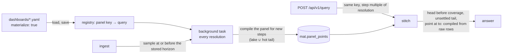

A dashboard panel normally reads all of its raw samples again on every refresh. Mark it
`materialize: true` and tiny-eye keeps the points it has already computed, and adds new ones as
data arrives. A refresh then reads the stored points and computes only the few steps that are
not stored yet. The answer is still the one the raw query gives. On the benchmark's 6-hour
panels over many series, reads are 10–12× faster (443 ms raw, 37 ms materialized). The code is
in `crates/engine/src/materialize.rs`.

## The idea in 60 seconds


A panel shows "requests per second, last 6 hours". Think of the 6 hours as 24 boxes.

```
WITHOUT materialize: every refresh does all the work

  [raw][raw][raw][raw][raw] ... [raw][raw][raw]   read + compute 24 boxes
                                                   -> 443 ms


WITH materialize: do the work once, keep it

  every 15 s a background task finishes one more box and stores it

  t=0     [    ][    ][    ] ...                   (empty)
  t=15 s  [ ## ][    ][    ] ...
  t=30 s  [ ## ][ ## ][    ] ...
  ...
  later   [ ## ][ ## ][ ## ] ... [ ## ][ ?? ][ ?? ]
           stored points           newest boxes: not settled yet

  A refresh = read the stored boxes + compute only the "??" boxes
                                                   -> 37 ms
```

Two cases people ask about:

```
Late data   a sender was offline and sends old samples for step 13

  stored:  [##][##]...[##][XX][##][##]             XX = now wrong
  next tick: delete step 13 and later, compute them again
  stored:  [##][##]...[##][##][##][##]             correct again

New panel   stored for 1 h, you view 6 h

  [ compute 5 h from raw ............ ][ 1 h stored ]   little gain yet
  Each hour of uptime moves one more hour to the store.
```

The answer is the same as the raw query at the same timestamps. The stored points are only a
copy of work already done, and tiny-eye can always compute them again from the lake and the
hot tail.

## Use it

**In a dashboard file**, next to `ui` and `query`:

```yaml
panels:
  - ui: { display: timeseries, unit: req/s, w: 6, h: 4 }
    materialize: true
    query:
      tqs: "3"
      id: rps
      kind: timeseries
      time: { from: "-6h" }
      queries:
        - { name: r, metric: http_requests_total, fn: { op: rate, window: 5m }, agg: { op: sum, by: [route] } }
```

**In the web UI**, tick **Store points** in the *Add panel* drawer (line and bar panels). The
panel is saved with `materialize: true` and shows a **stored** badge.

**Over the API**, send the dashboard with `materialize: true` on the panel to
`PUT /api/v1/dashboards/{id}`. Validation refuses it, with the reason, on a panel that
[cannot be materialized](#what-can-be-materialized).

**Check that it works.** A query answered from the store says so:

```json
"materialized": { "panel": "shop/rps", "resolution_ms": 15000, "stored_points": 1780, "computed_steps": 3 }
```

and `tiny_eye_materialized_reads_total` / `tiny_eye_materialized_points_total` count reads and
stored points on `/metrics`.

The same query sent by any client uses the stored points: the UI, `curl`, or an agent over MCP.
What is stored is exactly the panel's TQS document. Edit the panel and its old points are
dropped.

## When to use it

The gain is the raw work a read no longer does. So it is largest where a panel reads a lot of
raw data and is read often. From the benchmark (6 h of data, 2,620 series):

| Use case | Why it fits | Measured |
| :--- | :--- | :--- |
| **Long-range dashboards on auto-refresh** (6 h, 24 h, 7 d; wall screens) | raw cost grows with the range; stored points do not re-read it | 1 h 5.1×, 3 h 6.8×, 6 h 12.0×: materialized stays at 37–45 ms while raw grows from 229 to 441 ms |
| **Aggregations over many series** (`sum by`, `topk`, ratios) | each raw read touches every series' samples | `sum by`, `topk`, an error ratio: 10.6–11.9×; gauge `max` 3.9×; `histogram_quantile` 2.3× |
| **Recurring questions from agents and scripts** | an agent (MCP) or `curl` sending the panel's query gets the stored points; put the recurring question in a materialized panel | the panel's query with another `id` and `title`: 58 ms with the store, 441 ms raw ([ad-hoc queries](evidence/bench-local.md#ad-hoc-queries-6-h-relative-time-no-step-what-an-agent-or-curl-sends)) |

### When it does not help

- **One-off, exploratory queries.** A query that is not a materialized panel runs raw. In the
  benchmark, the same query with `window: 4m` instead of `5m` took 441 ms. Explore and new
  agent questions are ad-hoc by nature; materialize the ones that come back.
- **Single-series or cheap panels.** A single series: 21 ms raw, 20 ms materialized (1.1×).
  There is little raw work to save.
- **Short ranges.** The UI's 15-minute range asks for a 5 s step. That is not a multiple of the
  15 s resolution, so it runs raw. A 15-minute raw read is cheap anyway.
- **Panels materialized only recently.** Points start when the panel is first seen
  ([no backfill](#when-data-starts-no-backfill)). So a 6-hour read gains only once most of the
  6 hours is stored:

  ```
  a 6 h read, panel stored for 1 h:
     [ 5 h computed raw ........... ][ 1 h ]     431 ms  (raw 441 ms)

  a 6 h read, panel stored for 6 h:
     [ 6 h stored ..................... ]         37 ms  (raw 450 ms, 12.1×)
  ```

  The 5 h head computed raw costs nearly a full raw read. Expect the gain once a panel has
  been stored for about the range you view.

## How it works



1. **Registration.** At start and on every dashboard save, each panel with `materialize: true`
   is registered under a key. The key is the panel's effective query (dashboard `vars` merged)
   as canonical JSON, without `id`, `title` and `time`. So the UI's copy and the file's copy get
   the same key.
2. **Extension.** Every `materialize.resolution` (15 s), a background task computes each panel
   for the steps between its last stored step and `now - settle`. It stores the output points
   (after formulas, `having` and per-step `top`). It reads the same views as any query, so
   hot-tail rows are included. This task is separate from flushes and checkpoints.
   - Each panel runs on its own connection, in turn.
   - One slice is at most 2,880 steps (12 h), and fewer for wide panels (see
     [Memory](#memory-nothing-grows-without-a-bound)).
   - A panel that fails is skipped and retried with a shorter slice, so it does not block the
     others. A slow one delays the panels after it in the same tick.
   - A node that was down catches up slice by slice.
3. **Late data.** A sample can arrive for a timestamp at or before the stored horizon (a
   sender's backlog after an outage, a retry). Ingest notes it once it is visible. WAL replay
   notes it too after a crash, so a note lost with the process is not lost for good. The next
   tick deletes stored points from that timestamp on, for every panel, and computes them again.
   Late data is not tracked per metric. So a sender that is always about `settle` behind keeps
   the newest minutes of every panel recomputing.
4. **Reads.** A `timeseries` query uses the store when all of these hold: its key matches a
   registered panel, its step is a multiple of the resolution, and it overlaps the stored
   range. The answer is on the step-aligned grid plus the point at `to`. Each part comes from
   the cheapest place:

   ```
   from                                                                to
    |  head   |<------------- stored points ------------->|  tail  |   *
    computed    read from mat.panel_points                 computed    point at `to`,
    from raw    (most of the range)                        from raw    computed from raw
    (before                                                (newer than
    coverage)                                              now - settle)
   ```

   With nothing stored in range, the query runs raw, unchanged.
5. **Forgetting.** When the registered set changes (a panel removed, its query edited), the
   points of panels no longer registered are deleted. A changed query starts again from
   `now - settle`. Nothing is deleted before the first registration after a start.

Points live in a node-local DuckDB database (`materialize.path`). It is attached to the same
DuckDB instance as the lake and the hot tail, so stored and computed points are read in one
transaction. It holds derived data only: an unusable file is moved aside at start and a new one
begun.

### When data starts: no backfill

Stored points start **when the panel is first seen**: at startup for a dashboard file, or when
the dashboard is saved. They start from `now - settle`. Nothing earlier is computed in advance;
there is no "start from 7 weeks ago" option.

Reads are correct for any range regardless. Steps before the stored range are computed from raw
data on every read, as they would be without `materialize`. Example: a panel materialized an
hour ago and read over 7 days takes the last hour (minus the newest few minutes) from the store.
It computes the other 6 days 23 hours raw. Each hour of uptime moves another hour of every read
to the store.

## Why the answer is exact

### The one rule

A stored point at time *t* is a pure function of three things:

1. the samples inside its own window, `(t - offset - window, t - offset]`;
2. *t* itself;
3. the panel's query document, which is fixed.

It does not depend on `from`, `to` or `step`, on other steps, or on how long the range is. So a
value computed once is the value any later read would compute. Only queries where **every output
point follows this rule** can be materialized. All others are refused, with a reason.

Because a value at *t* does not depend on the step, points stored at 15 s serve any step that is a
multiple of 15 s. The UI's default steps for its ranges are such multiples:

```
range   1 h     6 h     24 h    7 d
step    15 s    2 min   5 min   1 h      all multiples of 15 s -> read from the store
```

(see the [TQS reference](tqs-reference.md)). The tests that check this point by point are in
[What the tests prove](#what-the-tests-prove).

### What can be materialized

**Pure** follows [the one rule](#the-one-rule). Pure items can be stored. The others are refused
with a reason.

| Item | Pure? | Why |
| :--- | :--- | :--- |
| `rate`, `increase`, `irate`, `delta`, `resets`, `changes`, `last_over_time`, `count_over_time` | yes | first and last samples (the last two for `irate`), or counts, inside the step's own window |
| `avg_over_time`, `min_over_time`, `max_over_time`, `sum_over_time` | yes | the same window, aggregated |
| `last` (no window) | yes | the latest sample in the fixed 5-minute lookback `(t − offset − 5 min, t − offset]`; a staleness marker ends it |
| `histogram_quantile` | yes | computed per step from the bucket rates of that step |
| `absent` | yes | 1 at the steps that have no value |
| `agg`, `then`, `having` | yes | grouped or filtered per step |
| `derive` | yes | rewrites labels, which do not change with time |
| `offset` | yes | moves the window into the past; a late sample still only affects steps at or after its timestamp |
| formulas, inner and outer | yes | joined per step and key |
| `top` with `rank: per_step` (the default) | yes | ranks the series at each step on its own |
| `top` with `query` | yes | ranks by another query at the same step (`rank` is then ignored) |
| `top` with `rank: max`, `avg` or `last`, and no `query` | no | picks the series over the **whole range** |
| `fill: zero` | no | zero is filled for series seen **anywhere in the range** |
| `$__range`, `$__interval` | no | change with the requested range or step |
| `kind: table` and the list kinds | no | `table` is one value at `to`; the list kinds return rows, not steps |
| spans and logs measures | no | each point covers a bucket as wide as the **step** (and they are not built yet) |

Two refused cases, with tiny numbers:

```
top 1 by max over the range                       (the range changes the answer)

           05:30   ...   10:00   10:30   11:00
  A         90             10      12      11
  B         40             50      52      51

  view 1 h  (10:00-11:00)   the top series is B  (max 52)  -> shows B at 11:00
  view 6 h  (05:00-11:00)   the top series is A  (max 90)  -> shows A at 11:00
  same step, different answer: it cannot be stored once.
```

```
spans count per step bucket                       (the step changes the answer)

  spans in the last 2 min: 20, of which 3 in the last 15 s

  step 15 s   point at t = spans in (t - 15 s,  t]  =  3
  step 120 s  point at t = spans in (t - 120 s, t]  = 20
  same time t, different value: it cannot be stored once.
```

With 15 s buckets stored, the 120 s point would be the sum of 8 of them. That is what mergeable
partials would add (see [Chained updates](#chained-updates-not-built)).

## What it costs

The stored points are a trade: the background task does the work once, and every read gets cheaper.
This part shows where the work goes and why.

### How the work adds up

No partial result is carried from one tick to the next. Each tick starts from the raw samples,
usually computes one new step, and stores its finished points. Only the finished points, and
where they end, pile up.

```
samples (every 15 s)  .  .  .  .  .  .  .  .  .  .  .  .  .  .  .  .  .  .  .  .  .  .

tick k       computes t:       (=========== 5 min window: 20 samples ===========]
tick k+1     computes t+15 s:     (=========== 5 min window: 20 samples ===========]
                                  <------ overlap: 19 of 20 samples read again ----->

stored:      [ t ] [ t+15 s ] [ t+30 s ] ...      <- the finished points pile up
```

Three small formulas help to see the cost. Let `S` be the number of series, `w` the window and `i`
the scrape interval.

```
one step, one tick      reads about  S x (w / i)  samples
one hour of ticks       240 steps  =  240 x S x (w / i)  samples
each sample is read     about  w / resolution  times by the background task
                        (20 times for w = 5 min at the 15 s resolution)
```

This is on purpose. Reading a window again is cheap. In return there is no state to repair: after
a late sample, the steps from its timestamp on are deleted and computed again from the raw data,
and the older steps stay as they are.

### Where the time goes

Take the benchmark's `sum by (job) (rate(http_requests_total[5m]))` panel: `S` = 2,000 series,
`i` = 15 s and `w` = 5 min. The read covers 6 h at a 120 s step (180 steps). The panel has 10
jobs, so it returns 1,800 points. Numbers marked *estimate* are worked out from the formulas. The
times and the point counts are measured.

| | How | Result |
| :--- | :--- | :--- |
| Raw refresh, samples read | one pass of running totals per series: `S × (range + w) / i` = 2,000 × 1,460 | about 2.9 M samples (*estimate*) |
| Raw refresh, window lookups | two per series and step: `2 × S × steps` = 2 × 2,000 × 180 | 720 k (*estimate*) |
| One background tick, one step | `S × (w / i)` = 2,000 × 20 | 40 k samples, 10 points (*estimate*) |
| Stored refresh | 1,770 stored points, plus 3 computed steps: the 2 newest steps (newer than now − settle) and the point at `to` | 56 k + 40 k, about 100 k samples (*estimate*) |
| Samples, raw against stored | 2.9 M / 100 k | about 30× (*estimate*) |
| **Time, raw against stored** | the benchmark | **443 ms and 37 ms: 11.9× (measured)** |

The measured gain is smaller than the sample ratio because a stored read still has fixed work:
two small queries (the tail and the point at `to`), planning, and the lookup of the stored rows.
The single-series panel shows that floor: about 21 ms raw and 20 ms stored. (This reading is an
inference from those numbers, not a separate measurement.)

The background task is not free. In samples it does more than three raw refreshes per hour
(240 ticks × 40 k = 9.6 M). In time it is more, about 16 raw refreshes, because every tick pays a
fixed cost of about 20 ms per query while its 40 k samples take only about 6 ms (*estimate*:
about 423 ms / 2.9 M ≈ 0.15 µs per sample). It is worth it because the work is done once per
step, not once per refresh:

```
per hour, one panel like the one above (estimate from the measured 30 ms per panel per tick)

background    240 ticks × 30 ms            =  7.2 s
each refresh  saves about 443 - 37         =  0.4 s       -> break-even at about 18 refreshes per hour
a 30 s auto-refresh (120 per hour):
   raw        120 × 0.443 s                = 53 s
   stored     7.2 s + 120 × 0.037 s        = 12 s
```

The 30 ms is the average over the 8 benchmark panels, so the rate panel itself probably costs more
per tick. Read the break-even as an order of magnitude: a panel that is refreshed more often than
about every few minutes gains, and a panel nobody reads does not.

### Chained updates: not built

A *chained* design would keep one small partial per output group and 15 s bucket (count, sum, min,
max, last), filled only from new samples. A tick would then read only the newest 15 s, not a whole
window again. A point would merge the buckets it covers: 8 buckets for a 120 s spans step, 20 for
a 5-minute window. The specification calls these mergeable partials (`view_partials`, section
9.1). For `rate` with extrapolation the spec marks them unproven. **They are not built.**

```
built now                              not built (the spec's mergeable partials)

each tick: read the whole window       each tick: read only the new 15 s
           compute the step                       store one partial for this bucket
           store the point
                                       a read:    merge the buckets it covers
```

Inside one query, tiny-eye does use running totals for every function except the four `*_over_time`
aggregates, but they live only for the length of that statement. Nothing is kept between ticks.

Mergeable partials would make spans and logs counts storable (a 120 s point is the sum of eight 15 s
buckets; a spans quantile needs log-bucket histograms, decision D6), and later percentiles merged
across regions. See
[Limitations and roadmap](limitations-and-roadmap.md#materialized-panels) and
[How it maps to the spec](#how-it-maps-to-the-spec).

## Memory: nothing grows without a bound

The background task is a buffer, not a cache. Each tick computes one slice, writes it to the
store in one statement, and lets go of it. Nothing is kept between ticks except one number (the
panel's width). Four limits keep the node's memory and the store file bounded:

```
 tick (every 15 s), for each panel:

   width known?  steps = max_slice_points / width      (first slice: 60 steps)
        |
        v
   compute <= max_slice_points rows ──> write ──> forget      working memory: one slice
        |
        v
   panel > max_points_per_panel?  ──> drop the OLDEST steps   store: newest N points only
   panel too wide for 240 steps?  ──> do not store it         reads compute it raw
   more than max_panels panels?   ──> skip the extra ones     (warning at registration)
```

| Limit | What it bounds | Default |
| :--- | :--- | ---: |
| `max_slice_points` | output rows of one background slice, about: the slice length comes from the width seen in the previous slice (the first slice after a start is 60 steps), and it counts output points, not the raw samples read | 200,000 |
| `max_points_per_panel` | points stored for one panel, about: the newest `max_points_per_panel / width` steps are kept, the oldest whole steps go first and a read computes them again, so answers stay exact | 1,000,000 |
| minimum 240 steps | a panel that cannot keep 1 h of steps is not stored (it would be rewritten every tick) | fixed |
| `max_panels` | panels materialized | 64 |

So the store can never hold more than `max_panels × max_points_per_panel × ~24 B`. That is
about 1.5 GB of disk with the defaults, and far less in practice: the six benchmark panels hold
about 65,000 points in 1.6 MB.

- **No leak.** The benchmark ran 240 more ticks (1 h of steps) over 8 panels. Process RSS was
  1,737 MB before and 1,589 MB after (the whole benchmark process, which also holds the 6 h of
  ingested data). The store grew by 1,794 points. Those ticks run past the last ingested
  sample, so they do not reach the caps.
- **The caps hold.** The tests in `crates/engine/tests/materialize.rs` prove them: a small cap
  is trimmed and the read still equals the raw query.
- **The store is paged.** It is a DuckDB file, so DuckDB pages it inside
  `duckdb.memory_limit` rather than holding it in the process. With `path: ""` it is in memory,
  but the same limits apply.
- **Reads.** A read still builds its answer in memory, as any query does (`query.timeout` and
  the points returned bound it).

Watch it on `/metrics`: `tiny_eye_materialized_stored_points`, `tiny_eye_materialized_panels`,
`tiny_eye_materialized_tick_milliseconds` and `tiny_eye_materialized_trimmed_points_total`.

- A rising trimmed counter is normal once a panel is full: the oldest steps go as new ones
  arrive.
- A panel with more than about 700 series per step (`max_points_per_panel` / 1,440 steps in
  6 h) cannot hold a 6 h range, so it never gets the full gain. Narrow its `by` labels or raise
  the cap.
- A panel that cannot hold 1 h is not stored at all, and is measured again every 10 minutes.

## Performance

All numbers from one `make bench` run on an 8-core laptop ([report](evidence/bench-local.md#materialized-panels); it holds the latest weekly run, so its numbers can differ):
in process, warm caches, 10 runs after a warm-up, 6 h of data for 2,620 series. In short:
6 h panels over many series read 10–12× faster, materialized reads stay near 40 ms from 1 h to
6 h ranges, and the background cost is 30 ms per panel every 15 s.

### Reads, fully stored

6 h range at the UI's default 2 min step:

| Panel | Raw p50 | Materialized p50 / p95 | Faster | Equal |
| :--- | ---: | ---: | ---: | :--- |
| `sum by (job) (rate(http_requests_total[5m]))` | 443 ms | 37 / 40 ms | 11.9× | yes |
| `topk(10, sum by (route) (rate(…[5m])))` | 443 ms | 38 / 39 ms | 11.8× | yes |
| error ratio formula (2 queries) | 499 ms | 47 / 48 ms | 10.6× | yes |
| `histogram_quantile(0.99, … by (job, le))` | 62 ms | 27 / 28 ms | 2.3× | yes |
| `max by (job) (gauge)` | 91 ms | 23 / 25 ms | 3.9× | yes |
| one series: `rate(…{instance="10.0.0.1:9100"})` | 21 ms | 20 / 23 ms | 1.1× | yes |

Each materialized read took 177 to 1,780 stored points and computed 3 steps (the unsettled tail
and the point at `to`). "Equal" compares every point with the raw query at the same timestamps.

### Read cost against range

`sum by (job) (rate(…[5m]))`:

| Range | Step | Raw p50 | Materialized p50 | Faster |
| :--- | ---: | ---: | ---: | ---: |
| 1 h | 15 s | 229 ms | 45 ms | 5.1× |
| 3 h | 60 s | 270 ms | 40 ms | 6.8× |
| 6 h | 120 s | 441 ms | 37 ms | 12.0× |

Raw cost follows the samples in range. Materialized cost follows the points returned, which the
UI keeps near 300 whatever the range.

### Coverage after uptime

The same 6 h read, panel stored for 0 h, 1 h, 6 h:

| Panel stored for | Raw p50 | Materialized p50 | Faster |
| :--- | ---: | ---: | ---: |
| 0 h (just added) | 438 ms | 444 ms | 1.0× |
| 1 h | 441 ms | 431 ms | 1.0× |
| 6 h | 450 ms | 37 ms | 12.1× |

With nothing stored in range the query runs raw, unchanged. Until most of the range is stored,
the head computed raw dominates.

### Background and storage

[Report section](evidence/bench-local.md#background-cost-and-storage).

| Measure | Result |
| :--- | :--- |
| One background tick, 8 panels (one new 15 s step each) | 244 ms every 15 s: 1.6 % of one query connection |
| Per panel per tick | 30 ms |
| Storage | 24.2 bytes per stored point (65,394 points in 1.6 MB) |
| 240 more ticks (1 h of steps), 8 panels | process RSS 1,737 MB before, 1,589 MB after (peak 1,749 MB): no growth; tick p50 152 ms, max 245 ms; stored points 65,394 to 67,188 |
| Catch-up of 6 panels over 6 h (benchmark only; the background task never backfills) | 62,490 points in 3.7 s |

A panel at the 15 s resolution stores 5,760 points per day per output series: about 140 KB per
series per day, deleted with `coordinator.retention`. Ingest does not wait for materialization:
the background task runs on a query connection, separately from flushes and checkpoints.

## Configuration

| Key | Default | Effect |
| --- | --- | --- |
| `materialize.path` | `./data/materialized.duckdb` | Where stored points live. Empty: in memory, started again after a restart |
| `materialize.resolution` | `15s` | Stored step. Reads with a step that is a multiple of it use the store |
| `materialize.settle` | `5m` | Store a step once it is this old (late samples are recomputed anyway) |
| `materialize.max_panels` | `64` | Panels beyond this are skipped with a warning |
| `materialize.max_points_per_panel` | `1000000` | Oldest steps are dropped past this; a wider panel is not stored |
| `materialize.max_slice_points` | `200000` | One background slice; its length shrinks for wide panels |

`settle` now trades recomputation for nothing else: a larger value stores later and recomputes
less often when samples arrive late. Changing `resolution` changes every panel's key, so stored
points start again. `coordinator.retention` deletes stored points older than the cutoff.

## Caveats

- **No backfill.** Points start when a panel is first seen; older steps are computed on read.
- **The response grid.** A materialized read answers on the step-aligned grid plus the point at
  `to`; a raw query's grid starts at `from`. Both give the same value at the same timestamp.
- **Node-local.** The store belongs to one node. A late sample is noticed by the node that
  ingests it — the only node today.
- **The UI's ranges.** 1 h, 6 h, 24 h and 7 d read from the store; 15 min does not (5 s step).
  Any other range does when its step is a multiple of 15 s.
- **Not the spec's partials.** Spans and logs measures, and percentiles merged across regions,
  are not materialized (see the mapping below).

## How it maps to the spec

This is the spec's **materialized panels** (section 9.1, decisions D5 and D6, milestone M4):
panels "maintained incrementally" by a materializer in the coordinator. Phase 1 is built, in a
different shape:

| Spec section 9.1 (D5, D6, M4) | Phase 1 |
| :--- | :--- |
| Often-viewed panels maintained incrementally by a materializer in the coordinator | `materialize: true` per panel; a background task extends each panel every 15 s |
| Fed from flush envelopes, never DuckLake's change feed (D5), so compaction cannot double count | Computed from the lake plus the hot tail for new steps; never the change feed, so compaction does not disturb stored points |
| State: mergeable partials in an inlined `view_partials` table | Finished points per panel in a node-local DuckDB file |
| Percentiles from log-bucket histograms merged with `SUM`, ≤ 1.01 % error (D6) | `histogram_quantile` computed exactly by the compiler |
| `rate`/`increase` with Prometheus extrapolation marked unproven | Exact, tested, and the largest measured gain |
| Read p50 ≈ 12.5 ms, target p95 < 50 ms | Materialized 6 h reads: p95 22.5–48.1 ms on the six benchmark panels (target p95 < 50 ms met), p50 20.3–47.2 ms |
| Alert rules on the same state | Not built (no alert evaluator yet) |

Still to build from the spec: partials for spans and logs measures and for percentiles that
merge across regions, and an alert evaluator reading the same state. See
[Limitations and roadmap](limitations-and-roadmap.md#materialized-panels).

## What the tests prove

`crates/engine/tests/materialize.rs` compares every materialized point with the raw query at
the same timestamps (relative 1e-9). It covers:

- **12 query shapes:** `rate` by job, gauge `max_over_time`, a formula over hidden queries,
  per-step `top`, `having`, `then`, `derive`, `offset`, `top.query`, an outer-join formula
  (`coalesce`), `absent`, `histogram_quantile`;
- **four range/step pairs**, including ranges that start before the stored range, and every
  range ending in the unsettled tail and at an unaligned `to`;
- data with a counter reset, rows in the lake and in the hot tail;
- **late samples** for already stored steps (recomputed), a **restart** (points kept), an
  unregistered tick after a restart (nothing wiped), and the fallbacks (another step, another
  query, unregistered, nothing stored);
- the memory caps: a small cap is trimmed and the read still equals the raw query.

The tests fail when the stitching, the late-sample recompute or the wipe guard is broken. This
was checked by hand while writing them: each fix was removed and its test failed. It is not an
automated mutation run.

`make bench` measures the speed and repeats the equality check on every benchmark panel: see
[Performance](#performance) and the [benchmark report](evidence/bench-local.md#materialized-panels).
