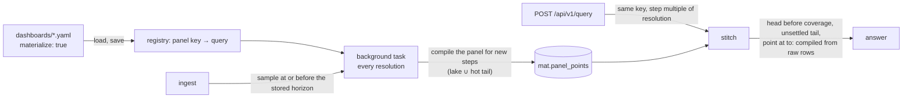

Mark a dashboard panel `materialize: true` and tiny-eye keeps the points it computed and
extends them as data arrives. A dashboard read then takes the stored points and computes only
what is not stored yet, so a long-range panel stops re-reading every raw sample on each
refresh — and the answer is still the one the raw query gives.

This is the spec's **materialized panels** (section 9.1, decisions D5 and D6, milestone M4):
panels "maintained incrementally" by a materializer in the coordinator. Phase 1 is built; how it
maps to the spec is [below](#how-it-maps-to-the-spec).

## The idea in 60 seconds


A panel shows "requests per second, last 6 hours". Think of the 6 hours as 24 boxes.

```
WITHOUT materialize: every refresh does all the work

  [raw][raw][raw][raw][raw] ... [raw][raw][raw]   read + compute 24 boxes
                                                   -> 440 ms


WITH materialize: do the work once, keep it

  every 15 s a background task finishes one more box and stores it

  t=0     [    ][    ][    ] ...                   (empty)
  t=15 s  [ ## ][    ][    ] ...
  t=30 s  [ ## ][ ## ][    ] ...
  ...
  later   [ ## ][ ## ][ ## ] ... [ ## ][ ?? ][ ?? ]
           stored points           newest boxes: not settled yet

  A refresh = read the stored boxes + compute only the "??" boxes
                                                   -> 38 ms
```

Two cases people ask about:

```
Late data   a sender was offline and sends old samples for step 13

  stored:  [##][##]...[##][XX][##][##]             XX = now wrong
  next tick: delete step 13 and later, compute them again
  stored:  [##][##]...[##][##][##][##]             correct again

New panel   stored for 1 h, you view 6 h

  [ compute 5 h from raw ............ ][ 1 h stored ]   little gain yet
  Each hour of uptime moves one more hour to the store.
```

The answer is the same as the raw query at the same timestamps. The stored points are only a
copy of work already done, and tiny-eye can always compute them again from the lake and the
hot tail.

## At a glance

| | Result | Proof |
| :--- | :--- | :--- |
| Faster long-range panels | 6 h panels over many series 10–12× faster (`sum by (job) (rate(…[5m]))`: 443 ms raw, 38 ms); materialized reads stay near 40 ms from 1 h to 6 h ranges | [benchmark](evidence/bench-local.md#materialized-panels) |
| Same answer as the raw query | every point equal (relative 1e-9) over 12 query shapes, late data and restarts | `crates/engine/tests/materialize.rs`, the benchmark's "Equal" column |
| Defined by the dashboard query | the panel's TQS document is what is materialized; edit it and the old points are dropped | [how it works](#how-it-works) |
| Any client benefits | the same query from the UI, `curl` or an agent over MCP uses the stored points | [benchmark, ad-hoc queries](evidence/bench-local.md#ad-hoc-queries-6-h-relative-time-no-step-what-an-agent-or-curl-sends) |
| Background cost | 29 ms per panel every 15 s (1.5 % of one connection for 8 panels); 24 bytes per stored point | [benchmark](evidence/bench-local.md#background-cost-and-storage) |

## Use it

**In a dashboard file**, next to `ui` and `query`:

```yaml
panels:
  - ui: { display: timeseries, unit: req/s, w: 6, h: 4 }
    materialize: true
    query:
      tqs: "3"
      id: rps
      kind: timeseries
      time: { from: "-6h" }
      queries:
        - { name: r, metric: http_requests_total, fn: { op: rate, window: 5m }, agg: { op: sum, by: [route] } }
```

**In the web UI**, tick **Store points** in the *Add panel* drawer (line and bar panels). The
panel is saved with `materialize: true` and shows a **stored** badge.

**Over the API**, send the dashboard with `materialize: true` on the panel to
`PUT /api/v1/dashboards/{id}`. Validation refuses it, with the reason, on a panel that
[cannot be materialized](#what-can-be-materialized).

**Check that it works.** A query answered from the store says so:

```json
"materialized": { "panel": "shop/rps", "resolution_ms": 15000, "stored_points": 1780, "computed_steps": 3 }
```

and `tiny_eye_materialized_reads_total` / `tiny_eye_materialized_points_total` count reads and
stored points on `/metrics`.

## When to use it

The gain is the raw work a read no longer does, so it is largest where a panel reads a lot of
raw data and is read often. From the benchmark (6 h of data, 2,620 series):

| Use case | Why it fits | Measured |
| :--- | :--- | :--- |
| **Long-range dashboards on auto-refresh** (6 h, 24 h, 7 d; wall screens) | raw cost grows with the range; stored points do not re-read it | 1 h 5.1×, 3 h 6.8×, 6 h 12.0×: materialized stays at 37–45 ms while raw grows from 229 to 441 ms |
| **Aggregations over many series** (`sum by`, `topk`, ratios) | each raw read touches every series' samples | `sum by`, `topk`, an error ratio: 10.6–11.9×; gauge `max` 3.9×; `histogram_quantile` 2.3× |
| **Recurring questions from agents and scripts** | an agent (MCP) or `curl` sending the panel's query gets the stored points; put the recurring question in a materialized panel | the panel's query with another `id` and `title`: 57 ms with the store, 445 ms raw |

When it does not help:

- **One-off, exploratory queries.** A query that is not a materialized panel runs raw (in the
  benchmark, the same query with `window: 4m` instead of `5m`: 445 ms). Explore and new
  agent questions are ad-hoc by nature; materialize the ones that come back.
- **Single-series or cheap panels.** A single series: 22 ms raw, 21 ms materialized (1.1×). There is little raw work to save.
- **Short ranges.** The UI's 15-minute range asks for a 5 s step, not a multiple of the 15 s
  resolution, so it runs raw — and a 15-minute raw read is cheap anyway.
- **Panels materialized only recently.** Points start when the panel is first seen (below), so
  a 6-hour read gains only once most of the 6 hours is stored: a 6 h read of a panel stored for 1 h is no faster (430 ms against 444 ms raw), because the 5 h head computed raw costs nearly a full raw read; stored for 6 h, it is 11.7× faster. Expect the gain once a panel has been stored for about the range you view.

## When data starts: no backfill

Stored points start **when the panel is first seen** — at startup for a dashboard file, or when
the dashboard is saved — from `now - settle`. Nothing earlier is computed in advance; there is
no "start from 7 weeks ago" option.

Reads are correct for any range regardless: steps before the stored range are computed from raw
data on every read, as they would be without `materialize`. A panel materialized an hour ago and
read over 7 days takes the last hour (minus the newest few minutes) from the store and computes
the other 6 days 23 hours raw. Each hour of uptime moves another hour of every read to the store.

## How it works



1. **Registration.** At start and on every dashboard save, each panel with `materialize: true`
   is registered under a key: its effective query (dashboard `vars` merged) as canonical JSON,
   without `id`, `title` and `time`. The UI's copy and the file's copy get the same key.
2. **Extension.** Every `materialize.resolution` (15 s), a background task — separate from
   flushes and checkpoints — compiles each panel for the steps between its last stored step and
   `now - settle`, and stores the output points (after formulas, `having` and per-step `top`).
   It reads the same views as any query, so hot-tail rows are included. Each panel runs on its
   own connection, at most 2,880 steps (12 h) per tick, so a slow panel never holds back the
   others; a node that was down catches up slice by slice.
3. **Late data.** A sample that arrives for a timestamp at or before the stored horizon (a
   sender's backlog after an outage, a retry) is noted by ingest once it is visible. The next
   tick deletes stored points from that timestamp on and computes them again.
4. **Reads.** A `timeseries` query whose key matches a registered panel, whose step is a
   multiple of the resolution, and that overlaps the stored range, is answered on the
   step-aligned grid plus the point at `to`: stored points where they exist, the compiler for
   the head before them, the unsettled tail and the final point. With nothing stored in range,
   the query runs raw, unchanged.
5. **Forgetting.** When the registered set changes (a panel removed, its query edited), the
   points of panels no longer registered are deleted; a changed query starts again from
   `now - settle`. Nothing is deleted before the first registration after a start.

Points live in a node-local DuckDB database (`materialize.path`), attached to the same DuckDB
instance as the lake and the hot tail, so stored and computed points are read in one
transaction. It holds derived data only: an unusable file is moved aside at start and a new one
begun.

## Why the answer is exact

A stored point is the output of the same compiled query at the same timestamp, and only queries
whose **every output point depends only on its own timestamp** can be materialized. Because a
value at instant *t* does not depend on the step, points stored at 15 s serve any step that is a
multiple of 15 s, and the UI's default steps for its ranges are such multiples (1 h → 15 s,
6 h → 2 min, 24 h → 5 min, 7 d → 1 h; see the [TQS reference](tqs-reference.md)).

`crates/engine/tests/materialize.rs` proves it point by point (relative 1e-9) against the raw
query at the same timestamps:

- **12 query shapes:** `rate` by job, gauge `max_over_time`, a formula over hidden queries,
  per-step `top`, `having`, `then`, `derive`, `offset`, `top.query`, an outer-join formula
  (`coalesce`), `absent`, `histogram_quantile`;
- **four range/step pairs**, including ranges that start before the stored range, and every
  range ending in the unsettled tail and at an unaligned `to`;
- data with a counter reset, rows in the lake and in the hot tail;
- **late samples** for already stored steps (recomputed), a **restart** (points kept), an
  unregistered tick after a restart (nothing wiped), and the fallbacks (another step, another
  query, unregistered, nothing stored).

The tests fail when the stitching, the late-sample recompute or the wipe guard is broken
(checked by breaking each on purpose while writing them).

### What can be materialized

| Can | Cannot (and why) |
| :--- | :--- |
| `kind: timeseries` metric queries: every `fn` with an explicit window, `agg`, `then`, `derive`, `offset`, `having`, formulas (inner and outer), `top` with `rank: per_step` or `query`, `absent`, `histogram_quantile` | `kind: table` (one value at `to`) and the list kinds |
| | `fill: zero`: which steps are filled depends on which series appear in the range |
| | `top` with `rank: max`, `avg` or `last`: ranks over the whole range |
| | `$__range` or `$__interval` in a window or a matcher: change with the request |
| | spans and logs measures: they count per step bucket, so they change with the step |

## Performance impact

All numbers from one `make bench` run ([report](evidence/bench-local.md#materialized-panels)):
in process, warm caches, 10 runs after a warm-up, 6 h of data for 2,620 series.

**Reads, fully stored** (6 h range at the UI's default 2 min step):

| Panel | Raw p50 | Materialized p50 / p95 | Faster | Equal |
| :--- | ---: | ---: | ---: | :--- |
| `sum by (job) (rate(http_requests_total[5m]))` | 443 ms | 37 / 40 ms | 11.9× | yes |
| `topk(10, sum by (route) (rate(…[5m])))` | 443 ms | 38 / 39 ms | 11.8× | yes |
| error ratio formula (2 queries) | 499 ms | 47 / 48 ms | 10.6× | yes |
| `histogram_quantile(0.99, … by (job, le))` | 62 ms | 27 / 28 ms | 2.3× | yes |
| `max by (job) (gauge)` | 91 ms | 23 / 25 ms | 3.9× | yes |
| one series: `rate(…{instance="10.0.0.1:9100"})` | 21 ms | 20 / 23 ms | 1.1× | yes |

Each materialized read took 177 to 1,780 stored points and computed 3 steps (the unsettled tail
and the point at `to`). "Equal" compares every point with the raw query at the same timestamps.

**Read cost against range** (`sum by (job) (rate(…[5m]))`):

| Range | Step | Raw p50 | Materialized p50 | Faster |
| :--- | ---: | ---: | ---: | ---: |
| 1 h | 15 s | 229 ms | 45 ms | 5.1× |
| 3 h | 60 s | 270 ms | 40 ms | 6.8× |
| 6 h | 120 s | 441 ms | 37 ms | 12.0× |

Raw cost follows the samples in range; materialized cost follows the points returned, which the
UI keeps near 300 whatever the range.

**Coverage after uptime** (the same 6 h read, panel stored for 0 h, 1 h, 6 h):

| Panel stored for | Raw p50 | Materialized p50 | Faster |
| :--- | ---: | ---: | ---: |
| 0 h (just added) | 438 ms | 444 ms | 1.0× |
| 1 h | 441 ms | 431 ms | 1.0× |
| 6 h | 450 ms | 37 ms | 12.1× |

With nothing stored in range the query runs raw, unchanged. Until most of the range is stored,
the head computed raw dominates.

**Background and storage:**

| Measure | Result |
| :--- | :--- |
| One background tick, 8 panels (one new 15 s step each) | 244 ms every 15 s: 1.6 % of one query connection |
| Per panel per tick | 30 ms |
| Storage | 24.2 bytes per stored point (65,394 points in 1.6 MB) |
| 240 more ticks (1 h of steps), 8 panels | process RSS 1,737 MB before, 1,589 MB after (peak 1,749 MB): no growth; tick p50 152 ms, max 245 ms; stored points 65,394 to 67,188 |
| Catch-up of 6 panels over 6 h (benchmark only; the background task never backfills) | 62,490 points in 3.6 s |

A panel at the 15 s resolution stores 5,760 points per day per output series: about 140 KB per
series per day, deleted with `coordinator.retention`. Ingest does not wait for materialization:
the background task runs on a query connection, separately from flushes and checkpoints.

## Memory: nothing grows without a bound

The background task is a buffer, not a cache. Each tick computes one slice, writes it to the
store in one statement and lets go of it; nothing is kept between ticks except a number (the
panel's width). Four limits keep the node's memory and the store file bounded:

```
 tick (every 15 s), for each panel:

   width known?  steps = max_slice_points / width      (first slice: 60 steps)
        |
        v
   compute <= max_slice_points rows ──> write ──> forget      working memory: one slice
        |
        v
   panel > max_points_per_panel?  ──> drop the OLDEST steps   store: newest N points only
   panel too wide for 240 steps?  ──> do not store it         reads compute it raw
   more than max_panels panels?   ──> skip the extra ones     (warning at registration)
```

| Limit | What it bounds | Default |
| :--- | :--- | ---: |
| `max_slice_points` | rows built by one background statement; the slice shrinks for panels with many series per step | 200,000 |
| `max_points_per_panel` | points stored for one panel; the oldest whole steps go first and a read computes them again, so answers stay exact | 1,000,000 |
| minimum 240 steps | a panel that cannot keep 1 h of steps is not stored (it would be rewritten every tick) | fixed |
| `max_panels` | panels materialized | 64 |

The store can therefore never hold more than `max_panels × max_points_per_panel × ~24 B`
(about 1.5 GB of disk with the defaults, far less in practice: the six benchmark panels hold
about 65,000 points in 1.6 MB). In the benchmark, 240 more ticks (1 h of steps) over 8 panels left the
process RSS flat (1,737 MB before, 1,589 MB after; the figure is the whole benchmark process, which
also holds the 6 h of ingested data) and the store grew by 1,794 points. The store is a DuckDB file, so it is paged by DuckDB inside
`duckdb.memory_limit` rather than held in the process; with `path: ""` it is in memory, but the
same limits apply. A read still builds its answer in memory, as any query does (`query.timeout`
and the points returned bound it).

Watch it on `/metrics`: `tiny_eye_materialized_stored_points`, `tiny_eye_materialized_panels`,
`tiny_eye_materialized_tick_milliseconds` and `tiny_eye_materialized_trimmed_points_total`. A
trimmed counter that keeps rising means a panel is wider than its cap: narrow its `by` labels or
raise `max_points_per_panel`.

## Caveats

- **No backfill.** Points start when a panel is first seen; older steps are computed on read.
- **The response grid.** A materialized read answers on the step-aligned grid plus the point at
  `to`; a raw query's grid starts at `from`. Both give the same value at the same timestamp.
- **Node-local.** The store belongs to one node. A late sample is noticed by the node that
  ingests it — the only node today.
- **The UI's ranges.** 1 h, 6 h, 24 h and 7 d read from the store; 15 min does not (5 s step).
  Any other range does when its step is a multiple of 15 s.
- **Not the spec's partials.** Spans and logs measures, and percentiles merged across regions,
  are not materialized (see the mapping below).

## Configuration

```yaml
materialize:
  path: ./data/materialized.duckdb   # empty: in memory, started again after a restart
  resolution: 15s                    # stored step; reads with a step that is a multiple of it use the store
  settle: 5m                         # store a step once it is this old (late samples are recomputed anyway)
  max_panels: 64                     # panels beyond this are skipped with a warning
  max_points_per_panel: 1000000      # oldest steps are dropped past this; a wider panel is not stored
  max_slice_points: 200000           # one background slice; its length shrinks for wide panels
```

`settle` now trades recomputation for nothing else: a larger value stores later and recomputes
less often when samples arrive late. Changing `resolution` changes every panel's key, so stored
points start again. `coordinator.retention` deletes stored points older than the cutoff.

## How it maps to the spec

| Spec section 9.1 (D5, D6, M4) | Phase 1 |
| :--- | :--- |
| Often-viewed panels maintained incrementally by a materializer in the coordinator | `materialize: true` per panel; a background task extends each panel every 15 s |
| Fed from flush envelopes, never DuckLake's change feed (D5), so compaction cannot double count | Computed from the lake plus the hot tail for new steps; never the change feed, so compaction does not disturb stored points |
| State: mergeable partials in an inlined `view_partials` table | Finished points per panel in a node-local DuckDB file |
| Percentiles from log-bucket histograms merged with `SUM`, ≤ 1.01 % error (D6) | `histogram_quantile` computed exactly by the compiler |
| `rate`/`increase` with Prometheus extrapolation marked unproven | Exact, tested, and the largest measured gain |
| Read p50 ≈ 12.5 ms, target p95 < 50 ms | Materialized 6 h reads: p95 22–50 ms on the six benchmark panels (target p95 < 50 ms met), p50 21–48 ms |
| Alert rules on the same state | Not built (no alert evaluator yet) |

Still to build from the spec: partials for spans and logs measures and for percentiles that
merge across regions, and an alert evaluator reading the same state. See
[Limitations and roadmap](limitations-and-roadmap.md#materialized-panels).
