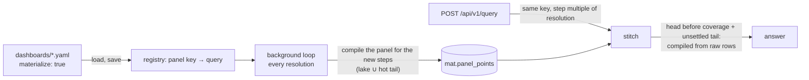

A dashboard panel with `materialize: true` keeps the points it computed. The node extends them
as data arrives, so a dashboard read computes only the steps that are not stored yet, and a
6-hour or 7-day panel stops re-reading every raw sample on each refresh. The answer stays
exactly what the raw query returns on the same grid.

```yaml
panels:
  - ui: { display: timeseries, unit: req/s, w: 6, h: 4 }
    materialize: true
    query:
      tqs: "3"
      id: rps
      kind: timeseries
      time: { from: "-6h" }
      queries:
        - { name: r, metric: http_requests_total, fn: { op: rate, window: 5m }, agg: { op: sum, by: [route] } }
```

The web UI marks such a panel with a **stored** badge.

## How it works



1. **Registration.** At start and on every dashboard save, each panel with `materialize: true`
   is registered under a key: its effective query (dashboard `vars` merged in) as canonical
   JSON, without `id`, `title` and `time`. The UI's copy of the query and the file's copy get
   the same key.
2. **Extension.** Every `materialize.resolution` (15 s by default), the background loop
   compiles each registered panel for the steps between its last stored step and the settle
   horizon, `now - materialize.settle` rounded down to the resolution, and stores the output
   points (after formulas, `having` and per-step `top`). It reads the same views as any query,
   so hot-tail rows are included. A panel seen for the first time starts at the horizon:
   there is **no backfill**. A node that was down catches up from where it stopped, at most
   11,000 steps per panel per tick.
3. **Reads.** A `timeseries` query whose key matches a registered panel and whose step is a
   multiple of the resolution is answered on the step-aligned grid inside `[from, to]`:
   stored points for the range they cover, the normal compiler for the head before the
   coverage and for the tail newer than the horizon. The response says so in `materialized`:

   ```json
   "materialized": { "panel": "shop/rps", "resolution_ms": 15000, "stored_points": 1440, "computed_steps": 21 }
   ```

4. **Forgetting.** A panel removed from its dashboard, or whose query changed, has a new key
   (or none). Its points are deleted on the next tick, and the new query starts at the
   horizon again.

The points live in a node-local DuckDB database, `materialize.path` (default
`./data/materialized.duckdb`), attached to the same DuckDB instance as the lake and the hot
tail, so a read takes stored and computed points in one transaction. It holds derived data
only: deleting it costs nothing but recomputation from the horizon.

## Why the answer is exact

A materialized point is the output of the same compiled query at the same timestamp. That
holds only for queries where **every output point depends only on its own timestamp**, which
`tqs::materialize_blocker` checks and dashboard validation enforces
(`panels[i].materialize` problem):

| Can be materialized | Cannot (and why) |
| :--- | :--- |
| `kind: timeseries` metric queries: every `fn` with an explicit window, `agg`, `then`, `derive`, `offset`, `having`, formulas, `top` with `rank: per_step` or `query` | `kind: table` (an instant query at `to`) and list kinds |
| | `fill: zero`: which steps are filled depends on which series appear in the range |
| | `top` with `rank: max`, `avg` or `last`: ranks over the whole range |
| | `$__range` or `$__interval` in a window or offset: change with the request |
| | spans and logs queries: their measures count per step bucket, so they change with the step |

Because a value at instant *t* does not depend on the step, points stored at the 15 s
resolution serve any step that is a multiple of it. The UI asks for a round default step for
its ranges (1 h → 15 s, 6 h → 2 min, 24 h → 5 min, 7 d → 1 h; see the [TQS
reference](tqs-reference.md)), so every range above 15 minutes reads from the store.

`crates/engine/tests/materialize.rs` proves it: for five panel shapes (a rate by job, a gauge
`max_over_time`, an error-ratio formula over two hidden queries, per-step `top`, `having`) and
four range/step pairs, including ranges that start before the coverage and every range ending
in the unsettled tail, the materialized answer equals the raw query on the same grid point by
point (relative 1e-9), over data with a counter reset and rows in both the lake and the hot
tail. The test fails if the grid filter or the computed head is removed (checked by mutation).

## Settle: the one trade-off

A step is stored once it is `materialize.settle` old (default 5 minutes). A sample that
arrives **later than settle after its own timestamp** (a sender buffering for longer, a
replayed backlog) is in the raw data but not in the steps already stored. Raw queries, and
the unsettled tail of every materialized read, still see it. Set `settle` to your senders'
worst delay; set it to `ingest.max_sample_age` (samples older than that are refused anyway)
to make stored steps final by construction, at the cost of computing that much of every read.

## Configuration

```yaml
materialize:
  path: ./data/materialized.duckdb   # empty: in memory, recomputed from the horizon after a restart
  resolution: 15s                    # stored step; reads with a step that is a multiple of it use the store
  settle: 5m                         # store a step once it is this old
```

Changing `resolution` changes every panel's key, so stored points are recomputed from the
horizon. Retention (`coordinator.retention`) deletes stored points older than the cutoff.

Self-metrics: `tiny_eye_materialized_points_total` (points stored) and
`tiny_eye_materialized_reads_total` (queries answered from the store).

## Benchmark

From `make bench` ([report](evidence/bench-local.md#materialized-panels)), on the benchmark's
6-hour data set: the six timeseries panels, read over 6 hours at the UI's default step
(2 min), raw against materialized, with every point compared.

| Panel | Raw p50 | Materialized p50 | Faster | Equal |
| :--- | ---: | ---: | ---: | :--- |
| `sum by (job) (rate(http_requests_total[5m]))` | 456 ms | 35 ms | 12.9× | yes |
| `topk(10, sum by (route) (rate(…[5m])))` | 447 ms | 34 ms | 13.2× | yes |
| error ratio formula (2 queries) | 499 ms | 45 ms | 11.1× | yes |
| `histogram_quantile(0.99, … by (job, le))` | 63 ms | 27 ms | 2.3× | yes |
| `max by (job) (gauge)` | 88 ms | 23 ms | 3.9× | yes |
| one series: `rate(…{instance="10.0.0.1:9100"})` | 21 ms | 20 ms | 1.1× | yes |

Each materialized read takes 178 to 1,780 stored points and computes 2 steps (the unsettled
tail). The panels that read the most raw data gain the most; a single series was already
cheap. Catching all six panels up over 6 hours took 8.0 s (once, by the benchmark; the
background loop never backfills), and one background tick, one new 15 s step for all six,
took 175 ms.

## Compared with the spec's design

The spec (section 9.1, D5, D6) designs mergeable **partials** per time bucket, fed from each
flush's envelope, so late rows, regions and percentiles merge with `SUM`. Phase 1 stores the
**finished points** of each panel at a fixed resolution instead: simpler, exact for every
shape above, and the same read path as raw queries, but it does not reflect samples later
than `settle`, does not merge across regions, and does not cover spans/logs measures.

Not built yet: the partials design (late rows, spans and logs measures, log-bucket
percentiles that merge across regions), alert rules on the same state, rollups, and backfill
of a panel's history. See [Limitations and roadmap](limitations-and-roadmap.md#materialized-panels).
