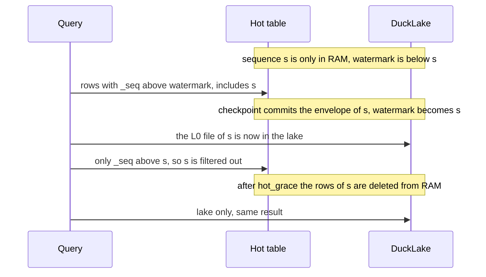

A query enters at `POST /api/v1/query` (handler `run_query`) and reaches `Node::query` in `crates/engine/src/query.rs`. The compiler lives in `crates/tqs/src/compile.rs`, the validator in `crates/tqs/src/lib.rs`, and the formula grammar in `crates/tqs/src/formula.rs`. The language itself is specified in the [TQS reference](tqs-reference.md). This page explains how it is executed and why the numbers equal Prometheus.

## From request to rows

1. `Node::parse_and_validate`: `Tqs::parse` (serde, `deny_unknown_fields`), then `validate(now_ms())`, which returns either the resolved times `(from_ms, to_ms, step_ms)` or every problem. Problems return without touching DuckDB.
2. `with_conn` borrows a pooled connection on a blocking thread, under the query timeout.
3. On that connection: `BEGIN TRANSACTION`, then `SELECT max(snapshot_id) FROM ducklake_snapshots('lake')`, then the compiled statement, then `COMMIT`.
4. Rows are shaped into the response. `timeseries` and `table` rows `(output, t, key, value)` arrive ordered by `output, key, t` and are folded into series. List kinds return rows of named text cells.

## Views: the lake plus the hot tail, counted once

The compiler reads four plain names: `metrics_series`, `metrics_points`, `spans`, `logs`. `Node::create_views` defines them in the in-memory database (`memory.main`):

```sql
CREATE OR REPLACE VIEW memory.main.<t> AS
  SELECT <columns> FROM lake.<t>
  UNION ALL
  SELECT <columns> FROM memory.main.hot_<t>
  WHERE _seq > (SELECT coalesce(max(seq_to), 0) FROM lake.applied_envelopes
                WHERE node_id = '<node.id>' AND node_epoch = <epoch>);
```

`metrics_series` wraps the union in `SELECT series_id, any_value(metric_name), any_value(metric_type), any_value(labels) ... GROUP BY series_id`, because one row is stored per (series, flush) and queries need one per series.

Why the watermark: a hot row whose sequence is committed is also in a lake file. A plain union would count it twice. The research's naive union double counted 60,000 rows (E7). The watermark is the highest `seq_to` this node, in this epoch, has in the catalog. Flushes commit sequences strictly in order ([Write path](write-path.md)), so every sequence at or below it is in the lake and every sequence above it is not. The subquery sits inside the view, so it is evaluated in the same transaction as the lake scan, against the same DuckLake snapshot. That is D8, "watermark read in the scan's catalog transaction".



A previous epoch's rows are never in the hot tables (WAL replay re-tags them with a new sequence), so filtering by the current epoch is enough. Test `ingest_flush_checkpoint_compact_retain` checks that the same `rate` value comes back in all four states: hot only, flushed but uncommitted, committed but still in RAM, and lake only. PoC P2 checks the same with row counts. The e2e run compares against Prometheus while the data is split across compacted files, an unapplied envelope and the hot tail ([e2e evidence](evidence/e2e.md)).

## One read transaction per query

Every TQS query runs between `BEGIN TRANSACTION` and `COMMIT` on its connection. DuckLake pins one snapshot for the transaction, so a query that reads several tables, or reads `applied_envelopes` through the watermark subquery, sees one consistent catalog state even while a checkpoint or compaction commits (spec section 7.1, E7). The response's `snapshot_id` is that snapshot. `freshness_s` is always `0.0`: the hot tail is local and part of every read, so a row is visible as soon as it is acknowledged.

The discovery endpoint (`Node::catalog`, `GET /api/v1/catalog`) does not open an explicit transaction. Its statements are independent and bounded: at most 500 metrics with their label keys and up to 50 values per label, plus services with up to 50 span names and their log line counts over the last 24 hours.

## Connection pool, timeout and interrupt

`Node::open` clones `query.workers` (default 4) connections from the root connection and guards them with a semaphore of the same size. `with_conn(f)`:

1. Sets one deadline, now + `query.timeout` (default 30 s), for the whole query. It acquires a semaphore permit (an owned permit) under that deadline and pops a connection. If no connection frees up in time, the query fails with "no query connection free within the N ms timeout".
2. Puts the connection's `interrupt_handle()` in a slot shared by the caller and the job, and arms a drop guard (`InterruptOnDrop`) on the awaiting future.
3. Spawns a blocking job that wraps connection, pool, slot and permit in a `Lease` and runs `f`.
4. Awaits the job until the same deadline, so the job gets only the time the pool wait left over. On timeout it returns "query exceeded the N ms timeout". Dropping the future fires the guard, which calls `interrupt()`, so DuckDB aborts the running statement.

The guard also fires when the HTTP client goes away. A disconnect drops the awaiting future but not the blocking job, so without the guard an abandoned query would keep running with no limit and hold its connection. `Lease::drop` first takes the interrupt handle out of the slot, so an interrupt that arrives late can never hit the next query on that connection. Then it runs `ROLLBACK`, because an interrupt or panic can leave a transaction open, and pushes the connection back. The permit is released after that. The connection always comes back, whether the job finished, was interrupted or panicked. Tests: `abandoned_queries_return_their_connection` aborts four queries on a two-connection pool and then runs four more (review finding 2). `abandoned_queries_are_interrupted` abandons a statement that would run for minutes and gets the single connection back at once. `pool_wait_and_run_share_one_deadline` checks that a query that waited for the pool is interrupted at the deadline, not a full timeout later.

Under saturation a request fails once `query.timeout` has passed since it arrived, whether it was waiting or running. DuckDB's own parallelism per statement is `duckdb.threads`, shared by all connections of the database, within `duckdb.memory_limit`.

## Validation

`Tqs::validate` collects every problem, each with a `code`, a JSON `path` (`queries[1].match[0].value`) and a message (spec section 8.12). An agent can fix all of them in one round trip. A JSON shape error (unknown field, bad enum) is the single exception: serde stops at the first one and returns code `schema` at path `$`.

Limits enforced here (spec section 11): 1 to 10 queries, at most 11,000 points per series for `timeseries`, regexes of at most 256 characters that must compile, formulas of at most 512 characters and 128 AST nodes, `in` lists of 1 to 100 values, `limit` 1 to 5,000, `top.n` 1 to 1,000, variable names matching `^[a-z][a-z0-9_]{0,31}$` with values of at most 256 characters. The default step is `range / 300`, rounded up to a whole second and at least 1 s. Label names must match `^[a-zA-Z_][a-zA-Z0-9_]*$`, metric names `^[a-zA-Z_:][a-zA-Z0-9_:]*$`, and fields must come from fixed lists (`SPAN_FIELDS`, `LOG_FIELDS`, `TRACE_FIELDS`, the group-field lists) or match `attr.*` / `resource.*`.

## Compilation rules

The compiler's one security rule (spec section 7.1, `CLAUDE.md`): every string that comes from the query is a bound parameter. `Sql::bind` appends to a parameter list and returns `$n`. Bound values include metric names, matcher values, regexes, derive regexes and replacements, attribute keys, condition values and trace ids. Only values the validator has reduced to a safe form are formatted into the SQL text: epoch milliseconds, durations, steps, `having` thresholds, `q` values, `top.n`, `limit`, query names, and label and field names checked against the grammars above. Label names go through `lit()`, which also escapes quotes. Cases A1 and A2 show that SQL-looking values return 0 rows and leave the tables intact.

A `timeseries` or `table` document compiles to one statement:

```sql
WITH q_<name> AS (<per-query CTE>),        -- one per query
     f_<name> AS (<zero-filled grid>),     -- queries with fill: zero
     q_<formula> AS (<formula join>)       -- one per formula, in order
SELECT '<name>' AS output, * FROM (<top applied to the output>)
UNION ALL ...                               -- one branch per non-hidden output
ORDER BY output, key, t
```

`compile::timeseries_sql` returns the text and parameters. `compile::run` executes them, and `crates/server/tests/profile.rs` uses the same function for `EXPLAIN ANALYZE`.

## Metric queries

`metrics_cte` builds this pipeline for one named query:

| CTE | Content |
| --- | --- |
| `sel` | `SELECT series_id, labels FROM metrics_series WHERE metric_name = $1 AND <matchers>` |
| `pts` | Points of the selected series with `timestamp_ms` in `(start - offset - window, end - offset]`, plus `lag(value)` and `lag(timestamp_ms)` per series. Staleness markers are excluded except for `last` |
| `grid` | `generate_series(from, to, step)`. A `table` query has the single step `to` |
| `per` | Per (step, series) window statistics: `n`, first sample `t1`/`v1`, last sample `t2`/`v2`/`st2`, reset correction `corr`, `nresets`, `nchanges`, the sample before the last (`pv_last`, `pt_last`), and for the `*_over_time` aggregates `a`, `mn`, `mx`, `s` |
| `ex`, `ex2` | Extrapolation inputs: `sampled`, `avgd`, `ds0`/`ds1`, `de0` |
| `ser` | The function value per (step, series), with `derive` applied to the labels |
| `out` | Aggregation into keys, or `absent`, or `histogram_quantile` |

The CTE ends with `SELECT t, key, value FROM out WHERE value IS NOT NULL`. A step with no value is simply absent: no point, not zero.

**Matchers.** The label value is `coalesce(map_extract_value(labels, '<label>'), '')`, so an absent label equals `""` (Prometheus semantics, R10). `=~` and `!~` use `regexp_full_match`, which anchors the regex at both ends like PromQL. Validation compiles regexes with Rust's `regex` crate, and DuckDB runs them with RE2. Both use the same RE2-style syntax.

**Windows.** The point at `t` reads samples in `(t - offset - window, t - offset]`, open on the left (mutant `closed_window` turns 30 cases red). `last` has no window. It uses the fixed 5-minute lookback `LOOKBACK_MS = 300000` (mutant `lookback_4m`).

### Functions

| `fn.op` | SQL value (from `per` / `ex2`) |
| --- | --- |
| `rate` | Extrapolated counter increase divided by the window in seconds |
| `increase` | Extrapolated counter increase |
| `delta` | Extrapolated `v2 - v1`, with no reset correction and no zero-crossing limit |
| `irate` | From the last two samples, both inside the window: `(v2 < pv_last ? v2 : v2 - pv_last) / ((t2 - pt_last) / 1000)` |
| `resets`, `changes` | `nresets`, `nchanges` |
| `last` | `v2`, or no value when the latest sample is a staleness marker (`st2`) |
| `last_over_time` | `v2` |
| `count_over_time` | `n` |
| `avg/min/max/sum_over_time` | `a`, `mn`, `mx`, `s` |
| `histogram_quantile` | See below |

**Extrapolation** reproduces Prometheus 3's `extrapolatedRate`. With `n` samples in the window (at least 2, otherwise no point):

```text
result  = v2 - v1 + corr                 (rate, increase, histogram buckets)   |  v2 - v1   (delta)
sampled = (t2 - t1) seconds;  avgd = sampled / (n - 1)
ds0     = t1 - window start;  ds1 = avgd / 2 if ds0 >= 1.1 * avgd else ds0
          counters only: if result > 0 and v1 >= 0, ds1 = min(ds1, sampled * v1 / result)   -- stop at the zero crossing
de0     = window end - t2;    de1 = avgd / 2 if de0 >= 1.1 * avgd else de0
value   = result * (sampled + ds1 + de1) / sampled    [ / window seconds, for rate ]
```

A window shorter than the scrape interval therefore yields no points, exactly as in Prometheus (M31). Mutant `no_extrapolation` turns 22 cases red.

**Reset correction.** Whenever a sample is lower than its predecessor (and the predecessor is not NaN), the predecessor's value is added back. Only resets where both samples lie inside the window count, so a drop from a sample before the window start is ignored. Mutant `no_reset_correction` turns 16 cases red.

**Staleness.** Receivers store Prometheus' staleness NaN (`0x7ff0000000000002`) as `value = NaN, is_stale = true`. Range functions filter staleness markers out in `pts`. `last` keeps them, so a series whose latest sample is a marker ends immediately instead of lingering for 5 minutes (W07, M10).

### Fast path and join path

`per_cte` has two implementations of the same statistics.

**Fast path**, used by every function except `avg/min/max/sum_over_time`:

1. `cum`: one running window per series over `pts` gives each sample a row number `i` and cumulative sums of the reset correction, the reset count and the change count.
2. `gs`: the grid crossed with the distinct series.
3. `lastp`: `gs ASOF JOIN cum ON series_id AND c.ts <= t - offset`, the last sample at or before the window end.
4. `firstp`: `gs ASOF JOIN cum ON series_id AND c.ts > t - offset - window`, the first sample after the window start.
5. `per`: `n = l.i - f.i + 1`, `corr = l.c_corr - f.c_corr`, and so on, keeping only windows with `l.i >= f.i`.

The cost is one pass over the samples plus two ASOF probes per (series, step): O(series × steps).

**Join path**, used by `avg_over_time`, `min_over_time`, `max_over_time`, `sum_over_time`: `grid JOIN pts ON p.ts > t - o - w AND p.ts <= t - o`, then `GROUP BY t, series_id` with `count`, `arg_min`/`arg_max`, `FILTER` clauses and `avg/min/max/sum`. The cost is O(series × steps × samples per window). Min and max cannot be derived from running sums. A sum or average computed as the difference of two large running sums loses precision through cancellation, and the conformance suite demands 1e-9 relative equality.

The change from join path to fast path for the rate family is what took the 6-hour `sum by (job) (rate(...[5m]))` panel from about 3.7 s to 0.58 s ([Performance](performance.md)).

### `histogram_quantile`

The query reads `<metric>_bucket`, computes each bucket series' extrapolated `rate`, and then:

1. `hb`: sums rates per (step, key without `le`, `le`). `le = '+Inf'` becomes infinity, and an unparsable `le` is dropped.
2. `hm`: a running `max` over increasing `le` makes the cumulative counts monotonic (Prometheus' monotonicity fix).
3. `hl`/`hq`: `total` is the `+Inf` bucket's count. The target rank is `q * total`. `b` is the first finite bucket whose count reaches it, with the previous bound `ple` and count `pc`.
4. `out`: no value if `total` is missing or 0, or if there are fewer than 2 buckets. If the rank falls in the `+Inf` bucket, the result is the highest finite bound. For the first bucket with `le <= 0`, it is `le`. For the first bucket, it is `le * rank / c`. Otherwise it is the linear interpolation `ple + (le - ple) * (rank - pc) / (c - pc)`.

Mutant `hist_upper_bound` (no interpolation) turns 4 cases red. M06 to M08 cover the `+Inf` edge and a histogram reset.

### Grouping, `then`, `having`, `derive`, `absent`

- **Key.** A result series is identified by a canonical label string. `agg.by` gives the listed labels (sorted, deduplicated) as `k=v`, comma-joined, with empty values omitted. `agg.without` gives every label except the listed ones. `agg` with neither gives `''`, a single series. No `agg` gives the full label set, so every series stays separate (spec section 8.7). `Node::query` splits the key back into a `labels` map, which is ambiguous only for values containing `,`. The key itself stays exact.
- **Aggregation.** `sum`, `avg`, `min`, `max` of the per-series values. `count` counts series with a value. Without `agg` the value is `any_value` per key.
- **`then`.** The first aggregation also carries `lbl`, a map of its grouping labels. `then` regroups those rows by `then.by` (a subset of `agg.by`) with its own op. This is PromQL `sum by (a) (max by (a, b) (...))`.
- **`having`.** Filters the values against a number. With `then`, it filters the first aggregation before `then` runs (needed for `count(count by (a) (... > 0))`). Without `then`, it wraps the query's result.
- **`derive`.** PromQL `label_replace`, applied in order before aggregation. When the regex fully matches the source label, `map_concat` sets the target to `regexp_replace(src, '^(?:re)$', replacement)`, with `$1` to `$9` rewritten to DuckDB's `\1` to `\9`. Otherwise the map is unchanged.
- **`absent`.** Emits `1.0` at every grid step where `ser` has no value, labelled with the query's `=` matchers. This is PromQL `absent()`.
- **`offset`.** A positive duration subtracted from every window.

### `fill: zero`

A query with `fill: zero` gets an extra CTE `f_<name>`: the grid crossed with the keys, `LEFT JOIN q_<name>`, `coalesce(value, 0)`. For a query that aggregates to one series, the key set is `''` even when nothing matched, so it emits 0 everywhere (PromQL `x or vector(0)`). For a grouped query the keys are those seen anywhere in the range. In formulas, a zero-filled operand joins through `f_<name>`, so its empty steps exist (D1 is the documented divergence from PromQL).

### Formulas

`formula.rs` parses `expr` into an AST (grammar in its header: `+ - * /`, unary minus, parentheses, numbers, names, and `abs`, `round`, `least`, `greatest`, `clamp`, `coalesce`). SQL is emitted from the AST, never from the text. Names are queries, earlier formulas, and `time`, the evaluation time in seconds (`t / 1000.0`).

Joining (`timeseries_sql`):

- Vector operands that are neither zero-filled nor in an `outer` formula are **inner**-joined `USING (t, key)`. A point exists only where all of them have one.
- With `join: "outer"`, or for zero-filled operands, the base is the `UNION` of their `(t, key)` pairs and each operand is `LEFT JOIN`ed. A missing operand is `NULL` (or 0 when zero-filled), so `coalesce(a, b * 0)` is PromQL `a or b * 0`.
- Scalar operands (queries that aggregate to one series) join `USING (t)` and broadcast to every key.
- Division is `CASE WHEN r = 0 THEN NULL ELSE l / r END`. The output keeps only `value IS NOT NULL`, so x/0 is a gap, not ±Inf or NaN (D2, mutant `division_ieee`).

Validation refuses formulas whose vector operands are grouped differently (`formula_join`), and formulas over two ungrouped per-series queries of different metrics.

### `top`

`top` applies to every returned output:

- `rank: per_step` (default): `QUALIFY row_number() OVER (PARTITION BY t ORDER BY value <dir>, key) <= n`, which is PromQL `topk`/`bottomk`.
- `rank: max | avg | last`: picks `n` keys for the whole range by `max(value)`, `avg(value)` or `arg_max(value, t)`, then keeps their points.
- `top.query`: a semi-join on the per-step top `n` keys of another, usually hidden, query. This is PromQL `x and on(k) topk(n, y)`.

## Spans and logs as time series

`events_cte` turns a `spans` or `logs` query into `(t, key, value)`:

```sql
WITH ev AS (SELECT <ts in ms> AS ts, <key> AS key, * FROM spans
            WHERE <conditions> AND ts > <from - width> AND ts <= <to>),
     grid AS (SELECT unnest(generate_series(from, to, step)) AS t)
SELECT g.t, ev.key, <measure> AS value
FROM grid g JOIN ev ON ev.ts > g.t - <width> AND ev.ts <= g.t
GROUP BY g.t, ev.key
```

The point at `t` covers events whose timestamp (span start, log time) is in `(t - step, t]`. A `table` query uses one bucket `(from, to]` (mutant `bucket_closed_left`). Measures: `count`, `rate` (count per second of bucket width), `quantile` (`quantile_cont` on `duration_ms`, exact, the R-7 definition), `avg`/`min`/`max`/`sum` of `duration_ms`. Conditions map fields to columns: `attr.<k>` to `map_extract_value(span_attrs|log_attrs, $n)`, `resource.<k>` to `resource_attrs`, `duration_ms` to `duration_ns / 1e6`, and `trace_id` to `lower(hex(trace_id))`. Note that this `trace_id` comparison cannot use pruning (see the waterfall below). Grouping uses the validated group fields or bound attribute keys.

## List kinds

`compile::run_list` builds one statement per kind and returns text cells:

| Kind | Shape of the SQL |
| --- | --- |
| `trace` | `WITH RECURSIVE s AS (SELECT * FROM spans WHERE trace_id = unhex($1) [AND start in (from, to]])`, a recursive `tree` from roots (no parent, or parent not in the trace) down to depth 64, child durations per parent for `self_ms`, and offsets from the trace's first start. Orphans (parent missing) are drawn at depth 0 and flagged. Ordered by start, then depth |
| `trace_search` | Spans with start in `(from, to]`, grouped per `trace_id`: start, duration (max end minus min start), span count, `has_error` (`status_code = 2`), root service and span (earliest parentless span), the services list, and `matched = bool_or(<all span conditions>)`. Then the trace conditions, order `duration_desc` (default) or `start_desc`, and `LIMIT` |
| `log_search` | Conditions plus `(from, to]`, then `ORDER BY timestamp_ns DESC, body LIMIT n` (or `ASC` with `order: asc`) |
| `log_patterns` | `GROUP BY pattern_hash` with `count(*)`, `min(body)` as the example and the services, `ORDER BY n DESC LIMIT n` |

The waterfall compares `trace_id = unhex(...)` instead of `lower(hex(trace_id)) = ...` on purpose. A predicate on the raw column lets DuckDB skip files by min/max statistics and row groups by the bloom filter (E4). A function wrapped around the column would force every row group to be read. The spec's rule that a lookup always carries a time range (default ±1 h, section 7.2) is not enforced. A `trace` document without `time` checks every span file's footer and bloom filter, which is cheap after compaction ([Performance](performance.md)).

For list kinds, `rows_total` is the number of rows returned. `truncated` is true when that equals `limit` (default 100). It is never set for `trace`, which has no limit.

## What proves it

| Evidence | Result |
| --- | --- |
| `make conformance` ([TQS coverage](evidence/tqs-coverage.md)) | 104/104 cases: M01 to M33 equal to Prometheus 3.16 point by point (1e-9 relative), D1 to D2 deliberate divergences, the real-board R cases, S1 to S6 and L1 to L5 and T1 to T3 against an independent Rust computation, V01 to V36 validation codes, A1 to A2 injection |
| Mutation check (same suite) | 15/15 mutants (`MUTANTS` in `lib.rs`) each turn at least one case red. Eight rules are guarded by a single case, so do not remove those cases |
| `make e2e` ([e2e](evidence/e2e.md)) | 20/20 panels equal to Prometheus on remote-written data spread across compacted files, an unapplied envelope and the hot tail |
| PoC P5 `p5_tqs_on_lake_views` | The compiler runs unchanged on DuckLake-backed views |
| `crates/engine/tests/node.rs` | Hot, flushed, committed and lake-only states give the same value. Spans, logs, waterfall, patterns and the catalog round-trip through the lake |

See [Testing and evidence](testing-and-evidence.md) for how the suites are built and run.
