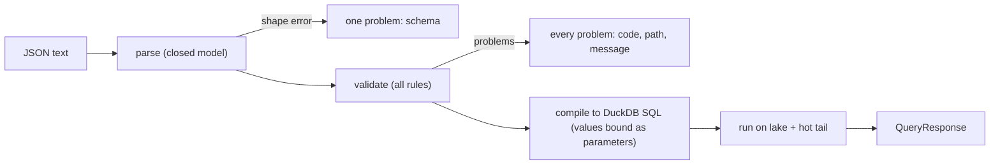

TQS 3 is the only query interface of tiny-eye. The HTTP API (`POST /api/v1/query`), dashboards and the MCP tools all take the same JSON document. This page describes the language **as implemented** in `crates/tqs` (`lib.rs` for the model and validator, `compile.rs` for the SQL compiler, `formula.rs` for formulas). Where the implementation differs from the specification (`research/spec/Observability Engine Spec.md` §8), this page follows the code and says so in a note.

For worked examples, see the [query cookbook](../examples/query-cookbook.md). For the JSON Schema that editors use, see [editor grammars](../reference/editor-grammars.md).

## How a document is processed



1. **Parse.** The Rust model refuses unknown fields, wrong types and unknown enum values. A shape error stops here and returns exactly one `schema` problem with path `$` and the parser's message.
2. **Validate.** Every cross-field rule is checked and **every** problem is returned at once, so a client or agent can fix all of them in one round trip.
3. **Compile.** The document becomes one DuckDB SQL statement. Every string from the document is a bound parameter; only validated identifiers and numbers the validator produced are formatted into the SQL text.
4. **Run.** The statement runs on a pooled connection inside one read transaction over the lake and the in-memory hot tail, with the configured `query.timeout`.

:::note
The runtime validator is the Rust model, not the JSON Schema in `api/openapi.yaml`. The two are kept in agreement by `crates/server/tests/openapi.rs` (see [API and code generation](api-and-codegen.md)), but a few string fields that the JSON Schema restricts with an `enum` are plain strings in the Rust model. Those cases are called out below.
:::

## Document

| Field | Type | Required | Notes |
| :--- | :--- | :--- | :--- |
| `tqs` | `"3"` | yes | Any other value gives `version`. |
| `id` | string matching `^[a-z][a-z0-9_-]{0,31}$` | yes | Echoed in the response. Bad value gives `id`. |
| `title` | string | no | Display only; the engine never reads it. |
| `kind` | `timeseries`, `table`, `trace_search`, `trace`, `log_search`, `log_patterns` | yes | Selects which other fields are read. |
| `time` | object, see [Time](#time) | yes, except for `trace` | Missing gives `time`. |
| `vars` | object, name to string | no | See [Variables](#variables). |
| `queries` | array of 1 to 10 named queries | for `timeseries` and `table` | See [Metrics queries](#metrics-queries) and [Spans and logs queries](#spans-and-logs-queries). |
| `formulas` | array | no | `timeseries` and `table` only. See [Formulas](#formulas). |
| `top` | object | no | `timeseries` and `table` only. See [Top](#top). |
| `search` | object | for list kinds | See [List kinds](#list-kinds). |
| `trace_id` | 32 lowercase hex characters | for `trace` | Bad or missing gives `trace_id`. |
| `limit` | integer 1 to 5000 | no | List kinds; default 100. |

Fields that do not apply to a kind are ignored, not refused. For example, `queries` on a `log_search` document is parsed but never validated or run.

## Time

| Field | Value | Default |
| :--- | :--- | :--- |
| `from` | epoch milliseconds (integer), `"now"`, or `"-<duration>"` such as `"-2h"` (relative to now) | required |
| `to` | same forms as `from` | `"now"` |
| `step` | positive duration: a whole number followed by `ms`, `s`, `m`, `h`, `d` or `w` | the smallest round step giving at most about 300 points: 1s, 2s, 5s, 10s, 15s, 30s, 1m, 2m, 3m, 5m, 10m, 15m, 30m, 1h, 2h, 3h, 6h, 12h, 1d, 2d, 1w (1h → 15s, 6h → 2m, 12h → 3m, 24h → 5m, 7d → 1h) |

Rules:

- `from` must be before `to` (`time_order`). A `table` document may have `from` equal to `to`.
- Every time point must resolve to between 1970 and 9999 (epoch ms `0` to `253402300799999`), and every duration (`step`, `window`, `offset`, `-<duration>`) is at most that many milliseconds. Larger values are refused (`time`, `step`, `window`, `offset`) rather than overflowing.
- A `timeseries` document may have at most **11,000 points per series**: `(to - from) / step + 1 <= 11000`. More gives `too_many_points` at `time.step`.
- `timeseries` evaluates at `from, from + step, ...` up to `to`.
- `table` evaluates once, at `to`. Metrics functions read their window ending at `to`; spans and logs aggregate over `(from, to]`.
- `trace` does not need `time`. When it is given, it bounds the lookup to spans that start in `(from, to]`.

:::note Implementation differs from the spec
The JSON Schema allows `step` to be a variable (`"$name"`, `"$__interval"`). The validator does not resolve variables in `step`, so a variable there gives `step`. Use a literal duration.
:::

## Variables

`vars` maps names to string values, for example `{"namespace": "ns-a"}`. A string value written as `"$name"` is replaced by the variable's value and bound as a parameter.

- Variable names match `^[a-z][a-z0-9_]{0,31}$`, may not start with `__`, and values are at most 256 characters. Otherwise: `var`.
- Where substitution happens: metric matcher values (`match[].value`), spans/logs query condition values, and `fn.window`.
- An undefined `"$name"` in a matcher value or condition value gives `var`; in `fn.window` it gives `window`.
- A regex matcher or condition (`=~`, `!~`) whose value is a variable is checked as the regex the variable resolves to.
- To write a literal value that starts with `$`, double the dollar: `"$$HOME"` is the text `$HOME`, not a variable. Only a leading `$` is special (`"a$b"` is literal). The rule is one function (`resolve_var`), so it applies wherever variables do: matcher values, condition values and `fn.window`. `search.trace` values are never resolved, so `$` there is always literal.

Built-in variables (not definable by users):

| Name | Value |
| :--- | :--- |
| `$__range` | `to - from`, as a duration (usable as a window) |
| `$__interval` | the resolved `step`, as a duration |

`$__rate_interval` is not provided (spec question Q15).

:::note Implementation differs from the spec
Variables are substituted in `timeseries` and `table` queries and in the `search.spans` / `search.logs` conditions of list kinds (an undefined `$name` there is refused with `var`). `search.trace` values are compared literally. `offset` and `step` do not accept variables (they give `offset` and `step`).
:::

Dashboards pass their `vars` as defaults: a panel's own `vars` win, and the dashboard values fill in the rest when the panel is validated or run. See [Dashboards and the web UI](dashboards-and-ui.md).

## Metrics queries

A metrics query has `name`, `metric`, `fn`, and optional `match`, `agg`, `then`, `derive`, `offset`, `having`, `fill` and `hidden`.

```json
{ "name": "err", "metric": "http_requests_total",
  "match": [ { "label": "code", "op": "=~", "value": "5.." },
             { "label": "namespace", "op": "=", "value": "$namespace" } ],
  "fn": { "op": "rate", "window": "5m" },
  "agg": { "op": "sum", "by": ["service"] },
  "having": { "op": ">", "value": 0 }, "fill": "zero" }
```

Common query rules:

- `name` matches `^[a-z][a-z0-9_]{0,31}$`, is unique in the document, and is not `time` (`name`).
- Exactly one of `metric`, `spans`, `logs` is set (`source`).
- `metric` matches `^[a-zA-Z_:][a-zA-Z0-9_:]*$` (`metric`).

### Selection: `match`

| Field | Rule |
| :--- | :--- |
| `label` | `^[a-zA-Z_][a-zA-Z0-9_]*$` (`label`) |
| `op` | `=`, `!=`, `=~`, `!~` (`op`) |
| `value` | any string, or `"$name"` |

- Regexes are RE2, **fully anchored** (PromQL semantics), at most 256 characters (`regex`).
- An absent label equals `""`, so `{"label": "queue", "op": "!=", "value": ""}` keeps only series that have the label.
- Values may contain any character, quotes included; they are bound, never spliced into SQL.

### Functions: `fn`

`fn` is required on every metrics query (`fn`). Use `{"op": "last"}` for the latest value.

The point at time `t` reads samples in the left-open window `(t - offset - window, t - offset]`. A function that needs two samples returns no point with fewer, so a window shorter than the scrape interval gives an empty result, as in Prometheus.

| `fn.op` | Window | Semantics |
| :--- | :--- | :--- |
| `rate` | required | Per-second increase with counter-reset correction and Prometheus `extrapolatedRate` boundary extrapolation (including the zero-point clamp for counters). |
| `increase` | required | Same as `rate` without dividing by the window: `rate x window`. |
| `irate` | required | From the last two samples in the window; a decrease between them counts the last value as the increase. |
| `delta` | required | Last minus first, extrapolated, no reset correction (for gauges). |
| `resets` | required | Number of decreases between consecutive samples in the window. |
| `changes` | required | Number of value changes between consecutive samples in the window. |
| `last` | **must not** be set (`window`) | Latest sample in a fixed 5-minute lookback. A staleness marker as the latest sample ends the series. |
| `last_over_time` | required | Latest sample in the window. |
| `avg_over_time` | required | Mean of the samples in the window. |
| `min_over_time` | required | Minimum in the window. |
| `max_over_time` | required | Maximum in the window. |
| `sum_over_time` | required | Sum of the samples in the window. |
| `count_over_time` | required | Number of samples in the window. |
| `histogram_quantile` | required | See below. Needs `q` in `[0, 1]` (`q`). |

- `window` is a positive duration, or a variable that resolves to one (`window`).
- `q` is allowed only with `histogram_quantile` (`q`).
- Range functions never see Prometheus staleness markers; only `last` uses them.

**`histogram_quantile`** reads `<metric>_bucket`, computes the reset-corrected, extrapolated rate per bucket series over the window, sums per group and `le` (the `le` label is never part of the result key), makes the bucket counts monotonic, and interpolates linearly inside the bucket that holds the quantile (Prometheus `BucketQuantile`):

- quantile in the `+Inf` bucket: the highest finite bound;
- fewer than two buckets, or a total of 0: no value;
- the first bucket interpolates from 0 (or returns its bound when the bound is `<= 0`).

:::note Implementation detail
For `histogram_quantile` the per-bucket aggregation is always a sum; `agg.op` is still required when `agg` is present but does not change the result. `then` is refused on a `histogram_quantile` query (`then`); `having` without `then` filters the quantiles.
:::

### Aggregation: `agg`

| Field | Values |
| :--- | :--- |
| `op` | `sum`, `avg`, `min`, `max`, `count` (series with a value), `absent`. Required for metrics (`agg`). |
| `by` | list of label names to keep |
| `without` | list of label names to drop |

- `by` and `without` are exclusive (`agg`). Every label must match the label-name grammar (`label`).
- With neither `by` nor `without`, everything collapses into one series (key `""`).
- Without `agg`, each series is kept; its key is all of its non-empty labels.
- `absent` returns `1` at every step where the selection has no series with a value. The result is labelled with the query's `=` matchers (PromQL `absent`). `absent` takes no `by`, `without` or `then` (`agg`).

### Second aggregation: `then`

`then` aggregates the groups produced by `agg` (after `having`). PromQL `sum by (queue) (max by (queue, workspace) (m))` is:

```json
"agg": { "op": "max", "by": ["queue", "workspace"] }, "then": { "op": "sum", "by": ["queue"] }
```

Rules (`then`): `agg` must be present; `then.op` is required and is not `absent`; `then.without` is not allowed; when `agg.by` is set, every `then.by` label must be in it; not on `histogram_quantile`.

### Derived labels: `derive`

PromQL `label_replace`, applied in order before aggregation:

```json
"derive": [ { "label": "role", "from": "pod", "regex": "(api|worker)-.*", "replacement": "$1" } ]
```

When `regex` fully matches the value of `from`, `label` is set to `replacement` with `$1` to `$9` expanded; otherwise the labels are unchanged.

- `label` and `from` are label names (`label`); `regex` is RE2, at most 256 characters (`regex`).
- `replacement` is literal text with `$1` to `$9` only: no backslash, no `${...}` or `$name`, at most 256 characters (`derive`).

### `offset`, `having`, `fill`, `hidden`

| Field | Semantics |
| :--- | :--- |
| `offset` | Positive duration that shifts the window into the past (`offset` if invalid). |
| `having` | `{op, value}` with `op` in `=`, `!=`, `>`, `>=`, `<`, `<=` and a finite number (`having`). Keeps the points that satisfy it. With `then`, it filters the first aggregation; otherwise it filters the query's result. |
| `fill` | `none` (default) or `zero`. See below. |
| `hidden` | `true` computes the query (for formulas or `top.query`) but does not return it. |

`fill: "zero"` has two forms:

- a query that aggregates to **one series** emits `0` at every step without a value, even when nothing matched (PromQL `x or vector(0)`);
- a **grouped** query fills `0` at the missing steps of the keys it has seen, and as a formula operand a missing key counts as `0`.

## Spans and logs queries

A spans or logs query has `name`, a list of conditions in `spans` or `logs`, a `measure`, and optional `agg` (with `by` only), `having`, `fill` and `hidden`.

```json
{ "name": "e", "spans": [ { "field": "status_code", "op": "=", "value": 2 } ],
  "measure": { "op": "count" }, "agg": { "by": ["service_name"] }, "fill": "zero" }
```

`fn`, `match` (`fn`), `then` and `derive` (`then`) are refused on spans/logs queries. `agg` takes only `by`; `agg.op` or `agg.without` gives `agg`.

### Fields

| Signal | Fields | Numeric fields |
| :--- | :--- | :--- |
| spans | `service_name`, `span_name`, `span_kind`, `status_code`, `duration_ms`, `region`, `trace_id`, `attr.<key>`, `resource.<key>` | `span_kind`, `status_code`, `duration_ms` |
| logs | `service_name`, `severity_number`, `severity_text`, `body`, `pattern_hash`, `trace_id`, `region`, `attr.<key>`, `resource.<key>` | `severity_number`, `pattern_hash` |

- `attr.<key>` reads span attributes (spans) or log attributes (logs); `resource.<key>` reads resource attributes. The key matches `[A-Za-z_][A-Za-z0-9_.\-/:]{0,127}` and is bound as a parameter.
- `duration_ms` is the span duration in milliseconds. `trace_id` compares as 32 lowercase hex characters.
- An unknown field gives `field`.

### Condition operators

| Op | Applies to | Value |
| :--- | :--- | :--- |
| `=`, `!=` | numeric fields | number |
| `=`, `!=` | text fields | string or boolean (a boolean is compared as the text `true`/`false`) |
| `>`, `>=`, `<`, `<=` | numeric fields only | number |
| `=~`, `!~` | text fields | RE2 regex, fully anchored, at most 256 characters; a missing value matches as `""` |
| `contains` | text fields | substring |
| `in` | any field | array of 1 to 100 values, all numbers (numeric field) or all strings (text field) |
| `exists` | `attr.*` and `resource.*` only | `true` or `false` |

Any other combination, such as a numeric comparison on a text field, gives `cond`. `attr.*` and `resource.*` are text fields, so they cannot be compared numerically.

### Measures

| `measure.op` | Spans | Logs | Value |
| :--- | :--- | :--- | :--- |
| `count` | yes | yes | number of events in the bucket |
| `rate` | yes | yes | count divided by the bucket width in seconds |
| `quantile` | yes, needs `field: "duration_ms"` and `q` in `[0, 1]` | no | exact continuous quantile of `duration_ms` |
| `avg`, `min`, `max`, `sum` | yes, need `field: "duration_ms"` | no | over `duration_ms` |

`measure` is required (`measure`); the only allowed `field` is `duration_ms`, and only on spans (`measure`). `q` belongs to `quantile` only (`q`).

### Bucketing

- `timeseries`: the point at `t` covers events whose timestamp is in `(t - step, t]`. Spans are bucketed by **start time**, logs by their timestamp.
- `table`: one bucket covering `(from, to]`, reported at `to`.
- A bucket with no events has no point, unless `fill: "zero"`.

### Groupable fields

`agg.by` on spans/logs accepts these fields plus any `attr.<key>` or `resource.<key>`; anything else gives `label`:

| Signal | Groupable fields (`SPAN_GROUP_FIELDS` / `LOG_GROUP_FIELDS`) |
| :--- | :--- |
| spans | `service_name`, `span_name`, `span_kind`, `status_code`, `region` |
| logs | `service_name`, `severity_number`, `severity_text`, `pattern_hash`, `region` |

`duration_ms`, `trace_id` and `body` cannot be grouped on. Without `agg.by`, all matching events form one series with key `""`.

:::note Implementation differs from the spec
`offset` is validated on spans/logs queries but not applied: the buckets are never shifted.
:::

## Grouping keys

Each result series is identified by its key: the grouped labels as `k=v`, sorted by label name, comma-joined, with empty values omitted. A single series has the key `""`. The response returns the key and, next to it, a `labels` map parsed from the key.

:::warning
`labels` is parsed back from the key, so a label value that contains `,` is split ambiguously. The `key` itself is exact.
:::

## Formulas

```json
"formulas": [ { "name": "pct", "expr": "100 * least(e / greatest(a, 1), 1)" },
              { "name": "depth", "expr": "coalesce(a, b * 0, c * 0)", "join": "outer" } ]
```

### Grammar

The grammar is closed. The expression is parsed to an AST, and SQL is generated from the AST; the expression text never reaches SQL.

```ebnf
expr  = term  { ("+" | "-") term } ;
term  = unary { ("*" | "/") unary } ;
unary = "-" unary | atom ;
atom  = number | name | "(" expr ")" | func "(" expr { "," expr } ")" ;
func  = abs | round | least | greatest | clamp | coalesce ;
```

- **Numbers:** digits with an optional fraction and exponent (`1.5e3`); must be finite.
- **Names:** lowercase identifiers `[a-z][a-z0-9_]*` naming a query, an **earlier** formula, or `time`.
- **Operators:** `+`, `-`, `*`, `/`, unary `-`, parentheses. Any other character is an error.
- **Size:** at most 512 characters and 128 AST nodes.
- A formula must reference at least one query; `time` alone is refused (`formula`).

| Function | Arguments | Meaning |
| :--- | :--- | :--- |
| `abs(x)` | 1 | absolute value |
| `round(x)` | 1 | round to the nearest integer |
| `least(a, b, ...)` | 2 to 8 | smallest argument (PromQL `clamp_max(x, n)` is `least(x, n)`) |
| `greatest(a, b, ...)` | 2 to 8 | largest argument (`clamp_min(x, n)` is `greatest(x, n)`) |
| `clamp(x, lo, hi)` | 3 | `least(greatest(x, lo), hi)` |
| `coalesce(a, b, ...)` | 2 to 8 | first non-missing argument |

### Semantics

- **`time`** is the evaluation time in **seconds** (PromQL `time()`). `time` is reserved: no query or formula may be named `time`.
- **Division by zero yields no value** (a gap), not `+Inf` or `NaN` (spec question Q2). Any formula point whose value is missing is dropped.
- **`join: "inner"`** (default): a point exists where every vector operand has one, matched on step and key.
- **`join: "outer"`**: the union of the vector operands' points; a missing operand is NULL, so the expression decides. `coalesce(a, b * 0, c * 0)` is PromQL `a or b * 0 or c * 0`. When every operand is a scalar, the steps are the union of all operands' steps, keyed like the first operand present at that step, so `coalesce(errors, total * 0)` is `0` where `errors` has no point yet (conformance case M34).
- A `fill: "zero"` operand counts as `0` where it has no point, with either join.
- A query that aggregates to **one series** is a scalar: it broadcasts to every key at the same step.
- Vector operands must be grouped the same way (same `by` set, or the same `without` set). Two ungrouped queries (no `agg`) cannot be combined with each other, because different queries never share label sets reliably. Otherwise: `formula_join`.
- `join` other than `inner` or `outer` gives `formula`. A reference to an unknown name or to a later formula gives `formula_ref`. The name rules of queries apply to formula names, and a formula name may not repeat a query or earlier formula (`name`).
- An aggregation **after** a formula is not supported. Rewrite it before the formula: `max by (app) (time() - x)` is `time - x` with `x` aggregated as `min by (app)` (spec question Q6).

## Top

```json
"top": { "n": 10, "rank": "per_step", "order": "desc" }
```

| Field | Values | Default |
| :--- | :--- | :--- |
| `n` | 1 to 1000 | required |
| `rank` | `per_step`, `max`, `avg`, `last` | `per_step` |
| `order` | `desc`, `asc` | `desc` |
| `query` | name of a query | none |

- `top` applies to **every returned output** (visible queries and formulas).
- `per_step` keeps the `n` highest (or lowest) series at each step, ties broken by key: PromQL `topk` / `bottomk`.
- `max`, `avg`, `last` rank each series over the whole range by its maximum, average or last value and keep the same `n` series at every step.
- `query` ranks by another (usually hidden) query at each step and keeps only those keys in every output: PromQL `x and on(k) topk(n, y)`. With `query`, `rank` is not used. `query` must name a query, not a formula (`top`).
- Invalid `n`, `rank` or `order` gives `top`.

## List kinds

List kinds return `rows`: each row maps a column name to a text value. `series` is empty.

| Kind | Input | Output columns (in order) |
| :--- | :--- | :--- |
| `trace_search` | `time`, `search.spans`, `search.trace`, `search.order`, `limit` | `trace_id`, `start_ms`, `duration_ms`, `span_count`, `has_error`, `root_service`, `root_span`, `services` |
| `trace` | `trace_id`, optional `time` | `depth`, `region`, `service_name`, `span_name`, `offset_ms`, `duration_ms`, `self_ms`, `status_code`, `is_root`, `orphan` |
| `log_search` | `time`, `search.logs`, `search.order`, `limit` | `ts_ms`, `service_name`, `severity_text`, `body`, `trace_id` |
| `log_patterns` | `time`, `search.logs`, `limit` | `pattern_hash`, `n`, `example`, `services` |

### `trace_search`

- Only spans that **start** in `(from, to]` are considered; a trace that crosses the range edge shows only its in-range spans.
- `search.spans`: conditions on span fields (see [Fields](#fields)). A trace matches when **at least one** of its spans matches **all** of them.
- `search.trace`: conditions on the trace as a whole:

| Field | Type | Ops |
| :--- | :--- | :--- |
| `duration_ms` | number: last span end minus first span start | `=`, `!=`, `>`, `>=`, `<`, `<=` |
| `span_count` | number | `=`, `!=`, `>`, `>=`, `<`, `<=` |
| `has_error` | boolean: any span has `status_code` 2 | `=` with `true` or `false` |
| `root.service_name`, `root.span_name` | text, from the earliest span without a parent | `=`, `!=`, `=~` |
| `service` | any span's service | `=` or `=~` |

- `search.order`: `duration_desc` (default) or `start_desc`; ties by `trace_id`.
- Output: `duration_ms` rounded to 3 decimals; `has_error` is `true`/`false`; `root_service` is `(missing root)` when no root span is in range; `services` is the sorted, comma-joined list of services.

:::note Implementation differs from the spec
The validator accepts exactly the operators in the table: `root.*` fields take `=`, `!=` or `=~`; `service` takes `=` or `=~`; `has_error` takes `=` with `true`/`false`; `duration_ms` and `span_count` take comparisons. `search.order` must be `duration_desc` or `start_desc` (`desc` or `asc` for log search); anything else is refused with `schema`.
:::

### `trace`

The waterfall of one trace, ordered by span start time and depth.

- `depth`: 0 for root spans and for spans whose parent is missing; the tree is followed to a depth of 64.
- `offset_ms`: start relative to the earliest span; `duration_ms`; `self_ms`: duration minus the summed duration of the direct children, at least 0 (all three with 3 decimals).
- `is_root`: the span has no parent. `orphan`: the span has a parent id that is not in the trace; it is drawn at depth 0.
- `limit` is not applied and `truncated` is always `false`.

:::tip
Pass a `time` range with `kind: trace`. Without it, the lookup probes every span file (bloom filters and min/max statistics still prune most row groups).
:::

### `log_search`

- `search.logs`: conditions on log fields; all must match. Only lines with a timestamp in `(from, to]`.
- `search.order`: `desc` (default, newest first) or `asc`; ties by body. Any value other than `asc` means `desc`.
- `trace_id` is lowercase hex, or empty.

### `log_patterns`

- Groups matching lines by `pattern_hash`: the hash of the body after deterministic masking of variable parts (UUIDs, IPv4 addresses with an optional port, hex runs of 8 or more characters, double-quoted strings and numbers become `<*>`), with a fixed, versioned rule list (`pattern_version` 1).
- `n` is the number of lines; `example` is one line of the group (the lexicographically smallest body); `services` is the sorted list of services, rendered as text such as `[api, worker]`.
- Ordered by `n` descending, then `pattern_hash`.

### `limit` and truncation

`limit` is 1 to 5000 (`limit`), default 100, and applies to `trace_search`, `log_search` and `log_patterns`. The response sets `truncated: true` when the number of rows reached the limit.

## Response

`POST /api/v1/query` returns `200` with a `QueryResponse`:

```json
{ "tqs": "3", "id": "rps", "snapshot_id": 42, "freshness_s": 0, "partial_regions": [],
  "series": [ { "output": "r", "key": "job=api", "labels": { "job": "api" },
                "points": [[1762743600000, 4.25], [1762743660000, 4.31]] } ],
  "rows": [], "rows_total": 2, "truncated": false, "elapsed_ms": 18.4 }
```

| Field | Meaning |
| :--- | :--- |
| `tqs` | always `"3"` |
| `id` | the document's `id` |
| `snapshot_id` | this node's own DuckLake snapshot the query read |
| `freshness_s` | age in seconds of the oldest catalog copy of another node sharing storage that the query read; `0` when the node is alone. The node's own rows are visible once acknowledged (see [Run a fleet](../examples/run-a-fleet.md#what-each-node-sees-and-how-fresh)) |
| `partial_regions` | always empty |
| `series` | `timeseries` and `table`: one entry per (output, key), ordered by output, then key; `points` are `[epoch_ms, value]` ordered by time |
| `rows` | list kinds: one object per row, column to text |
| `rows_total` | `timeseries`/`table`: number of points across all series; list kinds: number of rows returned |
| `truncated` | list kinds: the row count reached `limit` |
| `elapsed_ms` | wall time of validation, compilation and execution |

`output` is the name of the query or formula that produced the series. Hidden queries produce no series. Steps without a value have no point (they are gaps, not `null`).

:::note Implementation differs from the spec
The spec's response also lists `bytes_scanned`; it is not implemented. `elapsed_ms` and `rows` are additions. `partial_regions` is always empty, also when a fleet node skips another node whose manifest is too old.
:::

An invalid document returns `400` with `{"valid": false, "problems": [...]}`. A query that fails while running (for example the timeout) returns `500` with a plain-text message. `POST /api/v1/validate` always returns `200` with `{"valid": ..., "problems": [...]}`.

## Problem codes

Each problem has `code`, `path` (JSON path of the offending value, such as `queries[1].fn.window`) and `message`. In a dashboard, paths are prefixed with `panels[i].query.`.

| Code | Fires when |
| :--- | :--- |
| `schema` | The JSON does not parse, a field has the wrong type, a field is unknown, an enum value is unknown (`kind`, `fn.op`, `agg.op`, `measure.op`, `fill`), or a required field is missing. Only the first shape error is reported, at path `$`. Dashboards also use it for an empty title or an invalid `ui.display`, `ui.w` or `ui.h`. |
| `version` | `tqs` is not `"3"`. |
| `id` | The document `id` does not match `^[a-z][a-z0-9_-]{0,31}$`. Dashboards: the dashboard id is invalid, or the body id differs from the URL id on save. |
| `time` | `time` is missing for a kind other than `trace`, or `from`/`to` is not epoch ms, `"now"` or `"-<duration>"`, or resolves outside 1970 to 9999. |
| `time_order` | `from` is not before `to` (`table` allows equal). |
| `step` | `step` is not a positive literal duration. |
| `too_many_points` | A `timeseries` would have more than 11,000 points per series. |
| `var` | A variable name or value breaks the rules, or a matcher or condition value names an undefined variable. |
| `queries` | A `timeseries`/`table` document has 0 or more than 10 queries. |
| `name` | A query or formula name is invalid, duplicated, or `time`. |
| `source` | A query does not have exactly one of `metric`, `spans`, `logs`. |
| `metric` | The metric name does not match `^[a-zA-Z_:][a-zA-Z0-9_:]*$`. |
| `fn` | A metrics query has no `fn`, or a spans/logs query has `fn` or `match`. |
| `window` | A window is missing (any function but `last`), invalid, an undefined variable, or set on `last`. |
| `q` | `histogram_quantile` or `quantile` without `q` in `[0, 1]`, or `q` on any other function or measure. |
| `label` | A matcher label, `derive.label` or `derive.from` is not a label name, an `agg.by`/`agg.without` entry cannot be grouped on, or a label is listed twice in `agg.by`, `agg.without` or `then.by`. |
| `op` | A matcher op is not `=`, `!=`, `=~` or `!~`. |
| `regex` | A regex is longer than 256 characters or is not valid RE2 (matchers, conditions, `derive.regex`). |
| `derive` | A `derive.replacement` contains a backslash, a named group reference, or is longer than 256 characters. |
| `agg` | `by` and `without` together; metrics `agg` without `op`; `absent` with `by`, `without` or `then`; spans/logs `agg` with `op` or `without`. |
| `then` | `then` without `agg`, without `op`, with `without` or `absent`, a `then.by` label not in `agg.by`, or `then` on `histogram_quantile`; `then` or `derive` on a spans/logs query. |
| `having` | `having.op` is not one of the six comparisons, or the value is not finite. |
| `offset` | `offset` is not a positive literal duration. |
| `measure` | A spans/logs query has no `measure`; a metrics query has one; `quantile`/`avg`/`min`/`max`/`sum` without `field: "duration_ms"` or on logs; any other `field`. |
| `field` | A condition names a field the signal does not have (including `attr.*` in `search.trace`). |
| `cond` | The operator and value do not fit the field (see [Condition operators](#condition-operators)); `service` with an op other than `=`/`=~`; `has_error` with an op other than `=` or a non-boolean value. |
| `formula` | The expression does not parse (unknown function, wrong argument count, bad character, too long, too many nodes, empty), references only `time`, or `join` is not `inner`/`outer`. |
| `formula_ref` | The expression names something that is not a query or an earlier formula. |
| `formula_join` | The vector operands are grouped differently, or two ungrouped queries are combined. |
| `top` | `top.query` does not name a query, or `n`, `rank` or `order` is out of range. |
| `trace_id` | `kind: trace` without a 32-character lowercase hex `trace_id`. |
| `limit` | A list kind other than `trace` has `limit` outside 1 to 5000. |
| `io` | Dashboards only: writing the YAML file failed. |

## Limits

| Limit | Value | Problem code |
| :--- | :--- | :--- |
| Queries per document | 1 to 10 | `queries` |
| Points per series (`timeseries`) | 11,000 | `too_many_points` |
| Regex length | 256 characters | `regex` |
| `derive.replacement` length | 256 characters | `derive` |
| Variable value length | 256 characters | `var` |
| Formula length / nodes | 512 characters / 128 nodes | `formula` |
| Function arguments | `least`, `greatest`, `coalesce`: 8 | `formula` |
| `in` values | 1 to 100 | `cond` |
| `limit` | 1 to 5000, default 100 | `limit` |
| `top.n` | 1 to 1000 | `top` |
| Name length (`id`, query, formula, variable) | 32 characters | `id`, `name`, `var` |
| Attribute key length | 128 characters | `field`, `label` |
| `last` lookback | 5 minutes (fixed) | none |
| Waterfall depth | 64 levels | none |
| Query run time | `query.timeout` (default 30 s) | HTTP 500 |
| Request body | 64 MB | HTTP 413 |

See [Security](security.md) for how these limits protect the engine and [Configuration](configuration.md) for the timeout.

## PromQL to TQS translation

| PromQL | TQS 3 |
| :--- | :--- |
| `sum by (a) (rate(m{l="v"}[5m]))` | `metric: m`, `match: [{label: l, op: "=", value: v}]`, `fn: {op: rate, window: 5m}`, `agg: {op: sum, by: [a]}` |
| `histogram_quantile(0.95, sum by (a, le) (rate(m_bucket[5m])))` | `metric: m`, `fn: {op: histogram_quantile, q: 0.95, window: 5m}`, `agg: {op: sum, by: [a]}` |
| `m` (instant vector) | `fn: {op: last}` |
| `count by (a) (m)` | `fn: {op: last}`, `agg: {op: count, by: [a]}` |
| `x / y` (same grouping) | two queries and formula `x / y` |
| `x * 3600`, `clamp_max(x, 1)`, `clamp_min(x, 1)`, `clamp(x, 0, 20)` | formula `x * 3600`, `least(x, 1)`, `greatest(x, 1)`, `clamp(x, 0, 20)` |
| `x or vector(0)` | `fill: "zero"` on a single-series query |
| `a or b * 0 or c * 0` | formula `coalesce(a, b * 0, c * 0)` with `join: "outer"` |
| `absent(m{l="v"})` | query with `match: [{label: l, op: "=", value: v}]`, `agg: {op: absent}` |
| `0 * absent(m{l="v"})` | that query plus formula `z * 0` |
| `sum by (a) (max by (a, b) (m))` | `agg: {op: max, by: [a, b]}`, `then: {op: sum, by: [a]}` |
| `count(count by (a) (increase(m[$__range]) > 0))` | `fn: {op: increase, window: "$__range"}`, `agg: {op: sum, by: [a]}`, `having: {op: ">", value: 0}`, `then: {op: count}` |
| `label_replace(..., "dst", "$1", "src", "re")` | `derive: [{label: dst, from: src, regex: re, replacement: "$1"}]` |
| `topk(10, x)` / `bottomk(10, x)` | `top: {n: 10}` / `top: {n: 10, order: asc}` |
| `x and on(k) topk(10, y)` | `y` as a hidden query, `top: {n: 10, query: y}` |
| `time() - m` | formula `time - m` |
| `m offset 30m` | `offset: "30m"` |
| `x > 1` | `having: {op: ">", value: 1}` |

The conformance suite proves these translations point by point against Prometheus 3.16; see [TQS coverage](evidence/tqs-coverage.md) and [Testing and evidence](testing-and-evidence.md).

## Not supported

From the specification (questions Q5 and Q13), not built in v1:

- subqueries `[range:step]`;
- the `@` modifier; `unless`;
- many-to-one matching (`group_left`, `group_right`); `on`/`ignoring` outside the `and on(...) topk` pattern;
- `label_join`;
- `predict_linear`, `deriv`, `holt_winters`, `quantile_over_time`, `stddev`, `stdvar`;
- `count_values`, `quantile` across series, `sort`, `timestamp`, and math functions beyond the formula set;
- `bool` comparisons;
- native-histogram queries;
- aggregation after a formula (rewrite it before the formula);
- `$__rate_interval`.

Also not available in this implementation: variables in `step` and `offset`, `offset` on spans/logs queries, variable substitution in list kinds, and `bytes_scanned` in the response. See [Limitations and roadmap](limitations-and-roadmap.md).
