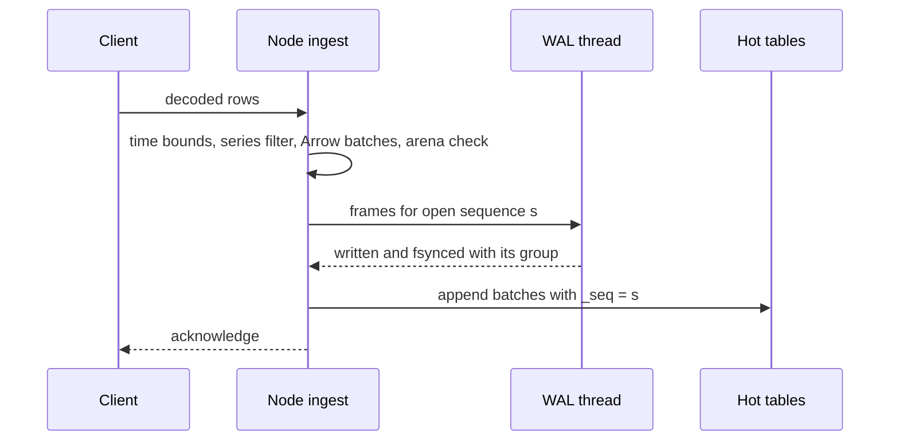
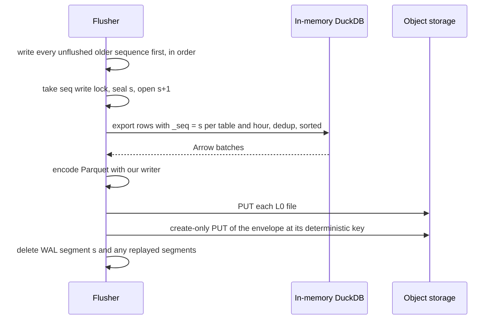

The write path lives in `crates/engine/src/node.rs` (`ingest`, `flush_now`, `write_sequence`, `replay_wal`) and `crates/engine/src/wal.rs`. Receivers in `crates/server/src/receivers.rs` turn wire formats into `engine::Rows`, four vectors of generated row structs. Everything after that is protocol-independent.

## The path in one picture

The acknowledgement is sent only after the rows are durable (in `wal` mode) and queryable (in the hot tables). Spec section 5.1 lists the steps. The sections below follow the code.

## Ingest, step by step

`Node::ingest(rows)`:

1. **Time bounds.** Points, spans and logs outside `[now - ingest.max_sample_age, now + ingest.max_sample_future]` (defaults 1 h and 10 min) are dropped and counted in `tiny_eye_rejected_rows_total{reason="out_of_bounds"}`. Spans are judged by start time. Series rows are not time-filtered. The rest of the request is still accepted, so dropping is silent to the client.
2. **Shared sequence lock.** `seq.read()` is taken and the open sequence number `s` is read. The guard is held until the request is acknowledged. That is the core invariant of the write path:

   :::note Invariant
   Every row acknowledged in sequence `s` is in WAL segment `s` and in the hot tables with `_seq = s`. No row can be added to `s` after `s` is sealed, because sealing takes the same lock exclusively.
   :::

3. **Series filter.** Receivers emit one `metrics_series` row per sample. Rows whose `series_id` is already in the open batch's `series_seen` set, or repeated within the request, are dropped. The ids are added to `series_seen` only after the append succeeds. A request refused with 429 or failed with 500 therefore does not hide its series rows from the retry. Test `retries_do_not_double_count_or_lose_series` covers this (review finding 7). `series_seen` is cleared when a sequence is sealed, so every sequence that holds points of a series also holds its series row. That is why `metrics_series` stores "one row per (series, flush)".
4. **Arrow batches.** Each non-empty vector becomes one `RecordBatch` through its generated builder (`MetricsSeriesBuilder`, `MetricsPointsBuilder`, `SpansBuilder`, `LogsBuilder`). `tenant` and `region` are overwritten from `node.tenant` and `node.region`.
5. **Arena check.** `bytes` is the sum of `RecordBatch::get_array_memory_size()`. If `hot_bytes + bytes > ingest.arena_limit` (default 1 GB), the request fails with `IngestError::Overloaded`, which the handlers map to HTTP 429 ("ingest arena full; retry later"). The rows are counted in `tiny_eye_rejected_rows_total{reason="overload"}`. `hot_bytes` counts every hot row, not just the open batch: rows leave the count only when `release_hot` deletes them after their commit plus `hot_grace`. A stuck flush or checkpoint therefore turns into backpressure instead of unbounded memory. The figure is Arrow buffer size, an estimate of DuckDB's real memory use.
6. **WAL** (`durability: wal` only). Each batch is encoded as one frame (see below). All frames of the request go to `Wal::append(s, frames)`, which returns after the group's fsync.
7. **Hot append.** On a blocking thread, holding the `writer` mutex, each batch gets an `_seq` column (`with_seq`) and is appended with DuckDB's Arrow appender to `memory.main.hot_<table>`.
8. **Bookkeeping, then ack.** The open batch's `bytes`, `rows` and `series_seen` are updated, `hot_bytes` increases, `tiny_eye_ingested_rows_total{table}` increases, the guard drops, and the call returns `Ok`.

## The WAL

`wal.rs` implements spec section 5.2's `wal` mode: acknowledge only after an fsync to local disk, and replay on restart.

- **Segments.** One file per flush sequence: `<wal_dir>/<epoch>-<seq:012>.wal`. The epoch is the process start time in milliseconds, so segments of different processes never collide. Sequence boundaries are file boundaries: a segment is deleted exactly when its sequence is in object storage.
- **Framing.** `u32 length (LE) ‖ u8 table index ‖ Arrow IPC stream`. The table index points into `Table::ALL`. The reader stops at a zero length or at a record that runs past the end of the file. That is a torn tail from a crash during the write, and because the ack waits for the fsync, a torn record was never acknowledged.
- **Group commit.** One thread named `wal` owns the files. It blocks on the channel for the first request, drains every other queued request with `try_recv`, writes all their frames, then calls `sync_data` once per segment touched. Only then does it answer every request in the group. Under load, many requests share one fsync, which is why remote-write reaches about 1.65 M samples/s with fsync on ([Performance](performance.md)). Only the newest two segment files are kept open.
- **Errors.** If a write or fsync fails, every request in the group gets the error and none of them is acknowledged.

## Sealing and flushing

`flush_due()` is true when the open batch has rows and either `bytes >= ingest.flush_bytes` (64 MB) or its age is at least `ingest.flush_interval` (60 s). The background loop checks it every 250 ms and calls `flush_now()`.

`flush_now()` holds `flush_lock` for the whole flush, then:

1. **Retries first.** Every sequence in `unflushed` (sealed but not yet in object storage) is written again, oldest first, with `?`. If one still fails, the flush stops there and nothing newer is sealed. Ingest continues into the open batch until the arena limit answers 429.

   This ordering is required for correctness. The read-side watermark is `max(seq_to)` over this node's applied envelopes ([Query engine](query-engine.md)). If sequence 5 were committed while 4 was still unwritten, the watermark would jump to 5. Views would then hide the rows of 4 from the hot tables, `release_hot` would eventually delete them, and they would never reach the lake. The test `failed_flush_is_retried_and_loses_nothing` makes the object directory read-only, checks that the failed rows stay visible from RAM, ingests more, restores permissions, and verifies that both batches reach the lake (review finding 1).

2. **Seal.** It takes `seq.write()`, which waits for every in-flight request holding the read guard. If the open batch has rows, it records `(s, bytes)`, increments the counter to `s + 1`, and resets the open batch. `s` is added to `sealed` (with no commit time yet) and to `unflushed`.
3. **`write_sequence(s)`**, on a cloned connection:
   - For each table, `SELECT DISTINCT <hour_sql>::BIGINT FROM memory.main.hot_<t> WHERE _seq = s` lists the hours present.
   - For each hour: `SELECT * EXCLUDE (_seq) FROM memory.main.hot_<t> WHERE _seq = s AND <hour_sql> = h <dedup_sql> ORDER BY <sort columns>`, read as Arrow (`query_arrow`) and encoded by `parquet::write`. DuckDB does the sort and the `QUALIFY` dedup, and our writer adds the encodings and bloom filters. One file per (table, hour) means a late sample only ever lands in its own hour's partition.
   - Each file is PUT to `<table>/tenant=/date=/hour=/l0-<ulid>-<node>.parquet`. Its absolute URL, size and row count go into a `FileEntry`.
   - An envelope with a fresh ULID `envelope_id` and `seq_to = s` is written with `Store::put_new` to `commits/<region>/<node>-<epoch>-<seq>.json`.
4. **After the envelope exists**, the WAL segment `s` is removed, any old segments replayed into `s` are removed, and `s` leaves `unflushed`. The hot rows stay. They are released by the checkpointer after the commit plus `hot_grace` ([Catalog and maintenance](catalog-and-maintenance.md)).

### Why the envelope key is deterministic

A PUT can succeed on the server while the response is lost. With a random key, the retry would commit the same sequence twice, with new data files and a new envelope, and the checkpointer would register both. With the key fixed per (node, epoch, sequence) and `If-None-Match: *` (D7, E1), the retry's create fails. `write_sequence` then reads back the envelope that is already there and continues as if it had written it. The first attempt's files win, and the retry's freshly PUT L0 files are left unreferenced in storage.

## Deduplication: what collapses where

| Duplicate source | Where it collapses |
| --- | --- |
| The same request sent twice into the same open sequence (lost response, client retry) | At flush, by `QUALIFY row_number() OVER (PARTITION BY <unique>) = 1`. Test `retries_do_not_double_count_or_lose_series`: two identical requests, 20 points stored |
| A retry that lands in a later sequence | Both copies are committed as separate L0 files and both are visible until the hour is compacted. Compaction dedups across all files of the hour |
| Logs | Never. `logs` has no `unique` key, so identical lines are kept |

Between flush and compaction, a cross-sequence retry of metric samples is double counted. It is bounded by the hour close plus `coordinator.compaction_delay` (10 min).

## WAL replay at start

`Node::open` ends with `replay_wal()`:

1. List every `*.wal` file as `(epoch, seq, path)`, oldest first.
2. Collect the `(node_epoch, seq_to)` pairs of this node in `lake.applied_envelopes`, plus the envelopes still pending under `commits/<region>/`.
3. For each segment of an earlier epoch:
   - If its `(epoch, seq)` is applied or pending, its rows are already in object storage. Delete the file.
   - Otherwise read every complete record and append it to the hot tables tagged with the current open sequence (1 in a new process). Add the bytes to the open batch and `hot_bytes`, and record the file under `replay_sources[1]`.
4. Log a warning with the number of replayed rows.

Replay never copies rows into the new epoch's WAL. The old segment remains the durable copy until the sequence it was replayed into is written. `write_sequence` then deletes it along with the sequence's own segment. If the process crashes again before that flush, the next start finds the same old segments and replays them again, with nothing lost and nothing doubled. Copying would open a window where a crash leaves the rows in both an old and a new segment. Test `wal_replay_after_crash_loses_nothing` drops a node with 13 acknowledged, unflushed samples (its "kill -9"). It reopens the node and checks that all 33 samples are visible before any flush and all 33 are in the lake after one.

Replay is not subject to the arena limit, and a large WAL can push `hot_bytes` above it. New requests then get 429 until the replayed sequence is flushed and released.

## Durability modes

`ingest.durability` selects the mode (`config::Durability`):

| Mode | Acknowledged after | Lost when the process crashes | Lost when the disk is lost |
| --- | --- | --- | --- |
| `memory` | Hot-table append | Every row not yet in object storage: the open batch and any sealed-but-unflushed sequences. Committed data is safe | Same |
| `wal` (default) | WAL fsync (group commit) and hot-table append | Nothing acknowledged | Every row not yet in object storage |

The spec's `replicated` and `s3-wal` modes are not built. Spec section 5.2 notes for `memory` mode that cumulative counter totals survive a lost batch: `rate`/`increase` computed at read time see a gap, not a wrong total, except for resets inside the lost batch (E5, D2).

### Crash windows that remain

These follow from the code as written. None loses an acknowledged row in `wal` mode, but some leave garbage or brief inconsistencies:

| Crash point | Effect |
| --- | --- |
| During a WAL write, before fsync | Torn tail ignored at replay. The request was never acknowledged |
| After the WAL fsync, when the hot append then fails (the request returns 500) | The frames stay in segment `s`. If the process keeps running, the flush of `s` exports only the hot rows and deletes the segment, so the unacknowledged rows vanish, which is correct because the client was told to retry. If it crashes first, they are replayed, and the client's retry may then be stored twice (see deduplication) |
| After some L0 PUTs, before the envelope PUT | The L0 objects are never registered and never deleted, because DuckLake only deletes files it knows. Rows are replayed from the WAL and written again under new keys. Orphans must be cleaned by a bucket lifecycle rule |
| After the envelope PUT, before the segment delete | Restart sees the envelope (pending or applied) and deletes the segment. The rows are invisible from the restart until the next checkpoint applies the envelope (up to `checkpoint_interval`, 5 s) |
| After the envelope PUT of a sequence that holds replayed rows, before the old segments are deleted | The next start checks the old segments' own `(epoch, seq)`, which was never committed, so it replays them again. The rows end up in two committed files. Compaction collapses them for tables with a `unique` key. Logs stay duplicated. The window is between `put_new` returning and the `remove_file` calls |
| WAL segment survives (its deletion errors are ignored) for more than a day after its envelope was applied | Retention prunes `applied_envelopes` rows older than one day, so a replay after that would not recognise the segment as committed |
| A WAL write error inside a group (disk full) | The segment can hold a partial record followed by later records. Replay stops at a record that runs past the end. A record that does not parse as Arrow IPC makes `Node::open` fail with "replaying `<path>`" until the file is moved away |

## Configuration

| Key | Default | Effect |
| --- | --- | --- |
| `ingest.durability` | `wal` | `wal` or `memory` |
| `ingest.wal_dir` | `./data/wal` | Segment directory |
| `ingest.flush_bytes` | `64MB` | Seal when the open batch reaches this Arrow size... |
| `ingest.flush_interval` | `60s` | ...or this age |
| `ingest.max_sample_age` / `max_sample_future` | `1h` / `10m` | Admission time bounds |
| `ingest.arena_limit` | `1GB` | 429 above this many hot bytes |
| `ingest.row_group_rows` | `122880` | Parquet row-group size |
| `node.id`, `node.tenant`, `node.region` | `node-0`, `default`, `local` | Stamped on rows, file names and envelope keys. `node.id` must be unique per catalog |

## What the tests prove

`crates/engine/tests/node.rs` runs a real `Node` on local disk:

| Test | Proves |
| --- | --- |
| `ingest_flush_checkpoint_compact_retain` | The same `rate` value hot-only, after flush, after commit, and lake-only. Then compaction and retention |
| `wal_replay_after_crash_loses_nothing` | Every acknowledged sample survives a drop without flush, visible before and after the next flush |
| `failed_flush_is_retried_and_loses_nothing` | Failed sequences stay visible, are retried in order, and nothing is lost or released early |
| `arena_limit_refuses_with_overload` | A request above `arena_limit` gets `Overloaded` |
| `retries_do_not_double_count_or_lose_series` | Duplicate requests collapse at flush, and a refused request does not hide its series rows |

`make e2e` (`crates/server/tests/e2e.rs`) runs the binary's HTTP path. It compares 20 panels against Prometheus while data is spread across compacted files, an unapplied envelope and the hot tail ([e2e evidence](evidence/e2e.md)).
