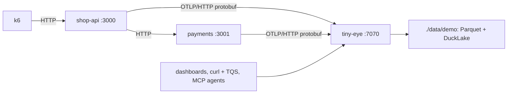
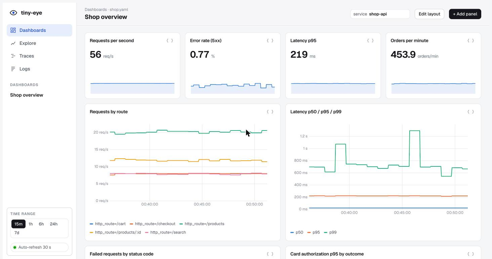

A small Node.js shop sends traces, metrics and logs to tiny-eye with the standard OpenTelemetry
SDK. k6 generates traffic. You then read the data through a dashboard, ad-hoc TQS queries, or an
AI agent over MCP. Everything lives in `examples/demo/`.



Both services use Express and the OpenTelemetry Node SDK. The shop has realistic trouble built
in:

- search is sometimes slow;
- about 6 % of card authorizations hit a 1.5 to 2.7 s provider stall, and half of those time out,
  which makes `/checkout` return `502`;
- 4 % of authorizations are declined;
- a few product lookups return `404`.

Every error writes a log line that carries its trace id.

## Run it

Prerequisites: Rust (for tiny-eye), Node.js 20+, Docker (for k6), and `jq`.

```bash
make tools                 # once: pinned DuckDB extensions (+ Prometheus for the test suite)
make demo                  # terminal 1: tiny-eye on :7070 with examples/demo/tiny-eye.yaml
make demo-app              # terminal 2: shop-api :3000 + payments :3001
make demo-load             # terminal 3: k6 for 3 minutes
```

For a longer run, use `DURATION=10m make demo-load`.

`make demo` builds the binary (web UI included) and starts it with `examples/demo/tiny-eye.yaml`:
data under `./data/demo`, a 15 s flush interval, and the dashboards from
`examples/demo/dashboards`. `make demo-app` installs the app's npm packages and starts both
services; they export to `http://127.0.0.1:7070` by default (`OTEL_EXPORTER_OTLP_ENDPOINT`
overrides it). `make demo-load` runs `grafana/k6` in Docker against the shop on port 3000.

Data appears within seconds. Rows are queryable as soon as they are acknowledged (the hot tail)
and are flushed to Parquet every 15 s in this config. Check the engine's own counters:

```bash
curl -s localhost:7070/metrics | grep ingested
```

## Look at the data

### The dashboard

`examples/demo/dashboards/shop.yaml` defines the **Shop overview**:

- stats: request rate, 5xx error rate, p95 latency, orders per minute;
- charts: requests by route, latency p50/p95/p99, failures by status, card-authorization p95 by
  outcome, error spans per service;
- a routes table;
- recent warnings and errors, error patterns, and slow checkouts.

List its panels, or read them through the API:

```bash
./examples/demo/run-panel.sh shop            # id, kind and title of every panel
curl -s localhost:7070/api/v1/dashboards/shop | jq '.panels[].query.title'
```

Each panel is a plain TQS document, so what the dashboard shows is exactly what
`POST /api/v1/query` returns for it. Run one panel with the dashboard's `vars` applied (the
shop panels use `$service`), as the UI does:

```bash
./examples/demo/run-panel.sh shop latency      # last point of p50, p95, p99
```

The same by hand, to see what it sends:

```bash
curl -s localhost:7070/api/v1/dashboards/shop \
  | jq '.vars as $v | .panels[] | select(.query.id == "latency") | .query | .vars = ($v + (.vars // {}))' \
  | curl -s localhost:7070/api/v1/query -d @- \
  | jq '[.series[] | {output, last: .points[-1]}]'    # last point of p50, p95, p99
```

The metric names in the dashboard are what the OpenTelemetry Node SDK emits, translated by the
OTLP receiver: dots become underscores, histograms become `_bucket`/`_count`/`_sum`, and
monotonic sums get `_total` (see [Sending data](sending-data.md)).

### Add or change a view

Each panel is `query` (TQS: what to fetch) plus `ui` (`display`, `unit`, and its place: `w` of 12
columns, `h` rows; panels flow in list order). You can change a dashboard in two ways:

- Edit the YAML and restart. VS Code autocompletes and validates the file through its
  `# yaml-language-server: $schema=…` header, which points to
  `schema/generated/dashboard.schema.json`.
- Send the whole new state with `PUT /api/v1/dashboards/<id>` (admin scope). The engine validates
  it and rewrites the file.

The file is the source of truth either way, so commit it. To try a panel before saving it:

```bash
curl -s localhost:7070/api/v1/validate -d @my-panel.json | jq   # every problem, with its JSON path
curl -s localhost:7070/api/v1/query    -d @my-panel.json | jq
```

More on the format: [Dashboards as code](dashboards-as-code.md).

### Ad-hoc queries

Start from what exists, then write the query:

```bash
curl -s localhost:7070/api/v1/catalog | jq '.metrics[] | {name, label_keys}'   # metrics + labels
curl -s localhost:7070/api/v1/catalog | jq '.services'                          # services, span names
```

Ready-made queries in `examples/demo/queries/`:

| File | What it answers |
| --- | --- |
| `checkout-p99-by-status.json` | p99 latency of `/checkout`, split by status code |
| `failed-checkout-traces.json` | traces where the payments service recorded an error, slowest first |
| `payment-timeouts.json` | the matching log lines, each with its trace id |

Find a failed checkout, then open it as a waterfall:

```bash
curl -s localhost:7070/api/v1/query -d @examples/demo/queries/failed-checkout-traces.json | jq '.rows[0]'

T=$(curl -s localhost:7070/api/v1/query -d @examples/demo/queries/failed-checkout-traces.json | jq -r '.rows[0].trace_id')
curl -s localhost:7070/api/v1/query -d "{\"tqs\":\"3\",\"id\":\"w\",\"kind\":\"trace\",\"trace_id\":\"$T\",\"time\":{\"from\":\"-30m\"}}" \
  | jq -r '.rows[] | "\("  " * (.depth|tonumber))\(.service_name) \(.span_name) \(.duration_ms)ms status=\(.status_code)"'
```

```text
shop-api POST /checkout 2719.820ms status=2
  shop-api SELECT cart_items 18.198ms status=0
  shop-api POST 2700.278ms status=2
    payments POST /authorize 2699.162ms status=2
      payments provider.charge 2696.777ms status=0
```

The provider stall is visible at a glance: almost all of the checkout's 2.7 s is spent in
`provider.charge`. The language is documented in the [TQS reference](../deep-dive/tqs-reference.md)
and as a JSON Schema in `schema/generated/tqs.schema.json`; `api/examples/` has one example per
query kind, and the [Query cookbook](query-cookbook.md) has many more.

### Web UI

Open [http://127.0.0.1:7070](http://127.0.0.1:7070). It shows the Shop overview dashboard live;
**Edit layout** lets you drag and resize panels and **Done** writes the new layout into
`examples/demo/dashboards/shop.yaml`. Explore (Builder | TQS), Traces (click a slow checkout for
its waterfall) and Logs (try the Patterns tab) are in the left rail.



## Connect an AI agent (MCP)

`tiny-eye mcp` is a stdio MCP server that forwards to a running node. Its tools are generated
from `api/openapi.yaml` and listed in [MCP tools](../reference/mcp-tools.md):
`discover_telemetry_catalog`, `validate_tqs`, `run_tqs`. It has read-only access.

`make demo` already built the binary. Then:

**Claude Code**

```bash
claude mcp add tiny-eye -- "$PWD/target/release/tiny-eye" mcp --url http://127.0.0.1:7070
```

**Claude Desktop, Cursor and other MCP clients** (`mcpServers` in the client's config file):

```json
{
  "mcpServers": {
    "tiny-eye": {
      "command": "/absolute/path/to/tiny-eye/target/release/tiny-eye",
      "args": ["mcp", "--url", "http://127.0.0.1:7070"]
    }
  }
}
```

With auth enabled on the node (`auth.tokens` in the config), add
`--token-env TINY_EYE_QUERY_TOKEN` and set that variable in the client's environment.

Things to ask once k6 has been running for a few minutes:

- "Which route of shop-api has the worst p99 latency right now, and why?"
- "Find the slowest failed checkout in the last 15 minutes and show me its spans."
- "What are the most common error log patterns, and which service do they come from?"
- "Compare card authorization latency for ok, declined and timeout outcomes."

The agent discovers metric and label names with `discover_telemetry_catalog`, writes TQS, and
fixes its own mistakes from the problem codes `validate_tqs` returns. Telemetry text comes back
inside a `<data>` block so it is not mistaken for instructions. Details:
[AI agents over MCP](ai-agents-mcp.md).

## Other senders

- **Any OpenTelemetry SDK**: set `OTEL_EXPORTER_OTLP_ENDPOINT=http://<tiny-eye>:7070` and
  `OTEL_EXPORTER_OTLP_PROTOCOL=http/protobuf` (or `http/json`). gRPC (`:4317`) is not supported
  yet.
- **Prometheus, Grafana Alloy, or an OTel Collector scraping `/metrics`**: remote-write to
  `http://<tiny-eye>:7070/api/v1/write`.
- **Loki clients**: push JSON to `/loki/api/v1/push` (protobuf push is not supported yet).

The demo exercises the OTLP path only; remote-write is covered by `make e2e`. See
[Sending data](sending-data.md).

## Troubleshooting

| Symptom | Cause and fix |
| --- | --- |
| No logs (`tiny_eye_ingested_rows_total{table="logs"} 0`) with recent `@opentelemetry/*` packages | The logs API now lives in `@opentelemetry/api` (`logs`, `SeverityNumber`); a separate `@opentelemetry/api-logs` package registers a provider the SDK never reads. Also pass log processors an options object: `new BatchLogRecordProcessor({ exporter })`. |
| A seconds histogram shows p95 of about 4.75 for everything | The SDK's default buckets (0, 5, 10, 25, …) are for milliseconds. Give `createHistogram` `advice.explicitBucketBoundaries` in seconds, as `server.js` does. |
| HTTP metrics have no `http_route` label | Express route templates reach the HTTP metric through the request's RPC metadata; `server.js` sets it with a small `route()` middleware. |
| Panels show nothing for delta counters | tiny-eye stores cumulative temporality (the SDK default) and skips delta points. |
| `/checkout` sometimes returns 502 | Intended: the payments provider times out on purpose. |
