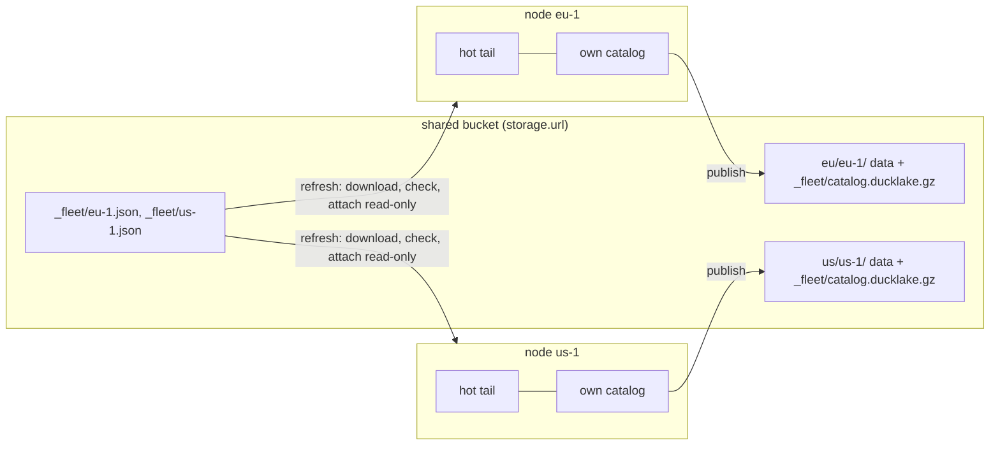

A fleet is a group of tiny-eye nodes that share one `storage.url`. Each node ingests and stores its
own data, as a single node does. Each node also answers queries over the data of every other node.

There is no coordinator, no list of peers and no special role. Every node is the same
`--role all` node. Nodes find each other through small files in the shared bucket. A node alone
answers exactly as before (it still publishes a small copy every 30 s; set both
`fleet.*_interval` to `0s` to turn that off), so a single node needs no fleet config at all.

## When to use it

- **One node per region or cluster.** Each node sits close to its senders. Any node's dashboards
  show all regions.
- **A laptop that reads production.** A node on your laptop, pointed at the same bucket, answers
  queries over what the other nodes published. It is a full node: anything sent to it is written
  to the bucket under its own prefix, and it needs the same storage access as a server (read on
  the whole bucket; write and delete on its own prefix). Running it with a read-only key is not
  tested.
- **Several nodes in one region.** Senders can be spread over nodes. Each node needs its own
  `node.id`.

A fleet does not copy data between nodes. It is not high availability: rows still in a node's
memory are only on that node, and a stopped node drops out of everyone's answers after about
10 minutes (see [When a node stops](#when-a-node-stops)).

## How it works



1. **Own prefix.** Each node writes every object under `<node.region>/<node.id>/` of
   `storage.url`. With the defaults that is `local/node-0/`. Two nodes never write the same key.
2. **Publish.** Every `fleet.publish_interval` (30 s), right after a checkpoint, a node copies its
   DuckLake catalog into a file, gzips it to `<region>/<id>/_fleet/catalog.ducklake.gz`, and then
   writes a small manifest `_fleet/<id>.json` at the root of the bucket. A catalog copy is small:
   about 43 to 74 KB gzipped in the [proof of concept](../deep-dive/evidence/fleet-poc.md), for
   6 hours of data at its scale. It grows with the number of files in the catalog.
3. **Refresh.** Every `fleet.refresh_interval` (30 s), a node lists `_fleet/`, downloads the copies
   that changed into `<fleet.dir>/<node.id>/`, checks them (see
   [Copies are untrusted](#copies-are-untrusted)) and attaches them read-only. Then it swaps its
   query views in one transaction, so a running query sees either the old set or the new set.
   A refresh gives up the listing and downloads it has not finished within
   `fleet.refresh_interval`. When a manifest cannot be fetched, or the listing fails, the node
   keeps the copies it has while they are fresh, and still drops the ones that are too old.
4. **Query.** A query reads the node's own lake, the node's own hot tail, and the published
   tables of every other node. The data files are read straight from the bucket.

Each node keeps running its own checkpoints, compaction and retention on its own data only.

## Try it on one machine

Two nodes, `eu-1` and `us-1`, on one machine. They share one storage directory and keep
everything else apart: port, catalog, WAL, materialized panels and downloaded copies. Short
intervals make the data move in seconds instead of minutes.

Build the binary and the pinned tools first: `make tools build`. `make build` also builds the web
UI and needs Node.js and npm; without them, run `make tools` and then
`cargo build --release --bin tiny-eye` (see [Installation](../getting-started/installation.mdx)).
Then, from the repository root:

```bash
mkdir -p data/fleet-demo
for n in eu:7071 us:7072; do
  region=${n%%:*} port=${n##*:} dir=$PWD/data/fleet-demo
  cat > $dir/$region.yaml <<EOF
node: { id: $region-1, region: $region }
server: { listen: 127.0.0.1:$port }
duckdb: { extension_dir: .tools/duckdb_ext }
storage: { url: $dir/objects }            # shared by both nodes; an absolute path
catalog: { url: $dir/$region/catalog.ducklake }
ingest: { wal_dir: $dir/$region/wal, flush_interval: 5s }
materialize: { path: $dir/$region/materialized.duckdb }
fleet: { dir: $dir/$region/fleet, publish_interval: 5s, refresh_interval: 5s }
coordinator: { checkpoint_interval: 2s }
EOF
done
```

Start each node in its own terminal:

```bash
./target/release/tiny-eye --config data/fleet-demo/eu.yaml
./target/release/tiny-eye --config data/fleet-demo/us.yaml
```

Send one gauge to each node. The `cluster` attribute becomes a label that tells the two senders
apart (see [Label your senders](#label-your-senders)):

```bash
send() {  # port cluster value
  curl -s -X POST localhost:$1/v1/metrics -H 'Content-Type: application/json' --data-binary @- <<EOF
{"resourceMetrics":[{"resource":{"attributes":[{"key":"service.name","value":{"stringValue":"shop"}}]},
  "scopeMetrics":[{"metrics":[{"name":"queue_depth","gauge":{"dataPoints":[
    {"timeUnixNano":"$(date +%s)000000000","asDouble":$3,
     "attributes":[{"key":"cluster","value":{"stringValue":"$2"}}]}]}}]}]}]}
EOF
}
send 7071 eu 3
send 7072 us 5
```

Ask the `eu-1` node for both clusters:

```bash
curl -s localhost:7071/api/v1/query -d '{"tqs": "3", "id": "q", "kind": "table", "time": {"from": "-5m"},
  "queries": [{"name": "q", "metric": "queue_depth", "fn": {"op": "last"}, "agg": {"op": "max", "by": ["cluster"]}}]}' \
  | jq -c '{freshness_s, series: [.series[] | {key, value: .points[-1][1]}]}'
```

At once, `eu-1` answers with `cluster=eu` only: its own rows are visible as soon as they are
acknowledged. Within about 20 seconds with these settings (flush, checkpoint, publish, refresh),
it answers with both:

```json
{"freshness_s":0.262,"series":[{"key":"cluster=eu","value":3.0},{"key":"cluster=us","value":5.0}]}
```

`freshness_s` is the age of the `us-1` copy it read. Ask
`us-1` on port 7072 and you get the same two series.

`find data/fleet-demo/objects -maxdepth 2 -type d` shows the layout: each node's prefix, and
`_fleet/` with the manifests `eu-1.json` and `us-1.json`:

```text
data/fleet-demo/objects
data/fleet-demo/objects/us
data/fleet-demo/objects/_fleet
data/fleet-demo/objects/eu
data/fleet-demo/objects/us/us-1
data/fleet-demo/objects/eu/eu-1
```

Stop both nodes with Ctrl-C and delete `data/fleet-demo` when done.

## A fleet in production

Two regions and a laptop share one bucket. Only the keys that differ from the defaults are
shown; the S3 credentials come from environment variables, as for a single node
([Installation](../getting-started/installation.mdx#store-data-on-s3-or-minio)).

```yaml
# eu-1.yaml, a server in Europe
node: { id: eu-1, region: eu }
storage:
  url: s3://acme-telemetry/tiny-eye
  s3: { region: eu-west-1 }
```

```yaml
# us-1.yaml, a server in the US: the same bucket, so the same storage settings
node: { id: us-1, region: us }
storage:
  url: s3://acme-telemetry/tiny-eye
  s3: { region: eu-west-1 }
```

```yaml
# laptop.yaml: reads what the servers publish, publishes nothing itself
node: { id: alice-laptop, region: laptop }
storage:
  url: s3://acme-telemetry/tiny-eye
  s3: { region: eu-west-1 }
fleet: { publish_interval: 0s }
```

The laptop is a full node. Anything sent to it is written to the bucket under `laptop/alice-laptop/`,
and it needs read access to the whole bucket and write and delete access to its own prefix, like
the servers. Give it its own region and id: a node that publishes nothing writes no manifest, so a
clash with its id is never detected.

Rules for every node of the fleet:

- **The same `storage.url`.** The catalogs record absolute file URLs, so every node must reach
  the same objects under the same URL. On local disk that means the same machine, or a shared
  mount at the same absolute path on every host. Use an absolute path: a relative one resolves
  against each node's working directory.
- **The same `fleet.publish_interval`, `fleet.refresh_interval`, `fleet.max_copy_bytes`,
  `query.timeout` and `coordinator.snapshot_grace`.** A node's grace protects the copies other
  nodes read, so it must fit their timing too. Each manifest also carries the publisher's grace,
  and a reader uses the smaller of its own and the publisher's. The one exception: a node may set
  `fleet.publish_interval: 0s` to publish nothing, like the laptop above.
- **Clocks synced with NTP.** A reader decides that a manifest is too old by comparing its publish
  time with its own clock. The publish time is the earlier of the time the publisher wrote into
  the manifest and the time the bucket says it was written, so a publisher whose clock runs ahead
  cannot make its copy look younger. A reader whose own clock runs behind still keeps copies too
  long.
- **A unique `node.id` across the whole fleet**, not only within a region: the manifest
  `_fleet/<id>.json` is named by the id alone. If two running processes use one id, the newest one
  wins. The older process finds the newer one's manifest at its next publish, stops publishing,
  logs `node.id "<id>" is used by another node too`, and counts `tiny_eye_fleet_errors_total`.
  It stays silent after the newer process stops until that process's manifest has not been written
  for `coordinator.snapshot_grace`; then it publishes again. This also covers a host whose clock
  stepped back: its new process has a smaller start time than the one before. Two processes that
  start together can both write their manifest once (each reads, then writes); the next publish
  settles it.
  Fix the id at once: two nodes with the same id *and* region also share one prefix, and each
  checkpoints the other's flushes into its own catalog.
- **Ids and regions are path segments.** Use letters, digits, `.`, `_` and `-`. `_fleet` is not
  allowed. Anything else stops the start with an error. An empty value falls back to the default
  (`node-0`, `local`).
- **Each node keeps its own local files**: `catalog.url`, `ingest.wal_dir` and `materialize.path`
  are per node, as on a single node. The downloaded copies go to `<fleet.dir>/<node.id>/`, so
  `fleet.dir` may be shared by nodes on one machine.
- **A DuckDB file catalog.** A `postgres:` `catalog.url` cannot be used in a fleet: the start
  fails unless both `fleet.*_interval` are `0s`.

A node with `publish_interval: 0s` is invisible to the others. A node with `refresh_interval: 0s`
reads only its own data.

## What each node sees, and how fresh

| Rows | On the node that received them | On the other nodes |
| :--- | :--- | :--- |
| Acknowledged, still in memory (hot tail) | Visible at once | Not visible |
| Flushed and checkpointed | Visible | Visible after that node's next publish and this node's next refresh |

So rows reach the other nodes at most `ingest.flush_interval + coordinator.checkpoint_interval +
fleet.publish_interval + fleet.refresh_interval` after they were acknowledged. With the defaults
that is 60 s + 5 s + 30 s + 30 s: up to about 2 minutes. Shorter intervals mean fresher answers
and more requests to the bucket.

Every query response has `freshness_s`: the age, in seconds, of the oldest other-node catalog
copy the query read. It is `0` on a node alone. It counts from the moment that copy was
published, so rows that were still in the other node's memory at that time are older than it
says.

:::note Materialized panels
A [materialized panel](../deep-dive/materialized-panels.md) stores a step once it is
`materialize.settle` old (5 minutes). When a refresh brings another node's rows for steps that are
already stored (late data, a node that joins the fleet, or a node that comes back after a stop),
the node recomputes those steps, so stored points do not miss them. Only the files added since the
copy the stored points already include count: a node that restarts with the same catalog, or this
node restarting (it keeps which copy of each node its stored points include in
`materialize.path`), recomputes nothing that is not new. A node seen for the first time, a new
catalog, or a copy older than the grace recomputes all stored steps once. The reverse is not
handled: when a node leaves the fleet, steps already stored keep its rows until retention drops them.
:::

## Label your senders

tiny-eye adds no region label to metrics. As with Prometheus `external_labels`, the senders
label their region or cluster. This keeps a single node's answers unchanged, and keeps them equal
to Prometheus.

A series is identified by its metric, its labels and the region of the node that received it.
So for one label set:

- **Sent to nodes in two regions**, it is two series. Aggregations (`sum`, `max`, and the others)
  see both. Without an aggregation, results are keyed by labels, so both series share one result
  key and the response shows only one of their values.
- **Sent to two nodes in one region**, it is one series, and its samples merge, as on one node.
  Duplicates are removed only within one node's files, so a sample that reaches both nodes (a
  sender that retries against the other node) is kept twice.

Add a label that tells the senders apart, such as `cluster` or `region`:

| Sender | Where to add the label |
| :--- | :--- |
| Prometheus | `global.external_labels: { cluster: eu }` |
| Grafana Alloy | `external_labels = { cluster = "eu" }` in `prometheus.remote_write` |
| OpenTelemetry | A data point attribute, for example an OTel Collector `attributes` processor with `{ key: cluster, value: eu, action: upsert }`. Resource attributes other than `service.name`, `service.namespace` and `service.instance.id` do not become labels ([Sending data](sending-data.md#how-otlp-metrics-become-prometheus-series)) |

Spans and logs need nothing extra: every span and log row has a `region` column, set to the
region of the node that received it. Filter or group by `region` in TQS.

## Copies are untrusted

A node reads another node's catalog copy as untrusted input. It leaves a copy out of its answers
when:

- the manifest is not `_fleet/<node_id>.json` of the node it names, or is larger than 64 KiB;
- the manifest's `catalog_key` is not under the publisher's own prefix `<region>/<id>/`;
- the copy is larger than `fleet.max_copy_bytes` (256 MB), compressed or once decompressed;
- the copy is not a gzipped DuckDB file, or not a DuckLake catalog;
- its metadata database holds anything but DuckLake's own tables (views, macros, sequences, types,
  indexes, generated columns, other schemas or tables), or names an inlined-data table it does not
  hold;
- the catalog defines views or macros;
- its tables or columns differ from this build's schema;
- it names data files outside the publisher's prefix.

A rejected copy is logged with the reason and counted in `tiny_eye_fleet_errors_total` once, and
not downloaded again until its publisher publishes another snapshot. The node keeps that
publisher's previous copy while it is fresh. The rest of the fleet keeps answering. The same happens to a copy from a build with another table schema,
for example during a rolling upgrade that changes `schema/tables.yaml`: that node's data is
missing from the others' answers until every node runs the same build.

What the bucket permissions must still guarantee is in [Security](../deep-dive/security.md).

## Configuration keys

| Key | Default | Meaning in a fleet |
| :--- | :--- | :--- |
| `node.id` | `node-0` | Unique across the fleet. Second part of the node's prefix `<region>/<id>/` |
| `node.region` | `local` | First part of the prefix; stamped on every row; part of a series' identity |
| `storage.url` | `./data/objects` | The same on every node, as an absolute path or `s3://` URL |
| `fleet.publish_interval` | `30s` | How often the catalog copy is published; `0s` = never |
| `fleet.refresh_interval` | `30s` | How often the other nodes' copies are looked for; `0s` = never |
| `fleet.dir` | `./data/fleet` | Downloaded copies go to `<fleet.dir>/<node.id>/` as `fleet_<n>.ducklake`; that directory is emptied at start |
| `fleet.max_copy_bytes` | `256MB` | A copy larger than this once decompressed is rejected |
| `coordinator.snapshot_grace` | `10m` | How long an old catalog snapshot, and the files only it names, are kept after a newer one exists. A reader skips a manifest older than the smaller of its own grace and the publisher's |

`coordinator.snapshot_grace` must be at least `fleet.publish_interval + 3 × fleet.refresh_interval
+ query.timeout` (150 s with the defaults). A reader drops a copy once it is older than the
smaller grace minus `2 × fleet.refresh_interval + query.timeout`: a copy stays in its views until
the next swap, at most one refresh interval plus one refresh later, and a query that started
before that swap runs for up to `query.timeout`. So no file a query on another node can still be
reading is deleted under it, and a node that keeps publishing is never dropped. A smaller value
stops the start with `coordinator.snapshot_grace (...) must be at least ...`.

Raise the grace when you raise the intervals, on every node. The full list of keys is in
[Configuration](../deep-dive/configuration.md#fleet).

## When a node stops

- Its last published copy stays attached on the other nodes, so its flushed data stays in their
  answers. `freshness_s` grows.
- Its rows that were still in memory are not in that copy. With `durability: wal` they are
  replayed when the node starts again, as on a single node.
- Once its manifest is older than `coordinator.snapshot_grace` (10 minutes), the other nodes skip
  it and log a warning once. Its data drops out of their answers. The files stay in the bucket.
- When it starts again, it publishes at once and is back in the others' answers after their next
  refresh.

To retire a node for good, stop it and delete its manifest `_fleet/<id>.json`. No other node runs
retention on a retired node's prefix, so its files stay in the bucket until you delete them. Use a
bucket lifecycle rule on `<region>/<id>/` that expires objects after `coordinator.retention`, or
delete the prefix once you no longer need its data.

## Watch it

| Metric | What to look for |
| :--- | :--- |
| `tiny_eye_fleet_nodes` | Other nodes whose data this node's queries read. Lower than expected means a node stopped publishing, was skipped, or its copy was rejected |
| `tiny_eye_fleet_oldest_copy_age_seconds` | Age of the oldest copy read. It should stay below `publish_interval + refresh_interval` plus a little |
| `tiny_eye_fleet_publishes_total` | Should rise every `publish_interval` |
| `tiny_eye_fleet_errors_total` | Failed publishes, failed refreshes (a failed listing, a manifest that could not be fetched, a download past the refresh's time limit) and rejected manifests and copies. The log says which, and why |

## Limits

- **The hot tail is local.** Other nodes see a node's rows only after they are flushed,
  checkpointed and published. There is no hot-tail RPC between nodes.
- **One bucket.** Every node of a fleet shares one `storage.url`. Separate buckets per region are
  not supported, so a node far from the bucket writes and reads across regions. In the
  [proof of concept](../deep-dive/evidence/fleet-poc.md), with a 150 ms round trip to the bucket
  and the copies downloaded, a panel's first run took about 1.5 to 3 s, later runs about as long
  as next to the bucket, and a refresh downloaded three copies in about 0.5 s.
- **Local disk across hosts.** The copies name absolute file paths, so a shared mount must have
  the same absolute path on every host.
- **No PostgreSQL catalog.** A fleet node keeps its catalog in a DuckDB file.
- **No deduplication across nodes.** A sample retried to two nodes of one region is kept twice
  (see [Label your senders](#label-your-senders)).
- **No coordinator.** Nothing elects a leader or checks the fleet as a whole. Each node checks the
  copies it reads, but it trusts the manifests for who published what and when.
- **No region label.** Senders must label their region (above).
- **The catalog copy uses a DuckLake internal.** Publishing copies DuckLake's metadata database by
  its internal name. A test fails if a DuckDB or DuckLake upgrade renames it (spec question Q19).
- **Breaking change from earlier builds.** The object layout moved under `<region>/<id>/`. A
  fleet build refuses to start on a catalog written by an earlier build (see
  [Installation](../getting-started/installation.mdx#data-directory-layout)); changing `node.id`
  or `node.region` of an existing node does the same. Start with an empty data directory, and keep
  the old build if you still need to read the old data.

## What proves it

- `crates/engine/tests/fleet.rs` runs nodes in one process over one storage directory. It checks
  that a node's answers over two nodes equal the answers of one node that received everything, that
  other nodes' rows show only after publish and refresh while its own show at once, that a node
  alone is unchanged, that retention on one node keeps another node's copy readable within the
  grace (this fails with the old expiry rule), that stale manifests are skipped (also when the
  listing fails, and by the bucket's time when the publisher's clock runs ahead), that each kind
  of untrusted copy and oversized manifest is refused, that a manifest that cannot be fetched
  keeps a fresh copy, that restarts of either node recompute no stored step that is not new, the
  rule for identical label sets, duplicate ids (also a stopped process with a later start time),
  and the DuckLake internal name.
- `make fleet-poc` measured publish, refresh and query cost against a node holding everything,
  over MinIO with added latency: [fleet proof of concept](../deep-dive/evidence/fleet-poc.md).
  The proof of concept used a separate read-only viewer; the built fleet has no viewer, and every
  node does what the viewer did.
