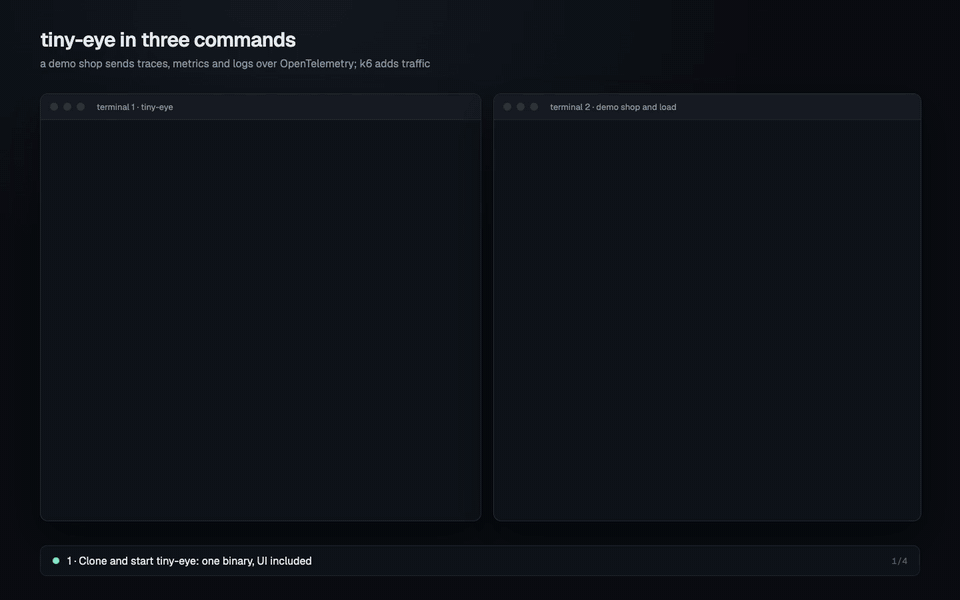

This page takes you from a fresh clone to a running node with data you sent yourself. You need
two terminals. Apart from the first build, it takes about 5 minutes.

Prefer a ready-made app with traffic? `make demo`, `make demo-app` and `make demo-load` run the
[demo shop](../examples/demo-shop.md); this is what it looks like:



## Prerequisites

- **Rust stable** (1.90 or newer) and a C/C++ compiler. The first build compiles DuckDB and takes
  several minutes.
- **Node.js 20+ and npm**. `make build` and `make run` build the web UI and embed it in the
  binary. The demo shop needs [Bun](https://bun.sh) 1.x.
- **curl** and **jq** for the commands below.
- **Docker** is optional. Only the S3 setup and the demo load test use it.

## 1. Clone and fetch the pinned tools

```bash
git clone https://github.com/tinnguyenhuuletrong/tiny-eye.git
cd tiny-eye
make tools
```

`make tools` downloads the pinned DuckDB
2.0.1 extensions and Prometheus 3.16 (used only by the test suites) into `.tools/`. See
[Installation](installation.mdx) for details.

## 2. Run a node

In the first terminal:

```bash
make run
```

`make run` builds the web UI and the release binary, then starts a single node with
`config/dev.yaml`. It listens on `127.0.0.1:7070` and keeps its data under `./data`. When the log
shows `serving listen=127.0.0.1:7070`, check it from the second terminal:

```bash
curl -s localhost:7070/healthz
# ok
```

## 3. Send data

tiny-eye refuses rows more than 1 hour old or 10 minutes in the future, so the examples stamp
everything with the current time. Run them in the second terminal, in the same shell session.

**A metric over OTLP/HTTP JSON.** A monotonic counter `http.server.requests` with three points,
30 seconds apart:

```bash
NOW=$(date +%s)
curl -s -X POST localhost:7070/v1/metrics -H 'Content-Type: application/json' --data-binary @- <<EOF
{"resourceMetrics":[{"resource":{"attributes":[{"key":"service.name","value":{"stringValue":"checkout"}}]},
  "scopeMetrics":[{"metrics":[{"name":"http.server.requests","sum":{"aggregationTemporality":2,"isMonotonic":true,
    "dataPoints":[
      {"timeUnixNano":"$((NOW-60))000000000","asDouble":10,"attributes":[{"key":"http.route","value":{"stringValue":"/cart"}}]},
      {"timeUnixNano":"$((NOW-30))000000000","asDouble":25,"attributes":[{"key":"http.route","value":{"stringValue":"/cart"}}]},
      {"timeUnixNano":"${NOW}000000000","asDouble":40,"attributes":[{"key":"http.route","value":{"stringValue":"/cart"}}]}]}}]}]}]}
EOF
```

tiny-eye stores it the way Prometheus would name it: `http_server_requests_total` with the labels
`job="checkout"` (from `service.name`) and `http_route="/cart"`.

**A trace over OTLP/HTTP JSON.** A failed `POST /cart` server span with one child span:

```bash
curl -s -X POST localhost:7070/v1/traces -H 'Content-Type: application/json' --data-binary @- <<EOF
{"resourceSpans":[{"resource":{"attributes":[{"key":"service.name","value":{"stringValue":"checkout"}}]},
  "scopeSpans":[{"spans":[
    {"traceId":"5b8efff798038103d269b633813fc60c","spanId":"eee19b7ec3c1b174","name":"POST /cart","kind":2,
     "startTimeUnixNano":"$((NOW-1))000000000","endTimeUnixNano":"${NOW}000000000",
     "status":{"code":2,"message":"payment timeout"}},
    {"traceId":"5b8efff798038103d269b633813fc60c","spanId":"0b1c2d3e4f5a6b7c","parentSpanId":"eee19b7ec3c1b174",
     "name":"charge card","kind":3,
     "startTimeUnixNano":"$((NOW-1))100000000","endTimeUnixNano":"$((NOW-1))900000000"}]}]}]}
EOF
```

**A log line over the Loki push API.** It carries the trace id as structured metadata:

```bash
curl -s -X POST localhost:7070/loki/api/v1/push -H 'Content-Type: application/json' --data-binary @- <<EOF
{"streams":[{"stream":{"service_name":"checkout","level":"error"},
  "values":[["${NOW}000000000","payment timeout after 2.5s",{"trace_id":"5b8efff798038103d269b633813fc60c"}]]}]}
EOF
```

Each request returns an empty success (`200` for OTLP, `204` for Loki). The rows are queryable
immediately. Check the engine's counters:

```bash
curl -s localhost:7070/metrics | grep -E 'ingested_rows_total|rejected_rows_total'
```

You should see 3 rows in `metrics_points`, 2 in `spans`, 1 in `logs`, and 0 rejected.

## 4. Query with TQS

TQS documents are JSON. Start by asking what exists:

```bash
curl -s localhost:7070/api/v1/catalog | jq
```

**Request rate per route**, one point every 15 seconds over the last 5 minutes. This is PromQL
`sum by (http_route) (rate(http_server_requests_total[2m]))`:

```bash
curl -s localhost:7070/api/v1/query -d '{"tqs":"3","id":"cart-rps","kind":"timeseries",
  "time":{"from":"-5m","step":"15s"},
  "queries":[{"name":"r","metric":"http_server_requests_total",
    "fn":{"op":"rate","window":"2m"},"agg":{"op":"sum","by":["http_route"]}}]}' \
  | jq '.series[] | {key, last: .points[-1]}'
```

Each point is `[epoch_ms, value]`.

**Failed traces**, slowest first:

```bash
curl -s localhost:7070/api/v1/query -d '{"tqs":"3","id":"errors","kind":"trace_search",
  "time":{"from":"-15m"},
  "search":{"trace":[{"field":"has_error","op":"=","value":true}],"order":"duration_desc"},
  "limit":10}' | jq '.rows'
```

**The trace as a waterfall:**

```bash
curl -s localhost:7070/api/v1/query -d '{"tqs":"3","id":"w","kind":"trace",
  "trace_id":"5b8efff798038103d269b633813fc60c","time":{"from":"-15m"}}' \
  | jq -r '.rows[] | "\("  " * (.depth|tonumber))\(.service_name) \(.span_name) \(.duration_ms)ms status=\(.status_code)"'
```

```text
checkout POST /cart 1000.000ms status=2
  checkout charge card 800.000ms status=0
```

:::tip
The example uses a fixed trace id. If you send the trace a second time, change `traceId` in both
spans, or the trace holds both copies and the waterfall shows its spans more than once.
:::

**Log lines that mention a timeout:**

```bash
curl -s localhost:7070/api/v1/query -d '{"tqs":"3","id":"logs","kind":"log_search",
  "time":{"from":"-15m"},
  "search":{"logs":[{"field":"body","op":"contains","value":"timeout"}],"order":"desc"},
  "limit":20}' | jq '.rows'
```

A mistake in a document returns `400` with every problem, its code and its JSON path. To check
a document without running it, send it to `/api/v1/validate` instead.

## 5. Look at a dashboard through the API

Dashboards are YAML files in `dashboards/`. The repository ships one, `dashboards/self.yaml`,
which monitors tiny-eye itself:

```bash
curl -s localhost:7070/api/v1/dashboards | jq
curl -s localhost:7070/api/v1/dashboards/tiny-eye-self | jq '.panels[] | {id: .query.id, title: .query.title, ui}'
```

Each panel is a TQS document plus a `ui` block. To run one panel, apply the dashboard's `vars`
to its query and post it:

```bash
curl -s localhost:7070/api/v1/dashboards/tiny-eye-self \
  | jq '.vars as $v | .panels[] | select(.query.id == "hot-bytes") | .query | .vars = ($v + (.vars // {}))' \
  | curl -s localhost:7070/api/v1/query -d @- | jq '.series'
```

This panel shows 0 until a Prometheus agent scrapes tiny-eye's own `/metrics` endpoint and
remote-writes it back (see [Sending data](../examples/sending-data.md)).

## 6. Open the web UI

Open [http://127.0.0.1:7070](http://127.0.0.1:7070) in a browser. It shows
dashboards (edit their layout and add panels; saving writes the YAML file), Explore (with a
Builder | TQS switch), traces and logs.

If you built the binary with `cargo build` instead of `make build`, the UI is not embedded and
`/` shows a short page that points to the API.

## 7. Connect Claude Code over MCP

The `tiny-eye mcp` subcommand is a stdio MCP server that forwards to the running node. Register
it with Claude Code from the repository root:

```bash
claude mcp add tiny-eye -- "$PWD/target/release/tiny-eye" mcp --url http://127.0.0.1:7070
```

Then ask Claude, for example: "Which traces failed in the last 15 minutes, and what do their
logs say?" Other clients and tokens are covered in
[AI agents over MCP](../examples/ai-agents-mcp.md).

## 8. Stop

Press Ctrl-C in the first terminal. tiny-eye flushes buffered rows to Parquet and checkpoints
them into the catalog before it exits. Your data stays in `./data` for the next `make run`.

## Next steps

- [Concepts](concepts.md): signals, TQS documents, panels, and how fresh data is.
- [Demo shop](../examples/demo-shop.md): a real Bun and TypeScript app with load, a dashboard and an agent.
- [Sending data](../examples/sending-data.md): point OpenTelemetry SDKs, the Collector,
  Prometheus or Alloy at tiny-eye.
- [Query cookbook](../examples/query-cookbook.md): TQS recipes with their PromQL equivalents.
