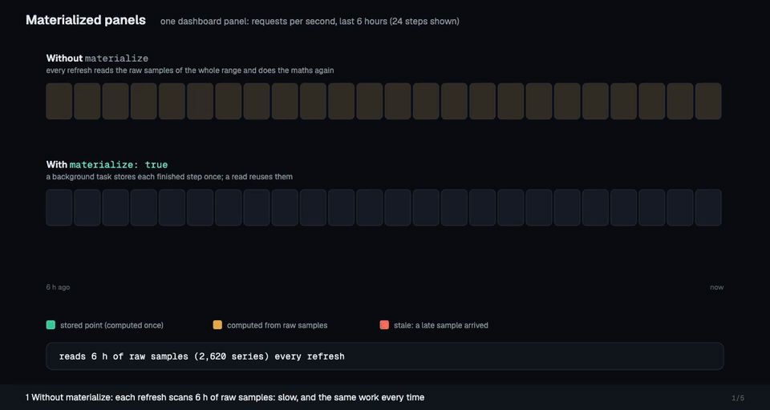

This page lists what sets tiny-eye apart and links each point to the test or benchmark that
backs it. It separates what you can run today from what the specification designs but the code
does not have yet. Nothing in the second group is shipped.

## At a glance

| Difference | Status | Proof |
| :--- | :--- | :--- |
| [Your telemetry is open Parquet you own](#your-telemetry-is-open-parquet-you-own) | Built | [Storage format](../deep-dive/storage-format.md) |
| [Results are proven, not claimed](#results-are-proven-not-claimed) | Built | [Conformance](../deep-dive/evidence/tqs-coverage.md), [end to end](../deep-dive/evidence/e2e.md) |
| [One query language for people, dashboards and agents](#one-query-language-for-people-dashboards-and-agents) | Built | [TQS reference](../deep-dive/tqs-reference.md) |
| [Acknowledged means queryable](#acknowledged-means-queryable) | Built | [Query engine](../deep-dive/query-engine.md#views-the-lake-plus-the-hot-tail-counted-once) |
| [Panel cost grows with series and steps, not window size](#panel-cost-grows-with-series-and-steps-not-window-size) | Built | [Performance](../deep-dive/performance.md#the-window-evaluation-change-37-s-to-058-s) |
| [Maintenance only rewrites what changed](#maintenance-only-rewrites-what-changed) | Built | [Catalog and maintenance](../deep-dive/catalog-and-maintenance.md), [MinIO benchmark](../deep-dive/evidence/bench-s3.md) |
| [One binary, defined by YAML](#one-binary-defined-by-yaml) | Built | [API and code generation](../deep-dive/api-and-codegen.md) |
| [Materialized panels, maintained incrementally](#materialized-panels-maintained-incrementally) | Built (phase 1) | [Materialized panels](../deep-dive/materialized-panels.md), [benchmark](../deep-dive/evidence/bench-local.md#materialized-panels) |

## Your telemetry is open Parquet you own

Every metric sample, span and log line ends up in a sorted, ZSTD-compressed Parquet file on
local disk or in your S3 bucket, under a plain key layout
(`<table>/tenant=<t>/date=<d>/hour=<h>/…`). A [DuckLake](https://ducklake.select/) catalog
(a DuckDB file, or PostgreSQL) records which files are live. There is no proprietary block
format: any Parquet reader can open the files, and DuckDB with the DuckLake extension can attach
the catalog and query them with SQL.

Because the files are yours and the format is open, the storage outlives the engine. Retention,
backups and lifecycle rules are object-storage operations. See
[Storage format](../deep-dive/storage-format.md) and [Operate a node](../deep-dive/operations.md).

## Results are proven, not claimed

Metric functions in TQS reproduce Prometheus semantics: left-open windows, the 5-minute
lookback, staleness markers, counter-reset correction, `rate`/`increase` extrapolation,
`histogram_quantile` interpolation. Each rule is checked by a test that can fail:

- `make conformance` runs every TQS case against Prometheus 3.16 on the same fixtures, point by
  point, within 1e-9 relative. A mutation check then breaks one compiler rule at a time and
  requires at least one case to turn red, so the suite is shown to catch the bugs it is meant
  to catch ([TQS coverage](../deep-dive/evidence/tqs-coverage.md)).
- `make e2e` remote-writes the same samples into Prometheus and into the tiny-eye binary, with
  the data split over compacted files, an unapplied envelope and the in-memory hot tail.
  **20/20 panels are equal** ([end to end](../deep-dive/evidence/e2e.md)).

Where tiny-eye knowingly differs, the difference is a named, tested case, not an accident. See
[Testing and evidence](../deep-dive/testing-and-evidence.md).

## One query language for people, dashboards and agents

TQS is a closed JSON schema. The same document is what a person writes in Explore, what a
dashboard panel stores, and what an AI agent sends over MCP. One language covers metric time
series and tables, span and log aggregates, trace search, the trace waterfall, log search and
log patterns.

The validator returns every problem at once, each with a code and a JSON path such as
`queries[1].fn.window`, and never ignores an unknown field. An agent can fix all of its mistakes
in one round trip instead of guessing what was silently dropped. Every string is a bound
parameter, so a label value can never become SQL. See the
[TQS reference](../deep-dive/tqs-reference.md) and [Connect an AI agent](../examples/ai-agents-mcp.md).

## Acknowledged means queryable

A write is acknowledged once its rows are in the write-ahead log and the in-memory hot tail.
Queries read the lake and the hot tail through one view per table. A per-node watermark,
read in the same catalog transaction as the scan, makes sure a row that is both committed and
still in RAM is counted exactly once. There is no wait for a flush: a sample is visible to the
next query, and responses report `freshness_s: 0`.

The e2e run above compares against Prometheus while part of the data lives only in RAM. See
[Query engine](../deep-dive/query-engine.md#views-the-lake-plus-the-hot-tail-counted-once) and
[Write path](../deep-dive/write-path.md).

## Panel cost grows with series and steps, not window size

The compiler evaluates the `rate` family with running sums per series and two ASOF joins per
(series, step) to find each window's first and last sample. The work is one pass over the
samples plus O(series × steps) probes, instead of building every (step, series, sample in
window) row. On the benchmark's 6-hour, 2,000-series `sum by (job) (rate(…[5m]))` panel this
took the query from about 3.7 s to **0.58 s** p50, and the saving grows with the window
([Performance](../deep-dive/performance.md#the-window-evaluation-change-37-s-to-058-s),
[local benchmark](../deep-dive/evidence/bench-local.md)). `avg_over_time`, `min_over_time`,
`max_over_time` and `sum_over_time` keep the slower join path, because min and max are not
differences of running sums and a difference of large sums would lose the 1e-9 precision the
conformance suite demands.

This is evaluation done once per query. To keep a panel's results between queries, mark it
`materialize: true`; see [materialized panels](#materialized-panels-maintained-incrementally).

## Maintenance only rewrites what changed

Background work is scoped to new data:

- **Checkpoint** applies only envelopes not yet applied, all of them in one catalog
  transaction, and is idempotent through `applied_envelopes`: a crash between commit and
  cleanup never registers a file twice.
- **Compaction** works per closed hour. An hour is rewritten only when it still has L0 files
  (new flushes or late data). Its L0 files and any old L1 file are merged, deduplicated, sorted
  and swapped for one L1 file in one transaction. Hours with no new files are not touched.
- **Retention** drops whole hours of files and lets DuckLake delete the objects.

Compaction is what keeps trace lookups cheap on object storage: an absent trace id needed
**22 GETs before compaction and 2 after** in the MinIO benchmark
([bench-s3](../deep-dive/evidence/bench-s3.md)). See
[Catalog and maintenance](../deep-dive/catalog-and-maintenance.md).

## One binary, defined by YAML

Ingest (remote-write, OTLP/HTTP, Loki push), storage maintenance, the query API, the web UI and
the MCP bridge run in one process. The API (`api/openapi.yaml`), the stored tables
(`schema/tables.yaml`) and every default (`config/default.yaml`) are each defined once; the
router, Arrow schemas, DDL, UI types and MCP tools are generated from them. Dashboards are YAML
files in git, and a layout change in the UI is saved back to the file. See
[API and code generation](../deep-dive/api-and-codegen.md) and
[Build dashboards as code](../examples/dashboards-as-code.md).

## Materialized panels, maintained incrementally

The spec's materialized panels (section 9.1): mark a dashboard panel `materialize: true` and
tiny-eye keeps the points it computed, extends them every 15 s as data settles, and answers a
read from the stored points plus only what is not stored. Long-range panels stop re-reading
every raw sample on every refresh.

- **Defined by the dashboard query.** What is materialized is exactly the panel's TQS document.
  Edit the panel and the old points are dropped. Any client sending the same query (the UI,
  `curl`, an agent over MCP) gets the stored points.
- **Exact, including late data.** Stored points are the same compiled query at the same
  timestamps, and a sample that arrives late for stored steps makes them recomputed. A test
  compares materialized and raw answers point by point over 12 query shapes, late samples and
  restarts.
- **Measured.** On the benchmark's 6-hour panels, aggregations over many series read 10–12× faster once the range is stored (`sum by (job) (rate(…[5m]))`: 443 ms raw, 38 ms materialized), materialized reads stay near 40 ms from 1 h to 6 h ranges, every point equals the raw answer, and the background cost is 30 ms per panel every 15 s ([benchmark](../deep-dive/evidence/bench-local.md#materialized-panels)).
- **Stated limits.** No backfill: points start when a panel is first seen, so the gain grows
  with uptime. Spans and logs measures, `table`, `fill: zero` and range-ranked `top` run raw.

How it works, how to use it, when it helps and what it costs:
[Materialized panels](../deep-dive/materialized-panels.md).

## Designed, not built yet: rollups

The spec's proposed retention (open question Q14) keeps raw data 15 days, 5-minute rollups
90 days and 1-hour rollups 13 months. Only raw retention exists today (`coordinator.retention`,
default `15d`). Compaction already computes `positive_delta` (the reset-corrected increase per
sample) into L1 files, but no query reads it yet.

## Where to go next

- [Limitations and roadmap](../deep-dive/limitations-and-roadmap.md): the full list of what is
  not built.
- [Testing and evidence](../deep-dive/testing-and-evidence.md): how each claim above is tested.
- [Quickstart](quickstart.md): run it and judge for yourself.
