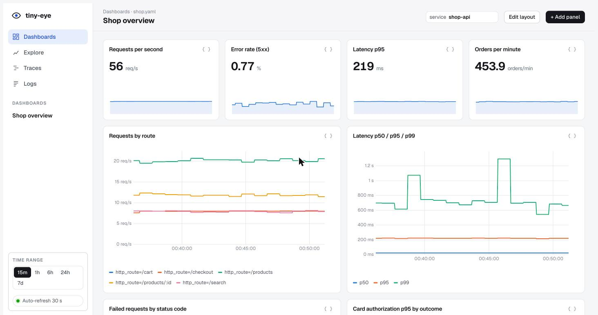
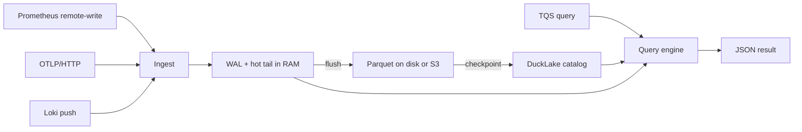

tiny-eye is an observability engine in one Rust binary. It receives metrics, logs and traces,
stores them as sorted, ZSTD-compressed Parquet files on local disk or S3, and answers queries
written in TQS 3, a closed JSON query language. For metrics, TQS reproduces Prometheus semantics
point for point, and a test suite proves it.

## The problem

A typical open-source stack runs three systems for three signals: Prometheus for metrics, Loki
for logs, Tempo for traces. Each has its own storage format, query language, scaling story and
operations runbook. Correlating a slow request with its log lines means switching languages and
tools.

tiny-eye keeps all three signals in one place and one format:

- **One process.** Ingest, storage maintenance and queries run in the same binary.
- **Open files.** Every row ends up in Parquet, tracked by a [DuckLake](https://ducklake.select/)
  catalog. DuckDB (embedded, version 2.0.1) reads them. You can inspect the files with any
  Parquet tool.
- **One query language.** TQS is plain JSON with a fixed schema. People, dashboards, the web UI
  and AI agents all write the same documents, and the server validates them before it runs them.

## What it does today

- **Ingest** Prometheus remote-write 1.0, OTLP/HTTP (protobuf and JSON, metrics, traces and logs)
  and Loki push (JSON).
- **Store** rows in a write-ahead log first, then flush them as Parquet every 60 s or 64 MB
  (both configurable). A coordinator records the files in DuckLake, compacts each hour and
  applies retention.
- **Query** with TQS: metric time series and tables, span and log aggregates, trace search,
  trace waterfall, log search and log patterns.
- **Dashboards** are YAML files in git. Each panel is a TQS `query` plus a `ui` block (display,
  unit, width and height on a 12-column grid).
- **AI agents** connect through an MCP stdio bridge, `tiny-eye mcp`. Its tools are generated from
  the OpenAPI spec.
- **Web UI**: a Preact app embedded in the binary and served at `/`. It covers dashboards
  (live panels, drag-and-resize layout editing, adding panels, saved to the YAML file), Explore
  with a Builder | TQS switch, trace search with waterfalls, and log search with patterns.

Each tiny-eye process is one complete node (`--role all`). Several nodes that share one bucket
form a [fleet](examples/run-a-fleet.md): every node answers queries over the data of all of them,
with no coordinator. What is not built yet is in
[Limitations and roadmap](deep-dive/limitations-and-roadmap.md).

## How data flows

A request is acknowledged once its rows are in the write-ahead log and in the in-memory hot
tail. Queries read the hot tail and the lake together, so new data is visible right away.

## Principles

**Keep it simple.** Three crates (`tqs`, `engine`, `server`), one binary, one process. No layer,
trait or config knob without a second user.

**One source of truth.** `api/openapi.yaml`, `schema/tables.yaml` and `config/default.yaml` define
the API, the stored tables and every default. Code, schemas and docs are generated from them.

**Config-driven.** Sizes, intervals, durability, retention, storage and auth come from
configuration, not constants in code. Every key can be overridden by an environment variable.

**Proven, not claimed.** Each semantic rule has a test that can fail. TQS is compared with
Prometheus 3.16 point by point, and a mutation check proves the suite catches broken rules.

## Where to go next

- [Quickstart](getting-started/quickstart.md): run tiny-eye, send data, query it, in 5 minutes.
- [Concepts](getting-started/concepts.md): signals, TQS documents, panels, freshness.
- [Demo shop](examples/demo-shop.md): a real instrumented app with load, dashboards and an AI agent.
- [Query cookbook](examples/query-cookbook.md): TQS recipes next to their PromQL equivalents.
- [Architecture](deep-dive/architecture.md): how the pieces fit together.
- [Testing and evidence](deep-dive/testing-and-evidence.md): what is measured and how.
